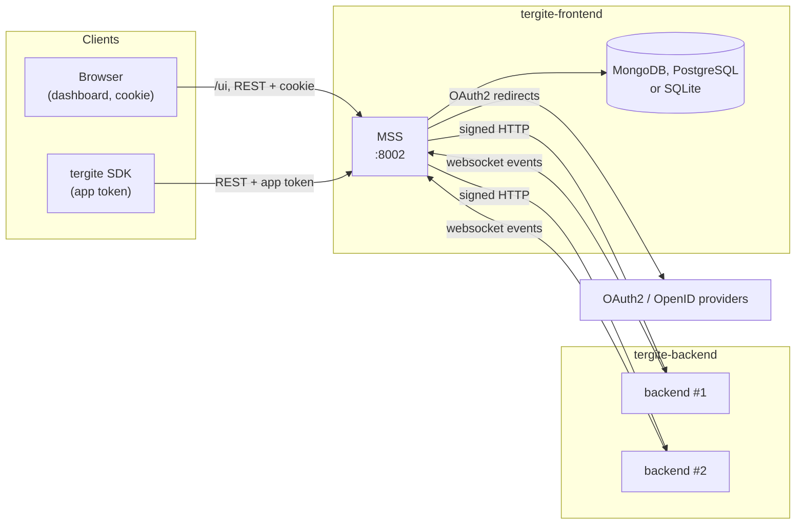
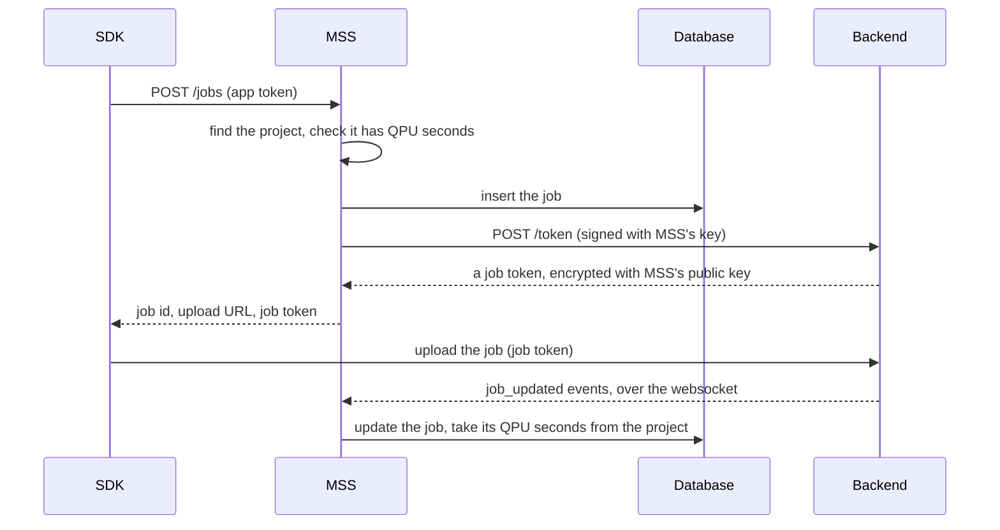

# Tergite Frontend — Design

A map of MSS and the dashboard for contributors: what the parts are, how they talk to each
other and to the rest of the stack, and where things are in the code. Each topic links to a
page in [docs/](docs) with the details. The dashboard's own design is in
[ui/DESIGN.md](ui/DESIGN.md). How to set up, test and follow the conventions is in
[CONTRIBUTING.md](CONTRIBUTING.md).

## What it is

`tergite-frontend` is the user-facing half of the [Tergite stack](https://tergite.github.io/).
It is one application, the Main Service Server (MSS), whose `ui/` folder holds the dashboard.
MSS serves the dashboard's build at `/ui`; the two are released together, under one version
and one changelog.

| Part | Path | Stack | Role |
| --- | --- | --- | --- |
| **MSS** | `.` | Python 3.13+, FastAPI; MongoDB, PostgreSQL or SQLite | The public REST API. Owns all data, authentication and access, and all traffic to the quantum backends. |
| **Dashboard** | `ui/` | Node 26, Vite, React 18, TypeScript, Tailwind + shadcn/ui | The browser client: a static bundle MSS serves at `/ui`, with no server of its own. |

## How it fits in



### MSS and the dashboard

The dashboard depends on MSS through three things only:

1. **HTTP JSON endpoints**, all called through the client in `ui/src/lib/api/client.ts`,
   which sends credentials. The production build calls the origin that served it.
2. **The auth cookie**, which MSS sets after login (`auth.cookie_name`,
   `auth.cookie_domain`).
3. **The OpenAPI schema**, committed as `dev/openapi/openapi.json`. The dashboard's
   `npm run generate:api` regenerates it and the TypeScript types in
   `ui/src/lib/api/schema.d.ts`, so a change to an MSS route or DTO fails the dashboard's
   type check.

The classic mistake is `localhost` versus `127.0.0.1`: the cookie domain and the host in the
browser must match, or login seems to succeed and then bounces back to `/login`.

### A job's journey



A job from the dashboard's Run page takes the same journey with MSS in the SDK's place:
`POST /me/jobs/` (session cookie) carries OpenQASM 3 text, which `libs/qasm` reads with the
backend's own parser to refuse what the backend could not run, and `services/jobs/submission.py`
creates the job and uploads the job file itself, keeping the text on the job as its `source`.

MSS and each backend trust each other through key pairs, not tokens: MSS signs its HTTP calls
with its private key, and each backend signs its websocket handshake with its own. See
[docs/backends.md](docs/backends.md).

## Code map

MSS is organised by **service**, not by technical layer. Each service under `services/` is a
slice of the domain: its DTOs, its data, its rules. `api/` is a thin HTTP layer on top that
wires routers, injects dependencies and maps errors to status codes; it holds no business
logic.

```
.
├── main.py              # the `mss` command: start (migrate, then serve), migrate, serve
├── settings.py          # loads and validates the config at import; fails fast
├── api/                 # HTTP: the app, auth, dependencies, error handlers, routers/
├── services/            # the domain
│   ├── auth/            # users, projects, app tokens, providers, access rules
│   ├── calibration/
│   ├── devices/         # devices, and the backends' websocket events
│   ├── jobs/
│   ├── notices/         # notices, their templates and emails
│   ├── requests/        # user requests, and what approving one does
│   ├── bcc_nonces/      # the backends' websocket nonces
│   └── external/        # outbound: bcc/ to the backends, email/ to SMTP
├── libs/storage/        # Database and its stores; imports no app code
├── libs/authlib/        # users and sessions, from fastapi-users (MIT); imports no app code
├── utils/               # domain-agnostic helpers
├── migrations/          # Alembic revisions for SQL; mongodb/ for MongoDB
├── tests/
├── ui/                  # the dashboard; see ui/DESIGN.md
├── pkg/                 # the deb, the macOS installer, their service files
├── docs/
└── dev/                 # tooling: openapi/, seed.py, the e2e and its reset server, perf/
```

### Layers

- A **router** resolves its dependencies, calls one or two service functions and wraps the
  result in a response. Every injectable is an `Annotated` alias in `api/dependencies.py`,
  ending in `Dep` (`DatabaseDep`, `CurrentUserDep`, …).
- A **service** takes the `Database` as an argument and never reaches for a global
  connection. Services may import `utils/` and each other, never `api/`.
- **Only `api` reads `settings`.** A class gets its config in its constructor (`BccClient`,
  `Emailer`); a module that needs config gets it once at startup through its `on_startup`.
- Services raise domain errors (`utils/exc.py`), never `HTTPException`. `api/errors.py` maps
  them to status codes once.

### A service's shape

| File | Contains |
| --- | --- |
| `__init__.py` | the facade: re-exports only, with `__all__`. Code outside the service imports from here. |
| `dtos.py` | Pydantic models: requests, responses, query models, and the storage `Schema`s |
| `service.py` | the business logic, as `async` module-level functions taking the `Database` first |
| `exc.py` | the service's exceptions |

## Runtime

**Startup.** `mss start` migrates the database, then serves `api:app` with uvicorn. The
lifespan (`api/app_kwargs.py`) creates the backends' HTTP clients, opens the `Database`
(creating each schema's collection or table and indexes), runs the services' `on_startup`,
and starts two background loops: the websocket connection manager, which keeps this
process's connections alive, and, when `[email]` is set, the emailer. Interactive API docs
exist only when `general.environment` is `development`.

**A request** passes through CORS (mirroring the request's origin, as the cookie needs
credentialed CORS), then `RequestIDMiddleware` (which echoes or creates an `x-request-id`,
for the logs only), then the route's dependencies, and finally the error handlers.

**Emails** are sent in the background, every `email_sweep_interval` seconds, never on a
request, so a dead mail server cannot fail one.

## Topics

| Topic | Page |
| --- | --- |
| Login, sessions, projects, app tokens, adding an OAuth2 provider | [docs/auth.md](docs/auth.md) |
| Adding a backend; MSS's calls to backends; the device websocket and its events | [docs/backends.md](docs/backends.md) |
| The `Database`, schemas, queries, MongoDB and SQL, migrations | [docs/storage.md](docs/storage.md) |
| REST conventions and the endpoint map | [docs/api-design.md](docs/api-design.md) |
| Installing, running and packaging MSS | [docs/deployment.md](docs/deployment.md) |
| The dashboard's layout, data flow and conventions | [ui/DESIGN.md](ui/DESIGN.md) |

## Configuration

| Where | What |
| --- | --- |
| `mss-config.toml` | MSS's settings: `[general]`, `[database]`, `[[backends]]`, `[projects]`, `[notices]`, `[email]`, `[auth]` and `[[auth.clients]]`. [mss-config.example.toml](mss-config.example.toml) documents each. MSS reads the file `MSS_CONFIG_FILE` names, or the JSON in `MSS_CONFIG_JSON_STR`, and validates it into `AppConfig` (`utils/config.py`). |
| `ui/.env*` | Vite's: `VITE_` variables are baked into the dashboard at build time, not read at runtime. `.env.production` empties `VITE_API_BASE_URL`, so the build calls its own origin. |

## Known rough edges

- **Liveness is the websockets'.** A backend that is up, but whose processes all lost their
  sockets, shows offline until one sends an event and reconnects. If an MSS process dies, its
  connections lapse within 90 s, and another process marks the device offline at its next
  refresh.
- **The dashboard's handling of 503s is incomplete.**
- **`GET /counts/job-submitters` raises `NotImplementedError`.**
