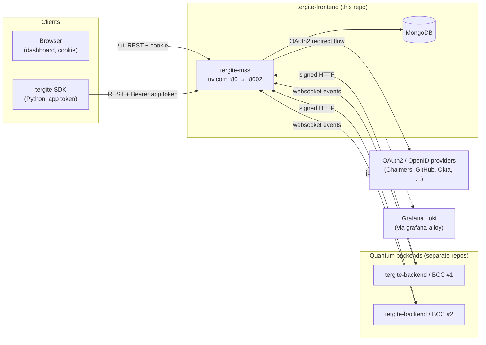
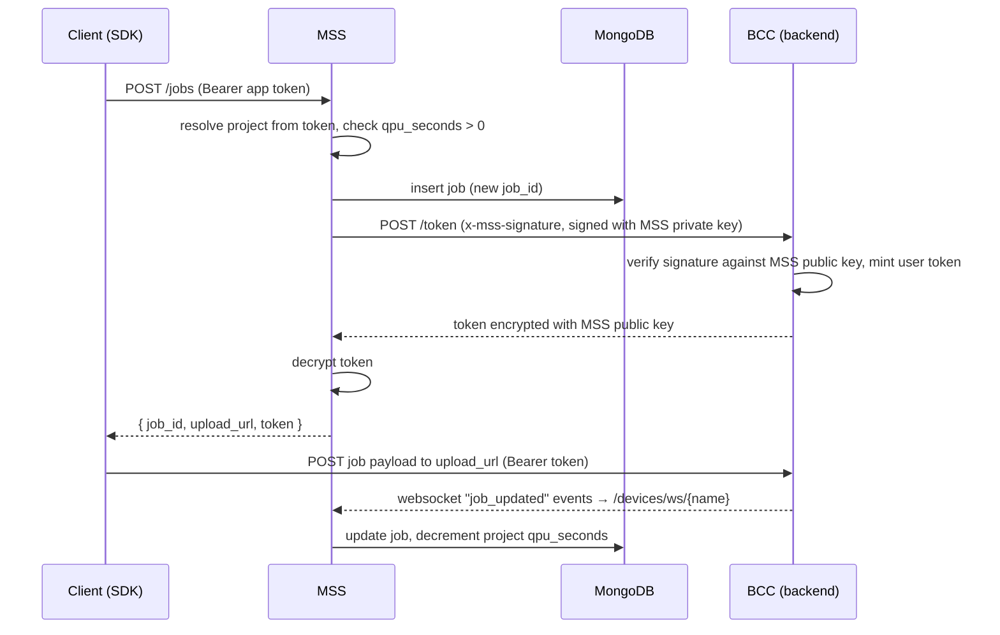

# Tergite Frontend — System Design

This document describes the architecture of `tergite-frontend`: MSS, the REST API server, and
the dashboard it serves from `ui/`, how they talk to each other and to the rest of the Tergite
stack, how the repository is configured, built, deployed and tested, and the conventions a
contributor is expected to follow. The dashboard's own layout and conventions are in
[ui/DESIGN.md](ui/DESIGN.md). The narrower docs — [docs/api-design.md](docs/api-design.md),
[docs/auth.md](docs/auth.md), [docs/backends.md](docs/backends.md) — remain the reference for
REST conventions, the OAuth2 setup recipe and adding a backend; this document is the map that
ties them together.

## 1. What this repo is

`tergite-frontend` is the user-facing half of the [Tergite stack](https://tergite.github.io/)
for the WACQT quantum computers. It is one application, the Main Service Server (MSS), whose
`ui/` folder holds the dashboard. They began as separate repositories, later shared one under
`apps/`, and are now one: MSS's deb and macOS installer carry the dashboard's build, which MSS
serves at `/ui`, and the two are released together under one version and one changelog.

| Part | Path | Stack | Role |
| --- | --- | --- | --- |
| **MSS** (Main Service Server) | `.` | Python 3.13+, FastAPI, MongoDB or PostgreSQL, SQLite | The public REST API. Owns all persistence, authn/authz, and all traffic to the quantum backends (BCC instances). |
| **Dashboard** | `ui/` | Node 20, Vite, React 18, TypeScript, Tailwind + shadcn/ui | The browser client for MSS. No backend of its own — a static bundle MSS serves at `/ui`. |

Everything the dashboard shows comes from MSS, which knows the dashboard only as the files
it serves at `/ui`.

## 2. System context



MongoDB or PostgreSQL is reached via `database.url` in `mss-config.toml`; MSS's deb installs
and provisions it alongside MSS on Debian and Ubuntu.

## 3. MSS and the dashboard: the seam between them

### 3.1 Contract

The dashboard depends on MSS only through:

1. **HTTP JSON endpoints** — every call goes through the openapi-fetch client in
   [src/lib/api/client.ts](ui/src/lib/api/client.ts), which always sends
   `credentials: "include"`. The base URL is the build-time `VITE_API_BASE_URL`, empty in the
   production build, which calls MSS on the origin that served it.
2. **The auth cookie** — MSS sets a JWT cookie whose name and domain come from
   `auth.cookie_name` / `auth.cookie_domain` in `mss-config.toml`, which the browser sends
   with every call, as the dashboard and the API share MSS's origin.
3. **The OpenAPI schema** — MSS commits it as `dev/openapi/openapi.json`,
   and the dashboard's `npm run generate:api` regenerates both it and the TypeScript types
   in `src/lib/api/schema.d.ts` that type the client, so a change to an MSS route or DTO
   fails the dashboard's `tsc`. The fixtures MSS is seeded with follow by hand, and a stale one
   fails the seeding.

The classic misconfiguration is `localhost` vs `127.0.0.1`: the cookie domain and the host
you type in the browser must match, or login appears to succeed and then bounces back to
`/login`.

### 3.2 Job submission — the one flow that crosses everything



Two distinct trust directions, both asymmetric-key based:

- **MSS → BCC**: MSS signs `"{user_id}-{request_id}-{timestamp}"` with its private key
  (`PRIVATE_KEY_FILE`) and sends `x-mss-*` headers. See `_create_headers` in
  [services/external/bcc/service.py](services/external/bcc/service.py).
- **BCC → MSS**: on the websocket handshake BCC sends `x-id`, `x-request-id`, `x-timestamp`,
  `x-signature`; MSS verifies against that backend's `public_key_path`, checks the source IP
  (unless `is_strict_ip = false`), rejects stale nonces (`bcc_nonce_ttl`) and replayed ones
  (`bcc_nonces`, where a nonce is the key). See `get_verified_device_name` in
  [api/utils.py](api/utils.py).

## 4. MSS's architecture: service-oriented

MSS is organised by **service**, not by technical layer. Each service under `services/` is a
self-contained slice of the domain: its DTOs, its persistence, its business rules, and —
where it needs them — its own routers. `api/` is a thin HTTP adapter on top: it wires
routers together, injects dependencies, and translates domain exceptions to status codes.
It should hold no business logic.

```
.
├── main.py                  # the command line: start (migrate, then serve), migrate, serve
├── settings.py              # loads + validates config at import time; fails fast
├── start_mss.sh             # from a checkout: decrypt a SOPS config → main.py start
├── api/                     # HTTP adapter layer
│   ├── __init__.py          # the FastAPI app: middleware, exception handlers, routers
│   ├── app_kwargs.py        # app metadata + lifespan (startup/shutdown)
│   ├── auth.py              # the auth backends, and the current user and project dependencies
│   ├── dashboard.py         # serves the dashboard's build at /ui, and redirects / to it
│   ├── database.py          # opens the one Database in the lifespan; get_database
│   ├── dependencies.py      # every injectable, as an Annotated alias
│   ├── errors.py            # the exception handlers
│   ├── middleware.py        # RequestIDMiddleware
│   ├── utils.py             # router-level helpers (request id, BCC ws verification)
│   └── routers/             # one module per URL prefix
│       ├── admin/               /admin (bcc/, notices.py, projects.py, users.py)
│       ├── auth.py              /auth
│       ├── booking.py           /bookings
│       ├── calibrations.py      /calibrations
│       ├── counts.py            /counts
│       ├── jobs.py              /jobs
│       ├── me/                  /me (jobs, notices/, profile, projects, requests, tokens)
│       └── devices/             /devices (+ the websocket and its connections.py; the
│                                event handlers are in services/devices)
├── services/                # the domain
│   ├── auth/                # users, projects, app tokens, providers, access rules
│   ├── calibration/
│   ├── devices/
│   ├── jobs/
│   ├── notices/             # notices, their templates and their emails
│   ├── requests/            # user requests and the actions their approval runs
│   ├── bcc_nonces/          # the backends' websocket nonces, so that none is replayed
│   └── external/            # outbound clients: bcc/ to the quantum backends, email/ to SMTP
├── libs/storage/            # Database, Schema and the stores behind them; imports no app code
├── libs/authlib/            # users and sessions, from fastapi-users 14.0.2 (MIT); imports no app code
├── utils/                   # cross-cutting, domain-agnostic helpers
├── migrations/              # Alembic's revisions for SQL; mongodb/ for MongoDB
├── tests/
├── ui/                      # the dashboard; see ui/DESIGN.md
├── pkg/                     # the deb, macOS installer and their service files
├── docs/                    # the narrower docs above
└── dev/                     # tooling: openapi/ (export.py and the openapi.json it writes, the
                             # API contract), seed.py (seeds the database from ui/fixtures),
                             # the full-stack e2e and its reset service, perf/
```

### The shape of a service

A service is a package. Its public surface is what `__init__.py` exposes; callers import
`from services import jobs as jobs_service` and use module-level functions.

| File | Contains |
| --- | --- |
| `dtos.py` | Pydantic models — request bodies, responses, and the `libs.storage` `Schema`s that are also the persistence schema. Query-param models too. |
| `service.py` | The business logic: module-level `async def` functions taking the `Database` as their first argument. |
| `exc.py` | Service-specific exceptions. |
| `on_startup(...)` | Config from the app lifespan. |

A service's `__init__.py` is its facade: it only re-exports, with `__all__` as strings. Code
outside the service imports from the facade (`from services.jobs import Job`), never from its
`dtos.py` or `service.py`; `tests/test_styleguide.py` checks this. Each `services/external/`
package is a service of its own.

### Why the layering matters

A router should read as: resolve dependencies → call one or two service functions → wrap the
result in a response envelope. Persistence details, BCC protocol details and cross-entity
rules live in `services/`. Two consequences worth internalising:

- Services take the `Database` as a parameter; they never reach for a global connection.
  This is what makes them testable and what lets the lifespan own the connection.
- `services/` may import `utils/` and other services (e.g. `devices` events call `jobs` and
  `calibration`). `services/` must not import from `api/`.
- Only `api` reads `settings`. A class gets its config in its constructor (`BccClient`,
  `Emailer`). A module whose functions are called from many places, or from `default_factory`
  fields, gets it once from the lifespan through its `on_startup` (`notices`, `jobs`, `auth`)
  or a setter (`date_time.set_datetime_precision`) and keeps it module-private.

## 5. Runtime

### Startup

`main.py start`, the default command, migrates the database and then serves `api:app`
with uvicorn on the config's `general.mss_port`; `migrate` and `serve` do one alone. The
packages run it as `tergite-mss start`. From a checkout, `start_mss.sh` does the same, after
SOPS-decrypting `MSS_CONFIG_FILE` (default `mss-config.toml`) into `MSS_CONFIG_JSON_STR` with
`sops` and `yq` when it carries a `hc_vault` block.

`settings.py` then validates that JSON into `AppConfig` and asserts the private key file
exists. Any config error is a startup crash, not a runtime surprise.

The FastAPI `lifespan` in `app_kwargs.py` creates the BCC httpx clients, opens the
`Database` (whose `setup` creates every schema's collection, validator and indexes), then runs the `on_startup` of `auth` (which stores the roles users may hold),
`jobs` and `notices`, and starts the app's background loops: the device websockets'
`WebsocketConnectionManager`, keeping this process's connections from lapsing (§7), and, when
`[email]` is configured, the `Emailer` sending the notices' pending emails. On shutdown it
stops the emailer, closes the BCC clients, closes all device websockets, each of which forgets
its connection, and closes both databases.

`docs_url` / `redoc_url` / `openapi_url` are set to `None` unless
`general.environment == "development"` — there are no interactive docs in production.

### Per-request pipeline

1. **`CORSMiddleware`** — Starlette's, with `allow_origin_regex=".*"`, so that it mirrors the
   request `Origin` back instead of `*`, because the auth cookie requires credentialed CORS.
2. **`RequestIDMiddleware`** — resolves or generates a request ID (reusing an incoming
   `x-request-id`), which the request signs its calls to BCC with, and echoes `x-request-id`
   back on the response. It records nothing.
3. **Dependencies** — everything injectable is a named `Annotated` alias in
   `api/dependencies.py` (`DatabaseDep`, `CurrentUserDep`, `BccClientDep`,
   `RequestIdDep`, …), one name per dependency, each ending in `Dep`. Routers take them as
   parameters (`user: CurrentUserDep`), never the raw `Depends(...)` expression, and a route
   that only needs the check still names the parameter (`requester: CurrentSuperuserDep`).
   Add new injectables there.
4. **Exception handlers** — domain exceptions from `utils/exc.py` are mapped to status codes
   centrally in `api/__init__.py`, with the handlers `api/errors.py` makes:
   `InvalidInputError` (and its `TooManyListQueryParams`) / `UnknownBccError` /
   `InvalidRequestIDError` → 400, `UnauthorizedError` → 401,
   `ForbiddenError` → 403, `NotFoundError` → 404, `ConflictError` → 409,
   `ServiceUnavailableError` → 503, `BccHttpError` → the BCC's
   own status, and `ValueError` / `TypeError` / `RuntimeError` / bare `Exception` → 500
   with a generic message, and
   `UnsupportedOauthException` → 500 with its own. Other service exceptions subclass these
   and need no mapping of their own. **Raise domain exceptions from services; do not raise
   `HTTPException` there.**

## 6. Authentication and authorization

Users sign in through `libs/authlib`, which began as a copy of
[fastapi-users](https://fastapi-users.github.io/); projects and app tokens are
`services/auth/`'s own. Two orthogonal mechanisms; most endpoints need one specific one.

### Users — who you are

- Login is **OAuth2/OpenID only**; there is no password login and authentication cannot be
  disabled (the old `auth.is_enabled` flag is gone).
- Each `[[auth.clients]]` entry is an `authlib.OAuthProvider`, served by one router at
  `/auth/{provider}/…` (plus a legacy `/auth/app/{provider}/…` alias); an unknown provider
  is a 404. Routes: `authorize`, `auto-authorize` (redirects immediately — this is what the
  dashboard links to), `callback`.
- `email_regex` gates which emails may use a given provider; `roles` are granted on sign-in;
  `email_domain` is what `GET /auth/providers/?email_domain=…` matches so the login page can
  offer the right button; `associate_by_email` decides whether a returning user who used a
  different provider is linked to the existing account.
- One session JWT, read from the **bearer header**, then the **cookie** the callback sets
  (the dashboard's). Roles are `user`, `researcher`, `admin`, `partner`, `system`;
  `is_superuser` is derived from having `admin`.
- Dependencies: `GET_CURRENT_USER`, `GET_CURRENT_USER_ID`, `GET_CURRENT_SUPERUSER`, from the
  `authlib.Auth` that `api/auth.py` builds from the auth config; routers use them
  through `api/dependencies.py`. authlib's errors are answered by the handler
  `add_exception_handlers` registers in `api/__init__.py`.

### Projects and app tokens — what you may spend

- An **app token** is a database-backed bearer token scoped to *(user, project)* with a
  lifespan. Created in the dashboard; revocable; this is what the SDK and other Tergite
  components use.
- A **project** carries `qpu_seconds`. Creating a job requires an active project with
  positive `qpu_seconds`. Job completion decrements it via `update_qpu_usage`.
- Dependencies, also in `api/auth.py`: `get_current_project_user_ids` (strict, enforces
  QPU seconds) and `get_current_lax_owner` (lax, for reads). Each checks the token's project
  and user against an `AccessRule` from `services/auth/access.py`: a missing token or an
  inactive project is 401, too few QPU seconds or a missing role is 403.
- A JWT is **not** interchangeable with an app token: a JWT works on `/auth…`, `/me…` and
  admin routes; an app token works on the resource routes. Using the wrong one yields
  401/403, which is the single most common confusion when testing by hand.

The interaction diagram for the full flow (via MyAccessID) is in
[docs/auth.md](docs/auth.md) with the editable drawio source in `docs/assets/`.

## 7. Talking to the backends

`services/external/bcc/service.py` holds a process-global map of `BccClient`s, one per
`[[backends]]` entry, created in the lifespan with the MSS private key it loads once.
`bcc.get_client(backend)` looks one up and
raises `UnknownBccError` for an unknown name; `BccClientDep` calls it with the `{backend}`
path param, and the jobs router calls it with the job's device.

Every outbound call goes through `BccClient._request`, which signs the request
(`x-mss-request-id`, `x-mss-timestamp`, `x-mss-signature`, `x-mss-user-id`, optional
`x-mss-is-admin`), raises `BccHttpError` with the status of a BCC error response, and
turns connection/timeout failures into `ServiceUnavailableError` → 503. Client methods:
`get_token`, `cancel_job`, `delete_job`, `view_users`, `create_user`, `delete_user`,
`create_booking`, `cancel_booking`, `view_bookings`, `view_bookings_configs`,
`init_recalibration`, `get_recalibration_info`, `stop_recalibration`, `switch_off`,
`switch_on`.

`services/external/email/` is the other outbound client: an `Emailer` that sends, every
`email_sweep_interval` seconds, the batch of pending notice emails that
`services/notices/emails.py` yields, and records each result through its callback. Nothing on
a request path sends mail, so a dead mail server cannot fail a request.

**Bookings and BCC users are not persisted by MSS.** The `/bookings` and
`/admin/bcc/users` routes proxy to the owning backend on the user's behalf. Only jobs,
devices, calibrations, notices and the auth entities live in MongoDB.

### Inbound: the device websocket

`WS /devices/ws/{name}` is how a backend pushes state. The handshake is verified by
`get_verified_device_name` (signature, source IP, nonce freshness, nonce replay) and the
socket is registered with the router's `WebsocketConnectionManager` (`connections.py` beside
it). A BCC opens a socket per process (its API, heavy worker and light workers), and each may
reach a different MSS process, so whether a device is online is kept in the database, not in a
process:

- Each socket is a `device_connections` record from when it is accepted until it closes, or is
  cancelled as MSS stops (`add_connection`, `remove_connection`). The MSS process holding it
  pushes its `expires_at` on every `CONNECTION_REFRESH_SECONDS` (30 s) to
  `CONNECTION_TTL_SECONDS` (90 s) ahead, so that the records of a process that died lapse.
- A device is online while it has a live connection and is not in `switched_off_devices`,
  which `switched_off` and `switched_on` events add it to and remove it from. Its stored
  `is_online`, which the device routes filter on, and `last_online` are set from them on each
  change (`sync_online_flags`), and for every device on each refresh, which puts right a
  change two processes raced on and a dead process's lapsed connections.
- An `initialized` event's own `is_online` is the backend's view, so the upsert sets the flag
  from the connections after it.

Each JSON frame is a `DeviceEvent` dispatched through `EVENT_HANDLERS` in `services/devices/events.py` to the
handler for its name:

| Event | Handler effect |
| --- | --- |
| `initialized` | upsert the device document |
| `recalibrated` | insert calibration into `calibrations` + append to `calibrations_logs` |
| `job_updated` | update the job; on first resource-usage report, decrement project QPU seconds |
| `switched_off` | `is_online = false`, stamp `last_online` |
| `switched_on` | `is_online = true`, clear `last_online` |

Handlers reply with an `EventResponse` per frame and never kill the socket: validation
errors become `{"status": "error", "detail": …}`, and a device attempting to edit another
device's record raises `ForbiddenError` → `forbidden`. Adding an event means adding an
enum member in `services/devices/dtos.py`, and a handler and its entry in `EVENT_HANDLERS` in
`services/devices/events.py`.

## 8. Data

MSS reaches its data through `libs/storage`: one `Database`, opened in the lifespan with
every service's `SCHEMAS`, which `services/schemas.py` gathers, and handed to routes as `DatabaseDep`. The `Database` picks its store from the URL's scheme: `MongoStore`
for `mongodb://`, `SqlStore` for a SQLAlchemy URL with an async driver
(`postgresql+asyncpg://`, `sqlite+aiosqlite://`). Nothing
outside `libs/storage/<store>` names a database technology.

A schema is a Pydantic `Schema` whose `__storage__` names its table, key, unique fields,
indexes, expiring field, references and `indexed_lists`. Services query it in MongoDB's own
dialect, kept to what every store can translate: `filter={"user_id": {"$in": [user_id,
None]}}`, `update={"$set": {…}, "$inc": {…}}`, `sort=["-created_at"]`, `skip`, `limit`.
`Database` refuses an unknown operator or field, and an update that would change a key,
before a store sees it, and a service builds its filters privately from its arguments;
routes never build one. Ids are `Id` strings, which MongoDB keeps as ObjectIds. No store
reads a record past its expiring field. A schema with `should_skip_invalid` has `get` and
`find` leave out stored records that fail validation, with a warning naming the invalid
fields, where any other read raises; writes always raise, and `count` includes them.
Jobs and notices set it, as MongoDB holds older shapes of both.

- **MongoDB** keeps a collection per schema, with a `$jsonSchema` validator and the indexes
  `__storage__` asks for; a TTL index deletes expired records. A revision that changes stored
  values has a JSON of updates, both ways, named after it in `migrations/mongodb/`. The start
  script applies the pending ones in Alembic's order (`python -m migrations.mongodb upgrade`),
  bypassing the old MSS's validator, as `setup` replaces it only once MSS starts; its
  `.upgrade.js` and `.rollback.js` apply the same JSON with mongosh, and both record it in
  `mongodb_migrations`.
- **SQL** gets a table per schema from `libs/storage/sql/tables.py`: a column per scalar
  field, a `JSON` column per nested one (read and written whole, never queried), a `row_id`
  that keeps insertion order, and a child table, one row per element, for each list in
  `indexed_lists` or `references` (`auth_project_user_ids`, `notice_dismissed_by`,
  `request_target_user_ids`). A list of models gets a column per element field; it is set
  whole and matched by element with `$elemMatch`, as a user's OAuth accounts are. A query on a JSON field, or a write to part of one, is refused,
  and is the signal to give it a table of its own. Alembic migrates the tables
  (`migrations/`), and `tests/test_migrations.py` fails when a schema changed without a
  revision. A task deletes expired rows hourly, as SQL has no TTL index.
- **`tests/libs/storage/test_conformance.py`** runs every `Database` method on MongoDB,
  PostgreSQL and SQLite, and each service's storage test (`tests/services/*/test_*_storage.py`)
  runs on all three too.

Users are records like any other: `auth_users`, keeping the documents fastapi-users wrote
field for field, with roles referencing `auth_roles` and OAuth accounts in a list of models.

Notable tables: `jobs`, `devices`, `calibrations`, `calibrations_logs` (historical,
indexed on `(name, last_calibrated desc)`), `notices` (expiring at `expires_at`),
`device_connections` (expiring at `expires_at`) and `switched_off_devices` (§7).
Deleting a project moves it to `deleted_auth_projects` rather than dropping it.

**BCC nonces** (`services/bcc_nonces`) are the nonces of the backends' signed websocket
handshakes, each kept in `bcc_nonces` (unique on `nonce`) for `bcc_nonce_ttl` seconds, past
which the handshake's timestamp is refused as too old anyway. One is written per connection,
as the handshake is verified, never per message or per HTTP request. `claim_bcc_nonce`
returns False for a nonce already claimed: that is how a replay is refused, in one write,
across every MSS process and host sharing the database. The backend keeps MSS's nonces the
same way, in its `mss_nonce` table.

## 9. REST conventions

Codified in [docs/api-design.md](docs/api-design.md); the short version:

- URLs are `/{resource}/({id})`. Every resource has a DTO named after it.
- List endpoints return `{"skip": int, "limit": int | null, "data": [...]}` — build it with
  `get_paginated_json(data, skip, limit)`, and declare `PaginatedListResponse[Item]` as the
  route's response.
- Action endpoints return `{"status": ..., "message": ...}` (`GeneralMessage`).
- Errors return `{"detail": "..."}` with a non-2xx status — produced by the central handlers,
  not per-route try/except.
- List filtering is a Pydantic query model injected with `Depends()` (e.g. `JobQuery`,
  `DeviceQuery`), usually built by `create_partial_model` so every field is optional.
  `sort` is a repeated query param where a leading `-` means descending.
- Property-only sub-resources (e.g. `GET /jobs/{id}/status`) are allowed only when that
  property is requested far more often than the whole object, and return `{"{property}": …}`.
- Every route declares its response, so the OpenAPI schema describes every body. A route that
  returns a model gets it as a return annotation. A route that returns a dict it dumped itself,
  e.g. with `exclude_none=True` (`Job`, `Project`, `Device`, the paginated list), declares
  `responses={200: {"model": …}}` instead: a `response_model` would re-serialise the body and
  undo that shaping. No model overrides `model_dump`; a call site passes the flags it needs.
- `dev/openapi/openapi.json` is the committed schema, written by `python -m dev.openapi.export`
  with the test config. `tests/test_openapi.py` fails when it no longer matches the app.

### Endpoint map

| Prefix | Auth | Notes |
| --- | --- | --- |
| `/auth/{provider}/…` | — | `authorize`, `auto-authorize`, `callback`; plus `GET /auth/providers/` and `POST /auth/logout`. There is no password-login route — `get_auth_router` only registers logout. |
| `/me` | JWT | current user; `/me/profile`, `/me/jobs/`, `/me/projects/…`, `/me/tokens/…`, `/me/requests/…` (every kind of user request, made and decided), `/me/notices/…` |
| `/devices` | app token / open reads | `GET /`, `GET /{name}`, `WS /ws/{name}` |
| `/calibrations` | open reads | `GET /`, `GET /{name}`; public device data, like `/devices` |
| `/jobs` | app token (strict on POST) | list, get, `/{id}/status`, create, `/{id}/cancel`, delete; reads return only the token user's jobs (and jobs with no recorded submitter) unless the user is an admin |
| `/bookings/{backend}` | JWT | proxied to BCC; create, cancel, list, `/config` |
| `/counts` | JWT | `/notices`; `/job-submitters` (superusers only) |
| `/admin` | superuser | `/projects/…`, `/users/emails/`, `/notices/…`, and the BCC's `/bcc/users/{backend}/…`, `/bcc/recalibration/{backend}/…`, `/bcc/switch/{backend}/on|off` |

## 10. Configuration

There are three configuration surfaces, and they overlap deliberately.

### 10.1 `mss-config.toml` (MSS)

Copy [mss-config.example.toml](mss-config.example.toml) →
`mss-config.toml`, or let the deb's provisioning write `/etc/tergite-mss/mss-config.toml`.
Sections: `[general]`, `[database]`, `[[backends]]` (one per BCC), `[projects]`, `[notices]`,
`[email]`, `[auth]` and `[[auth.clients]]` (one per OAuth2 provider). MSS reads the file
`MSS_CONFIG_FILE` names, or the JSON in `MSS_CONFIG_JSON_STR` when it is set;
the app validates it into `AppConfig`
([utils/config.py](utils/config.py)) at import time in `settings.py` and
fails fast on anything missing.

The file may be SOPS-encrypted with a Hashicorp Vault key; `start_mss.sh` detects this and
decrypts it into `MSS_CONFIG_JSON_STR` using `VAULT_ADDR` / `VAULT_TOKEN` from the environment.

### 10.2 `.env*` files in `ui/`

Vite conventions. `VITE_`-prefixed variables are baked into the bundle at build time —
they are not runtime configuration. `.env.production` empties `VITE_API_BASE_URL`, so the
build MSS serves calls its own origin. `.env.test` also carries the `JWT_SECRET` and
`AUTH_AUDIENCE` of the e2e stack's MSS, with which the specs sign their session cookies.

## 11. Deployment

MSS installs from its release's deb (amd64, Debian 13 and Ubuntu 24.04 onwards) or macOS arm64
installer, Nuitka's standalone build running as the `tergite-mss` systemd service or launchd daemon on
`8002`. The deb asks debconf where the database is, and its provisioning writes
`/etc/tergite-mss/mss-config.toml` and the private key; on macOS the config is written by hand
to `/usr/local/etc/tergite-mss/`. See the [README](README.md#deployment).

The dashboard ships inside MSS's packages: the release builds it with the base `/ui/`, Nuitka
includes it from `ui/dist`, and MSS serves it at `/ui`
([api/dashboard.py](api/dashboard.py)), sending the paths no file
has to `index.html` and redirecting `/` to `/ui/`.

MSS answers `GET /health` with 200, left out of uvicorn's access log (`UNLOGGED_PATHS`), so
that a frequent probe does not bury real traffic.

Logs reach Loki through Grafana Alloy installed beside MSS, whose [config.alloy](config.alloy)
reads `tergite-mss.service`'s journal and pushes it with `GRAFANA_LOKI_URL` and `LOKI_LOGGER_ID`.

## 12. Testing

| Level | Where | Command |
| --- | --- | --- |
| MSS unit/integration | `tests` — pytest against real MongoDB, PostgreSQL and SQLite | `uv run pytest` |
| Dashboard component | `ui/src/**/__tests__` — vitest + happy-dom | `npm run test` |
| e2e | `ui/playwright` — the Playwright specs, through [dev/e2e_native_test.sh](dev/e2e_native_test.sh), against real MSS + real backends, with MongoDB, all running natively | `BACKEND_PATH=../tergite-backend ./dev/e2e_native_test.sh` |

The e2e runs against the whole stack, so it catches contract drift: from a local
`tergite-backend` checkout or a clone, it runs one `main.py serve` for all the backends, each
under its own path, from the base dependencies, MSS from this checkout serving the dashboard's
test build at `/ui`, and a MongoDB and a reset service (`dev/e2e_reset_server.py`) of
its own, all from fresh data in `temp-native/`. It seeds MSS's database from
`ui/fixtures/*.json` with `dev/seed.py`, stands in for the OpenID provider, and runs the
Playwright specs against that stack, on one worker, as they share its data; a test that wrote
has the next reset it through `GET /refreshed-db`. CI runs it on every merge request, on
`main` and on tags.

Visual regression is Playwright's `toHaveScreenshot`; its baselines are named after the
platform, so make the Linux ones through `ui/Dockerfile.playwright` (see
[CONTRIBUTING.md](CONTRIBUTING.md#how-to-generate-snapshots-for-ci)).

### MSS's tests

`pytest` with a real MongoDB, PostgreSQL and SQLite — no database mocking. `tests/conftest.py`
calls `setup_test_env()` **before any app import**, because `settings.py` reads config at
import time; keep that ordering when adding fixtures.

- `tests/_utils/` — shared helpers, grouped by what they do: `auth.py`, `bcc.py`,
  `storage.py`, `fixtures.py`, `records.py`, `env.py`, `json.py`, `date_time.py`,
  `mock_backend.py`, `modules.py`, `notices.py`, `numbers.py`, `oauth.py`, `projects.py`,
  `types.py`. Put new helpers here, in the
  file that matches their job — not in a single `utils.py` and not in scattered
  `fixtures/*.py` modules.
- `tests/fixtures/` — JSON data and the RSA key pairs used to exercise the MSS↔BCC
  signature paths.
- `tests/api/test_*.py` — one file per router, driven through `TestClient`.
- `mock_backend.py` stands in for BCC; `respx` intercepts httpx calls.
- The app starts once per session, as its startup is the slow part: the `client` fixture's
  `with` block neither starts nor stops it, and clears its cookies afterwards. A fixture that
  changes what the app starts with (`unconfigured_email`) is listed in
  `_FRESH_APP_FIXTURES`, and its test gets a client that starts the app afresh.
- What each database does differently is the storage layer's to get right, so the
  conformance and storage tests run on MongoDB, PostgreSQL and SQLite. The API tests run
  once, on the database `TEST_DATABASE_URL` names (the test config's MongoDB if unset): the
  session-scoped `api_database` fixture empties it and points the app at it. The `db`
  fixture is that database, as a `SyncDatabase` from `tests/_utils/storage.py` that a
  synchronous test seeds and reads through, records not documents; it empties every table
  afterwards but the roles and notice templates the app writes at startup. Tests must not
  assume a clean store beyond what it gives them.

## 13. CI

Both GitHub Actions ([.github/workflows](.github/workflows)) and GitLab CI
([.gitlab-ci.yml](.gitlab-ci.yml)) are maintained; GitLab is the source of truth (GitHub is
a mirror — see §14).

On every pull or merge request, on `main` and on `v*` tags, GitHub's `ci.yml` and GitLab run:

- `mss` / `lint mss`, `test mss` — with uv, from `uv.lock`: `black --check .`, `isort`,
  `pyflakes`, then `pytest` on Python 3.13, the oldest MSS supports, against MongoDB and
  PostgreSQL.
- `dashboard` / `lint dashboard`, `test dashboard` — eslint and `npm run check:api`, vitest.
- `e2e` — `dev/e2e_native_test.sh`, after installing MongoDB, SQLite and uv.

On a `v*` tag, `release.yml` / `build dashboard`, `package mss linux`, `package mss macos`
and `release` build the dashboard, then MSS's deb and macOS installer with it, and attach
them to the release. GitLab's jobs upload them to the project's package registry and link
them from its release; its macOS job runs only where `PUBLISH_MACOS_ARM64` is `true`, on a
runner tagged `macos`.

## 14. Working on this repo

### Version control

Tergite is developed on a private GitLab and **mirrored to GitHub**. GitHub PRs and issues
are not read. Contributions and bug reports go to <contact.quantum@chalmersnextlabs.se>;
code changes need a signed CLA. See [CONTRIBUTING.md](CONTRIBUTING.md).

### Versioning and releases

`{year}.{month}.{patch}`, e.g. `2026.06.0`. A release bumps the version in **four** places
and dates the `[Unreleased]` section of [CHANGELOG.md](CHANGELOG.md):

- `pyproject.toml` and `api/app_kwargs.py`
- `ui/package.json` and `ui/package-lock.json`

### Changelog entries

One or two sentences: what changed, and what an operator would have hit before. Always
under `[Unreleased]`, under `Added` / `Changed` / `Fixed` as the file already uses them.
Reasoning, alternatives and numbers belong in the commit body, not the changelog.

### Commits

One logical change per commit, decided before editing rather than carved out of a large
working tree afterwards. Never add assistant attribution (`Co-Authored-By`, "Generated
with", …) to commit messages or MR bodies.

### Style guide

Shared by MSS and the dashboard:

- **Comments and docstrings must earn their place.** Say the constraint, the gotcha, the
  *why* that the code cannot. Never restate the code, never narrate the history of a fix —
  that is what the commit message is for. Default to none.
- **Names**: variables are nouns, functions are verbs, booleans start with `is_`/`should_`.
  If the name alone does not say what it returns, rename it.
- **No banner comments** (`# --- section ---`, `// ==== section ====`) at any indent. If a
  group needs a label it needs a docstring or its own file.
- **Tests**: the name says what it tests. Add a line of comment only when the *why* is
  non-obvious.
- **License headers**: every Python file in MSS carries the Tergite copyright/Apache-2.0
  header, with a line added per contributing party. Keep this when creating new modules.
  Dashboard TypeScript files do not carry per-file headers.

Language- and layout-specific rules — MSS's service-oriented layout (§4) and
[Python style](#python-style), the dashboard's co-located page hierarchy and React/TypeScript
conventions ([ui/DESIGN.md](ui/DESIGN.md)) — differ. **Read the relevant one before adding
files**; the two halves deliberately organise code in different ways and the difference is
load-bearing.

### Code structure

Code reads like an article: the overview first, the detail below it. New code follows these
rules, and code a change touches is brought in line with them.

1. **A function is a composition of functions.** A public function's body is a short sequence
   of calls, each to a function that does one thing and is named for it. A reader gets the
   whole flow from that body and drills into a step only when they need its detail. Each step
   is built the same way until it is a single operation.
2. **Two exceptions.** Do not extract a step that would be a one-line function. Do not split a
   performance-critical path where the extra calls cost something measurable.
3. **Callees sit below their callers.** A file runs: constants, public functions in the order a
   caller uses them, then private helpers in the order they are first called. Reading top-down
   follows the drill-down.
4. **A comment that labels a phase is a missing function.** `# Authenticate` or `# route to
   generate tokens` becomes the name of the function that does it.
5. **Data is a struct; state gets a class.** Data is a Pydantic model, a frozen `@dataclass`,
   an `Enum` or an `Exception` (a `type` in TypeScript); its only methods are derived views of
   its own fields, such as `Project.members`, and conversions to or from another shape, named
   `from_*` or `to_*` (`Notice.from_template`, `CustomNoticeCreate.to_documents`,
   `AppConfig.from_json_str`), even when a conversion reads the database to fill itself in. A
   component that owns state across calls (a connection pool, live sockets, background tasks)
   is a class with behaviour. Which is which is a judgement made by asking what the object
   holds between calls.
6. **Stateless behaviour is a module-level function.** It takes explicit arguments and returns
   data, with the `Database` first when it does I/O. Avoid the indirection that imitates state
   without holding any: objects built per request only to carry other objects, a `Protocol` or
   ABC with one implementation, inheritance used to share behaviour.
7. **Dependencies arrive as arguments.** A function or class never reads a global, in its body
   or as a default argument: config values, clients and keys are passed in, and the call site
   says what it passes. Only the composition root (`api`: the lifespan and the dependencies)
   reads `settings`, and it turns config into instances before handing them on: code that needs
   storage is given the `Database` instance, never a URL or a config section to build one from.
   The one exception is a module caching its own private global, such as a loaded key.
8. **One home per kind of thing.** Routes live in `api/routers/`. `HTTPException` is raised
   only in `api/`. Domain errors subclass `utils/exc.py` and are mapped to status codes once. A
   service's `__init__.py` only re-exports, with `__all__` as strings. Development and test
   tooling (scripts, generators, performance checks, the seeding) lives in `dev/`; the other
   folders hold the app and its tests, so the tree shows the architecture and nothing else.
9. **A reputable library beats our own code.** Every line we write is a line to maintain and a
   line a newcomer reads. Use a well-maintained library wherever it does the job, and write our
   own only where none does, or where getting the behaviour we need would mean fighting the
   library. The commit that adds our own code says which of the two it was.
10. **A name says what the thing is.** Variables are nouns that name their content:
    `notice_filter`, never `where`, `kind` or `changes` for a filter. No function is named
    `build_*`: a thing that is constructed is a class's constructor, and anything else is got,
    so the function is a `get_*`. `tests/test_styleguide.py` does not count `build` as a verb.
11. **Obvious beats clever.** Write code a reader takes in at a glance: an `if`/`else` that
    returns each whole literal, one explicit `if` per optional field. Do not make the reader
    assemble the result in their head from a loop over tuples of fields, a comprehension that
    builds operators, merged dicts, or one helper that returns two things to be pulled apart. A
    helper that two callers share is fine when it reads the same way.
12. **Storage is queried in MongoDB's own dialect**: `filter={"user_id": {"$in": [user_id,
    None]}}`, `update={"$set": {...}}`, `sort=["-created_at"]`, `skip`, `limit`, never structs
    that wrap each operator. A service function takes its query's arguments or its query model
    and gets its filter privately; a route never makes one.
13. **No request writes what nothing reads.** An HTTP request is not recorded: its id is
    only echoed and signed into calls to BCC, whose own nonce table refuses a replay. Writing
    every request to MongoDB doubled p95 latency.
14. **A value that is only defined stays where it is used.** A function that does no more than
    return a literal (a dict, a filter, an update, a range) makes the reader jump to it and
    back for nothing; write the literal at its use, in an `if`/`else` where it varies.
    Functions of their own are for real actions, such as I/O, a check that raises, or a
    computation with steps; the one-liner exception above covers the rest.

### Slow commands

Redirect test suites, builds and e2e runs to one temp file per kind of run, then grep and
tail that file for follow-up questions instead of re-running:

```bash
pytest > "$LOG" 2>&1; echo "exit=$?" >> "$LOG"
```

Record the exit status next to the command — a pipe reports the *pipe's* status, so
`pytest | tail` makes a failing suite read as green. Never call a suite passing because a
grep found nothing; confirm from the summary line or the recorded status.

### Python style

On top of the [style guide](#style-guide):

- **`black` is authoritative** for formatting (pinned `black==23.11.0`, a CI gate); `isort` for imports, configured with `profile = "black"` so the two agree —
  without it isort emits a style black then reformats, churning unrelated files. Run both
  before committing; neither needs flags.
- **`pyflakes`** finds unused imports and variables; CI runs it over `api services utils
  libs migrations settings.py main.py tests dev` and fails on any finding.
- **Constants go at the top of the file**, after imports — not buried between functions. The
  exception is a constant built from a function or class defined in the same file, which
  stays after it (e.g. `EVENT_HANDLERS` after the handlers, `ProjectPartial`
  after `Project`).
- **Module-private helpers** (`_name`, not used outside the module) go at the **bottom**,
  unless definition order forces otherwise. `_extract_error_message` and `_create_headers`
  at the end of `bcc/service.py` are the pattern.
- **No banner comments** at any indent. Give the group a real docstring, split it into its
  own file, or delete the banner when the docstring below already says it.
- **Docstrings**: one line where one line does. Where a function takes several arguments or
  raises domain exceptions the codebase uses the Google style already present —
  `Args:` / `Returns:` / `Raises:`, listing the exception messages callers can expect. That
  is the useful case; a short obvious helper needs nothing.
- **Names say what a thing is.** Variables are nouns naming their content (`notice_filter`,
  never `where`). No `build_*` functions: a constructed thing is a class's constructor,
  anything else a `get_*`; `tests/test_styleguide.py` rejects `build` as a verb.
- **Obvious beats clever.** An `if`/`else` returning each whole literal, one explicit `if`
  per optional field; not loops over tuples of fields, comprehensions that build operators,
  merged dicts, or one helper returning two things to pull apart.
- **A value that is only defined stays at its use.** No function that just returns a
  literal (a dict, a filter, an update); write it where it is used. Functions are for real
  actions: I/O, a check that raises, a computation with steps.
- **Type hints everywhere**, including `async def` return types. DTOs are Pydantic models,
  never bare dicts crossing a service boundary.
- **License header** on every new file: copy the block from a neighbouring module and add
  the copyright line for the contributing party.

### Adding things to MSS — where to start

| Task | Path |
| --- | --- |
| New endpoint on an existing resource | the router in `api/routers/`, plus a service function; add a `tests/api/test_*.py` case |
| New resource | new package under `services/` (`dtos.py` + `service.py`, `on_startup` if it needs indexes), new router module, include it in `api/__init__.py` |
| New injectable | an `Annotated` alias in `api/dependencies.py` |
| New OAuth2 provider | a `[[auth.clients]]` block — no code; see [docs/auth.md](docs/auth.md) |
| New quantum backend | a `[[backends]]` block plus its public key — no code; see [docs/backends.md](docs/backends.md) |
| New device event | enum member in `services/devices/dtos.py`, handler and `EVENT_HANDLERS` entry in `services/devices/events.py` |
| New config option | a field on the right model in `utils/config.py` **and** a documented entry in `mss-config.example.toml` |
| New BCC call | a method on `BccClient` using `self._request`, so signing and error mapping are inherited |

## 15. Known rough edges

Worth knowing before you are surprised by them:

- **Liveness is the websockets'.** A device is online while a process of its backend holds a
  websocket open; a backend that is up but whose processes all lost their sockets shows
  offline until one sends an event and reconnects. If MSS dies, its processes' connections
  lapse within `CONNECTION_TTL_SECONDS`, and another process, or MSS restarted, marks the
  device offline at its next refresh.
- **503 handling in the dashboard is incomplete** (the README's TODO).
- **`GET /counts/job-submitters` raises `NotImplementedError`.**
