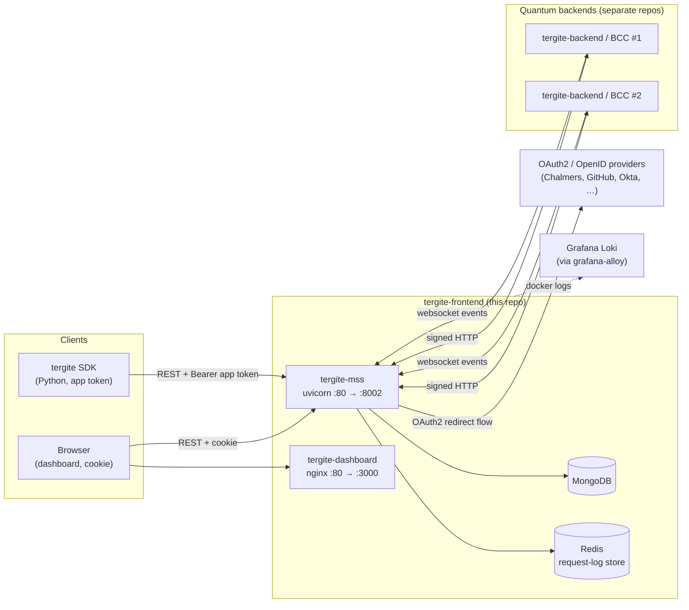
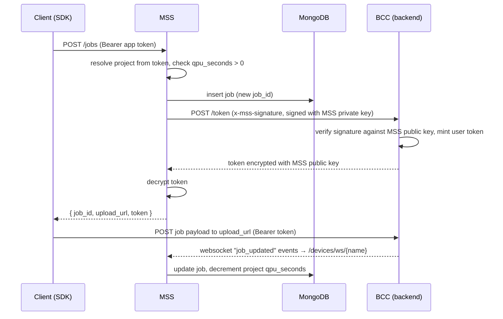

# Tergite Frontend — System Design

This document describes the architecture of the `tergite-frontend` monorepo: what the two
apps are, how they talk to each other and to the rest of the Tergite stack, how the repo
is configured, built, deployed and tested, and the conventions a contributor is expected
to follow.

Per-app design documents:

- [apps/tergite-mss/DESIGN.md](./apps/tergite-mss/DESIGN.md) — the REST API server (service-oriented layout)
- [apps/tergite-dashboard/DESIGN.md](./apps/tergite-dashboard/DESIGN.md) — the web UI (co-located page hierarchy)

Design proposals for changes that span both apps live in [docs/rfcs](./docs/rfcs):

- [RFC 0001 — Project access requests and notifications](./docs/rfcs/0001-project-access-requests-and-notifications.md) *(draft)*
- [RFC 0002 — Shared project creation requests](./docs/rfcs/0002-shared-project-creation-requests.md) *(skeleton)*

## 1. What this repo is

`tergite-frontend` is the user-facing half of the [Tergite stack](https://tergite.github.io/)
for the WACQT quantum computers. It is a monorepo of two applications that were originally
developed as separate repositories and later merged under `apps/`. They are still built,
versioned in CI, and released as two independent Docker images; they share this repo, the
`mss-config.toml` configuration file, the `.env` file, the docker compose stacks, the
end-to-end test harness, and the release tag.

| App | Path | Stack | Role |
| --- | --- | --- | --- |
| **MSS** (Main Service Server) | `apps/tergite-mss` | Python 3.12+, FastAPI, MongoDB, Redis | The public REST API. Owns all persistence, authn/authz, and all traffic to the quantum backends. |
| **Dashboard** | `apps/tergite-dashboard` | Node 20, Vite, React 18, TypeScript, Tailwind + shadcn/ui | The browser client for MSS. No backend of its own — it is a static bundle served by nginx. |

Everything the dashboard shows comes from MSS. MSS has no knowledge of the dashboard
beyond the auth cookie domain/name it must agree on.

## 2. System context



MongoDB is **not** part of the compose stacks in this repo — it is expected to already
exist and is reached via `database.url` in `mss-config.toml`. Redis *is* in the stacks
(service `tergite-redis`).

## 3. The two apps, and the seam between them

### 3.1 Contract

The dashboard depends on MSS only through:

1. **HTTP JSON endpoints** — every call goes through `authenticatedFetch` in
   [src/lib/api-client.ts](apps/tergite-dashboard/src/lib/api-client.ts), which always sends
   `credentials: "include"`. The base URL is the build-time `VITE_API_BASE_URL`.
2. **The auth cookie** — MSS sets a JWT cookie whose name and domain come from
   `auth.cookie_name` / `auth.cookie_domain` in `mss-config.toml`. The dashboard needs the
   same values as `VITE_COOKIE_NAME` / `VITE_COOKIE_DOMAIN`; its Dockerfile reads them out of
   the mounted `mss-config.toml` when they are not passed as build args.
3. **Response shapes** — mirrored by hand in
   [apps/tergite-dashboard/types.ts](apps/tergite-dashboard/types.ts). There is no code
   generation from the OpenAPI schema, so a change to an MSS DTO must be reflected there
   manually, and in the mock API fixtures.

The classic misconfiguration is `localhost` vs `127.0.0.1`: the cookie domain, the
`MSS_URL` in `.env`, and the host you type in the browser must all match, or login appears
to succeed and then bounces back to `/login`.

### 3.2 Job submission — the one flow that crosses everything



Two distinct trust directions, both asymmetric-key based:

- **MSS → BCC**: MSS signs `"{user_id}-{request_id}-{timestamp}"` with its private key
  (`PRIVATE_KEY_FILE`) and sends `x-mss-*` headers. See `_create_headers` in
  [services/external/bcc/service.py](apps/tergite-mss/services/external/bcc/service.py).
- **BCC → MSS**: on the websocket handshake BCC sends `x-id`, `x-request-id`, `x-timestamp`,
  `x-signature`; MSS verifies against that backend's `public_key_path`, checks the source IP
  (unless `is_strict_ip = false`), rejects stale nonces (`bcc_nonce_ttl`) and replayed ones
  (Redis request-log store). See `get_verified_device_name` in
  [api/rest/utils.py](apps/tergite-mss/api/rest/utils.py).

## 4. Configuration

There are three configuration surfaces, and they overlap deliberately.

### 4.1 `mss-config.toml` (MSS, and indirectly the dashboard build)

Copy `mss-config.example.toml` → `mss-config.toml`. Sections: `[general]`, `[database]`,
`[[backends]]` (one per BCC), `[auth]` and `[[auth.clients]]` (one per OAuth2 provider).
It is parsed by `start_mss.sh` into JSON and handed to the process as
`MSS_CONFIG_JSON_STR`; the app validates it into `AppConfig`
([utils/config.py](apps/tergite-mss/utils/config.py)) at import time in `settings.py` and
fails fast on anything missing.

The file may be SOPS-encrypted with a Hashicorp Vault key; `start_mss.sh` detects this and
decrypts using `VAULT_ADDR` / `VAULT_TOKEN` from the environment.

### 4.2 `.env` (docker compose)

Copy `.env.example` → `.env`. Drives image tags, ports, `MSS_URL`, the docker
`LOGGING_DRIVER` (`journald` recommended, Linux-only), and the Loki push URL.

### 4.3 `.env*` files in the dashboard

Vite conventions. `VITE_`-prefixed variables are baked into the bundle at build time —
they are not runtime configuration. `.env.development` / `.env.test` also carry
`JWT_SECRET` and `AUTH_AUDIENCE` used only by the mock API server.

## 5. Deployment

Two compose stacks at the repo root, both with services `tergite-redis`, `mss`,
`dashboard`, `grafana-alloy`:

- [fresh-docker-compose.yml](fresh-docker-compose.yml) — builds both images from source.
- [prebuilt-docker-compose.yml](prebuilt-docker-compose.yml) — pulls tagged images from
  `$REGISTRY`.

```bash
docker compose -f fresh-docker-compose.yml up -d
```

MSS is exposed on `8002`, the dashboard on `3000`. `mss` waits on a healthy Redis;
`dashboard` waits on a healthy MSS (`GET /health` returning 200). Both `/health`
endpoints are deliberately outside the request log — MSS skips them in
`request_logging_middleware`, nginx with `access_log off` — because a ten-second probe
otherwise buries real traffic.

The dashboard image is a two-stage build: `node:20-alpine` runs `npm run build`, then the
`dist/` output is copied into `nginx:1.27-alpine-slim` with a SPA-fallback
[nginx.conf](apps/tergite-dashboard/nginx.conf) (`try_files $uri /index.html`) and a
10 r/s rate limit. Its build context needs `parent-folder=./` as an additional context so
it can read the root `mss-config.toml`.

Logs are shipped by `grafana-alloy`, which tails the docker socket and pushes to Loki
using `GRAFANA_LOKI_URL` and `LOKI_LOGGER_ID` ([config.alloy](config.alloy)).

## 6. Testing

| Level | Where | Command |
| --- | --- | --- |
| MSS unit/integration | `apps/tergite-mss/tests` — pytest against real MongoDB + Redis | `pytest` |
| Dashboard component | `apps/tergite-dashboard/src/**/__tests__` — vitest + happy-dom | `npm run test` |
| Dashboard e2e | `apps/tergite-dashboard/cypress/e2e` — cypress against the **mock** API | `npm run e2e` |
| Full-stack e2e | [e2e_test.sh](e2e_test.sh) — cypress against real MSS + real backend in docker | `./e2e_test.sh` |

The dashboard's own e2e suite does not run MSS. It runs an Express mock API
(`apps/tergite-dashboard/api/`) that serves the same JSON shapes from
`cypress/fixtures/*.json`, plus a `GET /refreshed-db` endpoint tests hit to reset state.
This keeps the UI suite fast and deterministic, at the cost of a second place to update
when an MSS response changes.

`e2e_test.sh` is the one that catches contract drift: it clones `tergite-backend`, builds
MSS, the dashboard and the backend, seeds Mongo from the same cypress fixtures, wires up a
mock OpenID provider, and runs the cypress specs against the real stack. It is a manual /
tag-triggered job in CI, not a per-commit one.

Visual regression is via `cypress-image-diff-js`; baselines in
`cypress-image-diff-screenshots/baseline/` are Linux-specific, so regenerate them through
`Dockerfile.e2e` rather than on macOS (see the dashboard's `CONTRIBUTING.md`).

## 7. CI

Both GitHub Actions ([.github/workflows](.github/workflows)) and GitLab CI
([.gitlab-ci.yml](.gitlab-ci.yml)) are maintained; GitLab is the source of truth (GitHub is
a mirror — see §8).

- `mss-ci.yml` / `test mss` — `black --check .`, then `pytest` on Python 3.12 and 3.13
  against `mongo` and `redis` services. Path-filtered to `apps/tergite-mss/**`.
- `dashboard-ci.yml` / `lint dashboard`, `test dashboard`, `e2e test dashboard` —
  eslint, vitest, cypress. Path-filtered to `apps/tergite-dashboard/**`.
- `frontend-ci.yml` / `full e2e` — the cross-app `e2e_test.sh`, on `main`, on `v*` tags, or
  manually.
- On a `v*` tag, each app's workflow buildx-builds a multi-platform image and pushes to the
  staging registry and/or Docker Hub, gated on the `SHOULD_PUBLISH_TO_STAGING` /
  `SHOULD_PUBLISH_TO_PROD` variables.

## 8. Working on this repo

### Version control

Tergite is developed on a private GitLab and **mirrored to GitHub**. GitHub PRs and issues
are not read. Contributions and bug reports go to <contact.quantum@chalmersnextlabs.se>;
code changes need a signed CLA. See [CONTRIBUTING.md](CONTRIBUTING.md).

### Versioning and releases

`{year}.{month}.{patch}`, e.g. `2026.06.0`. A release bumps the version in **four** places
and touches **three** changelogs:

- `apps/tergite-mss/pyproject.toml` and `apps/tergite-mss/api/rest/app_kwargs.py`
- `apps/tergite-dashboard/package.json` and `package-lock.json`
- `CHANGELOG.md`, `apps/tergite-mss/CHANGELOG.md`, `apps/tergite-dashboard/CHANGELOG.md`

### Changelog entries

One or two sentences: what changed, and what an operator would have hit before. Always
under `[Unreleased]`, under `Added` / `Changed` / `Fixed` as the file already uses them.
Reasoning, alternatives and numbers belong in the commit body, not the changelog.

### Commits

One logical change per commit, decided before editing rather than carved out of a large
working tree afterwards. Never add assistant attribution (`Co-Authored-By`, "Generated
with", …) to commit messages or MR bodies.

### Style guide

Shared across both apps:

- **Comments and docstrings must earn their place.** Say the constraint, the gotcha, the
  *why* that the code cannot. Never restate the code, never narrate the history of a fix —
  that is what the commit message is for. Default to none.
- **Names**: variables are nouns, functions are verbs, booleans start with `is_`/`should_`.
  If the name alone does not say what it returns, rename it.
- **No banner comments** (`# --- section ---`, `// ==== section ====`) at any indent. If a
  group needs a label it needs a docstring or its own file.
- **Tests**: the name says what it tests. Add a line of comment only when the *why* is
  non-obvious.
- **License headers**: every Python file in MSS carries the Tergite copyright/Apache-2.0
  header, with a line added per contributing party. Keep this when creating new modules.
  Dashboard TypeScript files do not carry per-file headers.

Language- and layout-specific rules — MSS's service-oriented layout and Python
conventions, the dashboard's co-located page hierarchy and React/TypeScript conventions —
are in each app's design document (§1). **Read the relevant one before adding files**; the
two apps deliberately organise code in different ways and the difference is load-bearing.

### Slow commands

Redirect test suites, builds and e2e runs to one temp file per kind of run, then grep and
tail that file for follow-up questions instead of re-running:

```bash
pytest > "$LOG" 2>&1; echo "exit=$?" >> "$LOG"
```

Record the exit status next to the command — a pipe reports the *pipe's* status, so
`pytest | tail` makes a failing suite read as green. Never call a suite passing because a
grep found nothing; confirm from the summary line or the recorded status.

## 9. Known rough edges

Worth knowing before you are surprised by them:

- **No realtime backend liveness.** A device is "online" because it said so over the
  websocket; if BCC dies without disconnecting cleanly, MSS keeps showing it online until
  the socket drops. Called out in
  [apps/tergite-mss/docs/backends.md](apps/tergite-mss/docs/backends.md) and the root TODO.
- **`GET /counts/job-submitters` raises `NotImplementedError`.**