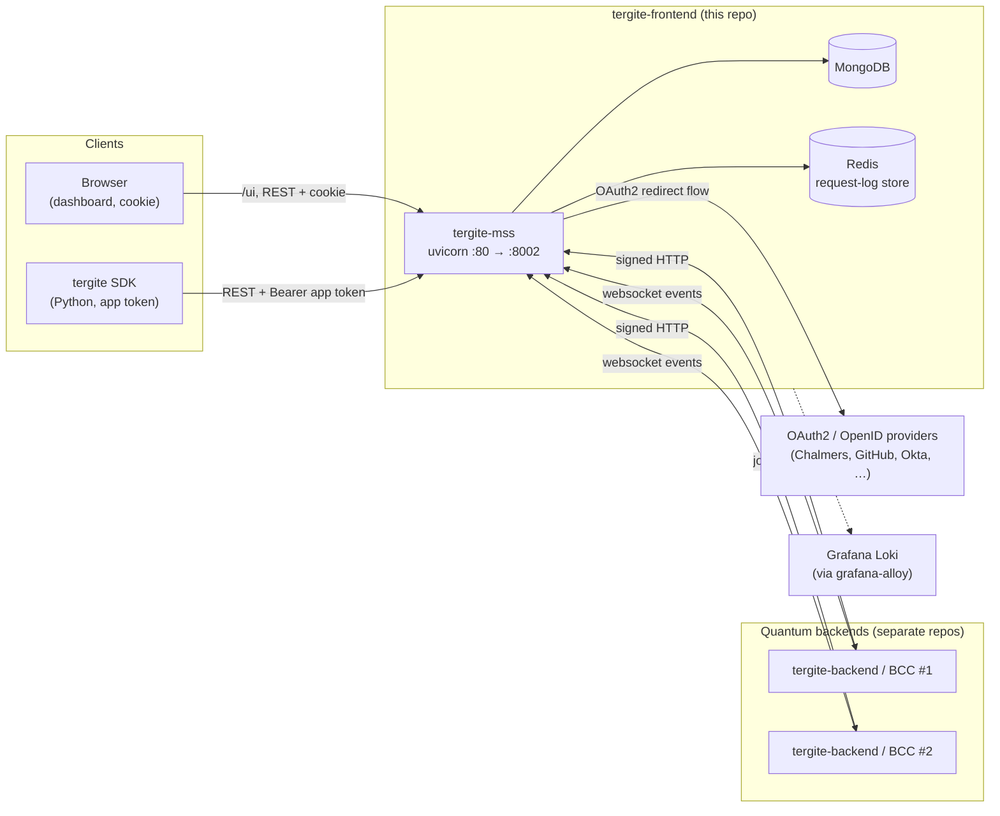
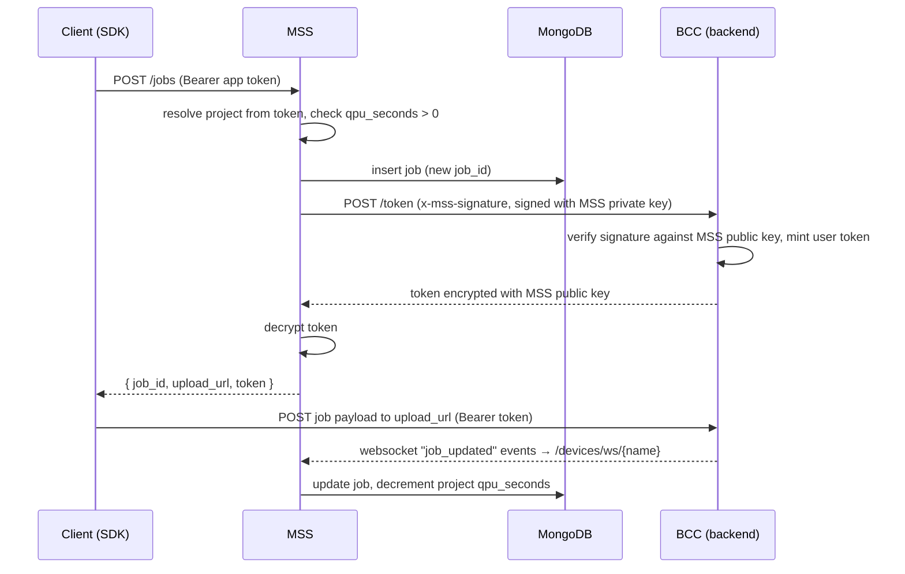

# Tergite Frontend — System Design

This document describes the architecture of the `tergite-frontend` monorepo: what the two
apps are, how they talk to each other and to the rest of the Tergite stack, how the repo
is configured, built, deployed and tested, and the conventions a contributor is expected
to follow.

Per-app design documents:

- [apps/tergite-mss/DESIGN.md](./apps/tergite-mss/DESIGN.md) — the REST API server (service-oriented layout)
- [apps/tergite-dashboard/DESIGN.md](./apps/tergite-dashboard/DESIGN.md) — the web UI (co-located page hierarchy)

## 1. What this repo is

`tergite-frontend` is the user-facing half of the [Tergite stack](https://tergite.github.io/)
for the WACQT quantum computers. It is a monorepo of two applications that were originally
developed as separate repositories and later merged under `apps/`. They are still built and
tested independently in CI, and released together: MSS's deb and macOS installer carry the
dashboard's build, which MSS serves at `/ui`. They share this repo, the `mss-config.toml`
configuration file, the end-to-end test harness, and the release tag.

| App | Path | Stack | Role |
| --- | --- | --- | --- |
| **MSS** (Main Service Server) | `apps/tergite-mss` | Python 3.12+, FastAPI, MongoDB, Redis | The public REST API. Owns all persistence, authn/authz, and all traffic to the quantum backends. |
| **Dashboard** | `apps/tergite-dashboard` | Node 20, Vite, React 18, TypeScript, Tailwind + shadcn/ui | The browser client for MSS. No backend of its own — it is a static bundle MSS serves at `/ui`. |

Everything the dashboard shows comes from MSS, which knows the dashboard only as the files
it serves at `/ui`.

## 2. System context



MongoDB, or PostgreSQL, and Redis are reached via `database.url` and `database.redis_url` in
`mss-config.toml`; MSS's deb installs and provisions them alongside it on Debian and Ubuntu.

## 3. The two apps, and the seam between them

### 3.1 Contract

The dashboard depends on MSS only through:

1. **HTTP JSON endpoints** — every call goes through `authenticatedFetch` in
   [src/lib/api-client.ts](apps/tergite-dashboard/src/lib/api-client.ts), which always sends
   `credentials: "include"`. The base URL is the build-time `VITE_API_BASE_URL`, empty in the
   production build, which calls MSS on the origin that served it.
2. **The auth cookie** — MSS sets a JWT cookie whose name and domain come from
   `auth.cookie_name` / `auth.cookie_domain` in `mss-config.toml`, which the browser sends
   with every call, as the dashboard and the API share MSS's origin.
3. **Response shapes** — mirrored by hand in
   [apps/tergite-dashboard/types.ts](apps/tergite-dashboard/types.ts). There is no code
   generation from the OpenAPI schema, so a change to an MSS DTO must be reflected there
   manually, and in the mock API fixtures.

The classic misconfiguration is `localhost` vs `127.0.0.1`: the cookie domain and the host
you type in the browser must match, or login appears to succeed and then bounces back to
`/login`.

### 3.2 Job submission — the one flow that crosses everything



Two distinct trust directions, both asymmetric-key based:

- **MSS → BCC**: MSS signs `"{user_id}-{request_id}-{timestamp}"` with its private key
  (`PRIVATE_KEY_FILE`) and sends `x-mss-*` headers. See `_create_headers` in
  [services/external/bcc/service.py](apps/tergite-mss/services/external/bcc/service.py).
- **BCC → MSS**: on the websocket handshake BCC sends `x-id`, `x-request-id`, `x-timestamp`,
  `x-signature`; MSS verifies against that backend's `public_key_path`, checks the source IP
  (unless `is_strict_ip = false`), rejects stale nonces (`bcc_nonce_ttl`) and replayed ones
  (the request log in Redis, where a nonce is the key). See `get_verified_device_name` in
  [api/rest/utils.py](apps/tergite-mss/api/rest/utils.py).

## 4. Configuration

There are three configuration surfaces, and they overlap deliberately.

### 4.1 `mss-config.toml` (MSS)

Copy [apps/tergite-mss/mss-config.example.toml](apps/tergite-mss/mss-config.example.toml) →
`mss-config.toml`, or let the deb's provisioning write `/etc/tergite-mss/mss-config.toml`.
Sections: `[general]`, `[database]`, `[[backends]]` (one per BCC), `[projects]`, `[notices]`,
`[email]`, `[auth]` and `[[auth.clients]]` (one per OAuth2 provider). MSS reads the file
`MSS_CONFIG_FILE` names, or the JSON in `MSS_CONFIG_JSON_STR` when it is set;
the app validates it into `AppConfig`
([utils/config.py](apps/tergite-mss/utils/config.py)) at import time in `settings.py` and
fails fast on anything missing.

The file may be SOPS-encrypted with a Hashicorp Vault key; `start_mss.sh` detects this and
decrypts it into `MSS_CONFIG_JSON_STR` using `VAULT_ADDR` / `VAULT_TOKEN` from the environment.

### 4.2 `.env*` files in the dashboard

Vite conventions. `VITE_`-prefixed variables are baked into the bundle at build time —
they are not runtime configuration. `.env.production` empties `VITE_API_BASE_URL`, so the
build MSS serves calls its own origin. `.env.development` / `.env.test` also carry
`JWT_SECRET` and `AUTH_AUDIENCE` used only by the mock API server.

## 5. Deployment

MSS installs from its release's deb (amd64, Debian 13 and Ubuntu 24.04 onwards) or macOS arm64
installer, Nuitka's standalone build running as the `tergite-mss` systemd service or launchd daemon on
`8002`. The deb asks debconf where the database and Redis are, and its provisioning writes
`/etc/tergite-mss/mss-config.toml` and the private key; on macOS the config is written by hand
to `/usr/local/etc/tergite-mss/`. See the [README](README.md#deployment).

The dashboard ships inside MSS's packages: the release builds it with the base `/ui/`, Nuitka
includes it from `apps/tergite-mss/ui/`, and MSS serves it at `/ui`
([api/rest/dashboard.py](apps/tergite-mss/api/rest/dashboard.py)), sending the paths no file
has to `index.html` and redirecting `/` to `/ui/`.

MSS answers `GET /health` with 200 outside the request log, as `request_logging_middleware`
skips it, so that a frequent probe does not bury real traffic.

Logs reach Loki through Grafana Alloy installed beside MSS, whose [config.alloy](config.alloy)
reads `tergite-mss.service`'s journal and pushes it with `GRAFANA_LOKI_URL` and `LOKI_LOGGER_ID`.

## 6. Testing

| Level | Where | Command |
| --- | --- | --- |
| MSS unit/integration | `apps/tergite-mss/tests` — pytest against real MongoDB + Redis | `pytest` |
| Dashboard component | `apps/tergite-dashboard/src/**/__tests__` — vitest + happy-dom | `npm run test` |
| Dashboard e2e | `apps/tergite-dashboard/playwright` — Playwright against the **mock** API, a mock API per worker | `npm run e2e` |
| Full-stack e2e | [dev/e2e_native_test.sh](dev/e2e_native_test.sh) — the same Playwright specs against real MSS + real backends, with MongoDB and Redis, all running natively | `BACKEND_PATH=../tergite-backend ./dev/e2e_native_test.sh` |

The dashboard's own e2e suite does not run MSS. It runs an Express mock API
(`apps/tergite-dashboard/dev/mock-api/`) that serves the same JSON shapes from
`apps/tergite-dashboard/fixtures/*.json`, plus a
`GET /refreshed-db` endpoint tests hit to reset state.
This keeps the UI suite fast and deterministic, at the cost of a second place to update
when an MSS response changes.

`dev/e2e_native_test.sh` is the one that catches contract drift: from a local
`tergite-backend` checkout or a clone, it runs one `main.py serve` for all the backends, each
under its own path, from the base dependencies, MSS from this checkout, the dashboard's test
build, and a MongoDB, a Redis and a reset service (`dev/e2e_reset_server.py`) of its own, all
from fresh data in `temp-native/`; it seeds Mongo from the same fixtures, wires up a mock
OpenID provider, and runs the Playwright specs against that stack, on one worker. It is a
manual / tag-triggered job in CI, not a per-commit one.

Visual regression is Playwright's `toHaveScreenshot`; its baselines are named after the
platform, so make the Linux ones through the dashboard's `Dockerfile.playwright` (see its
`CONTRIBUTING.md`).

## 7. CI

Both GitHub Actions ([.github/workflows](.github/workflows)) and GitLab CI
([.gitlab-ci.yml](.gitlab-ci.yml)) are maintained; GitLab is the source of truth (GitHub is
a mirror — see §8).

- `mss-ci.yml` / `test mss` — `black --check .`, `pyflakes`, then `pytest` on Python 3.12 and
  3.13 against `mongo` and `redis` services. Path-filtered to `apps/tergite-mss/**`.
- `dashboard-ci.yml` / `lint dashboard`, `test dashboard`, `e2e test dashboard` —
  eslint, vitest, Playwright. Path-filtered to `apps/tergite-dashboard/**`.
- `frontend-ci.yml` / `full e2e` — the cross-app `dev/e2e_native_test.sh`, after installing
  MongoDB, Redis, SQLite and uv, on `main`, on `v*` tags, or manually.
- On a `v*` tag, `mss-release.yml` builds the dashboard, then MSS's deb and macOS installer
  with it, and attaches them to the release.

## 8. Working on this repo

### Version control

Tergite is developed on a private GitLab and **mirrored to GitHub**. GitHub PRs and issues
are not read. Contributions and bug reports go to <contact.quantum@chalmersnextlabs.se>;
code changes need a signed CLA. See [CONTRIBUTING.md](CONTRIBUTING.md).

### Versioning and releases

`{year}.{month}.{patch}`, e.g. `2026.06.0`. A release bumps the version in **four** places
and touches **three** changelogs:

- `apps/tergite-mss/pyproject.toml` and `apps/tergite-mss/api/rest/app_kwargs.py`
- `apps/tergite-dashboard/package.json` and `package-lock.json`
- `CHANGELOG.md`, `apps/tergite-mss/CHANGELOG.md`, `apps/tergite-dashboard/CHANGELOG.md`

### Changelog entries

One or two sentences: what changed, and what an operator would have hit before. Always
under `[Unreleased]`, under `Added` / `Changed` / `Fixed` as the file already uses them.
Reasoning, alternatives and numbers belong in the commit body, not the changelog.

### Commits

One logical change per commit, decided before editing rather than carved out of a large
working tree afterwards. Never add assistant attribution (`Co-Authored-By`, "Generated
with", …) to commit messages or MR bodies.

### Style guide

Shared across both apps:

- **Comments and docstrings must earn their place.** Say the constraint, the gotcha, the
  *why* that the code cannot. Never restate the code, never narrate the history of a fix —
  that is what the commit message is for. Default to none.
- **Names**: variables are nouns, functions are verbs, booleans start with `is_`/`should_`.
  If the name alone does not say what it returns, rename it.
- **No banner comments** (`# --- section ---`, `// ==== section ====`) at any indent. If a
  group needs a label it needs a docstring or its own file.
- **Tests**: the name says what it tests. Add a line of comment only when the *why* is
  non-obvious.
- **License headers**: every Python file in MSS carries the Tergite copyright/Apache-2.0
  header, with a line added per contributing party. Keep this when creating new modules.
  Dashboard TypeScript files do not carry per-file headers.

Language- and layout-specific rules — MSS's service-oriented layout and Python
conventions, the dashboard's co-located page hierarchy and React/TypeScript conventions —
are in each app's design document (§1). **Read the relevant one before adding files**; the
two apps deliberately organise code in different ways and the difference is load-bearing.

### Slow commands

Redirect test suites, builds and e2e runs to one temp file per kind of run, then grep and
tail that file for follow-up questions instead of re-running:

```bash
pytest > "$LOG" 2>&1; echo "exit=$?" >> "$LOG"
```

Record the exit status next to the command — a pipe reports the *pipe's* status, so
`pytest | tail` makes a failing suite read as green. Never call a suite passing because a
grep found nothing; confirm from the summary line or the recorded status.

## 9. Known rough edges

Worth knowing before you are surprised by them:

- **No realtime backend liveness.** A device is "online" because it said so over the
  websocket; if BCC dies without disconnecting cleanly, MSS keeps showing it online until
  the socket drops. Called out in
  [apps/tergite-mss/docs/backends.md](apps/tergite-mss/docs/backends.md) and the root TODO.
- **503 handling in the dashboard is incomplete** (root `README.md` TODO).
- **`GET /counts/job-submitters` raises `NotImplementedError`.**