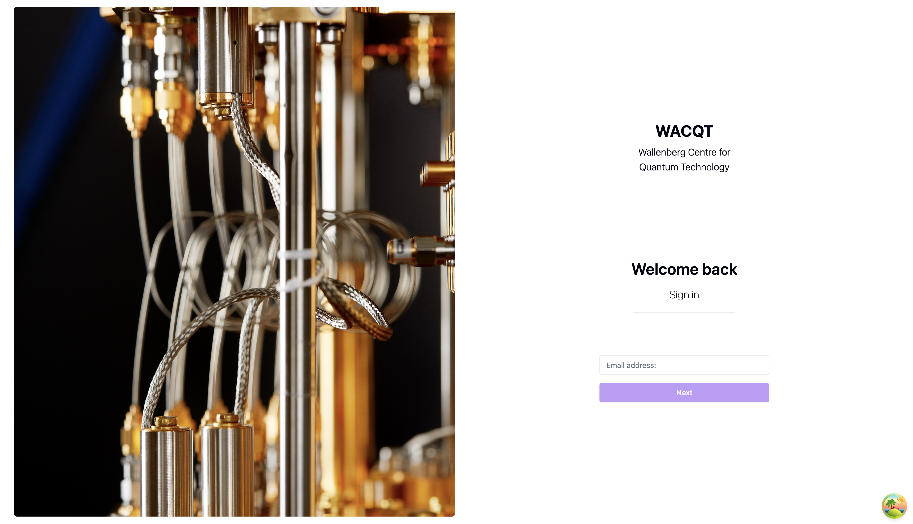
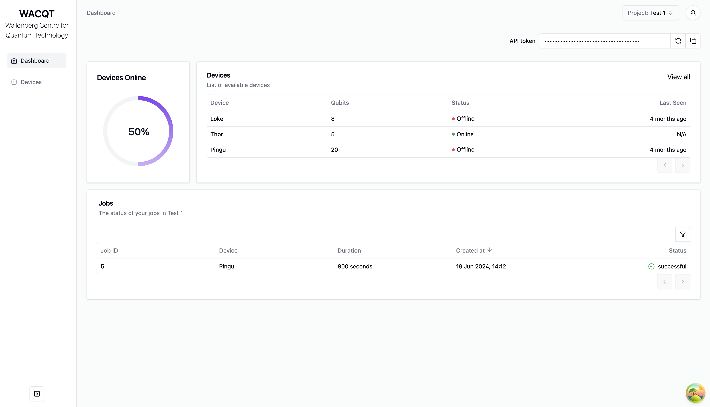
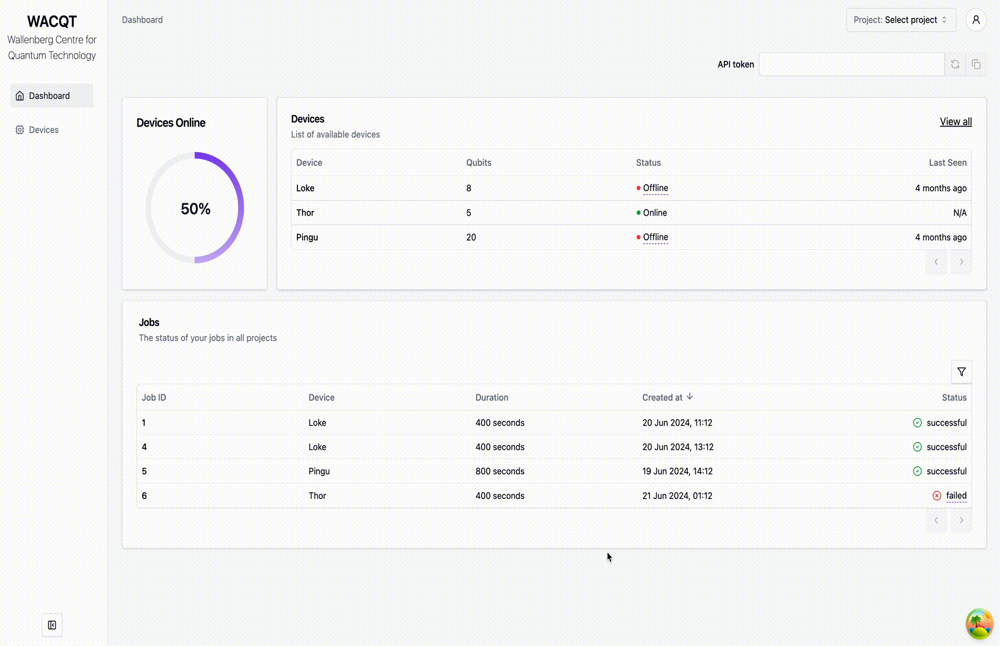

# tergite-frontend

[](https://github.com/tergite/tergite-frontend/actions/workflows/ci.yml)

The Frontend in the [Tergite software stack](https://tergite.github.io/) of the WACQT quantum computer:
the Main Service Server (MSS), the API through which users reach the quantum computers, and the
dashboard, the website that shows their state.

**This project is developed by a core group of collaborators.**
**Chalmers Next Labs AB (CNL) takes on the role of managing and maintaining this project.**


The login screen


The home screen


A preview of the the dashboard

## Quick Start

Run MSS and the dashboard on your machine, with test data and no other services. You need
[uv](https://docs.astral.sh/uv/getting-started/installation/) and [Node.js 26.12.1 or later](https://nodejs.org/).

```shell
git clone git@github.com:tergite/tergite-frontend.git
cd tergite-frontend
uv sync --extra dev
cp mss-config.example.toml mss-config.toml
openssl genpkey -algorithm RSA -out private-mss-key.pem -pkeyopt rsa_keygen_bits:4096
cd ui
npm i
npm run dev
```

Then open [http://127.0.0.1:5173/ui/](http://127.0.0.1:5173/ui/), click **Log in as a seeded
user** and pick one: `jane.doe@example.com` is an admin, `john.doe@example.com` a plain user.

To run tests, build the packages or contribute, see [CONTRIBUTING.md](./CONTRIBUTING.md).

## Layout

This folder is MSS, a FastAPI app: the public API through which clients like the
[tergite SDK](https://github.com/tergite/tergite) reach the quantum computers. The dashboard, a
React app, is in [ui/](./ui), and MSS serves its build at `/ui`. [DESIGN.md](./DESIGN.md) describes
how they are built, and [docs/](./docs) more of MSS's API.

## Development

The [Quick Start](#quick-start) is all the dashboard needs. For MSS's own work:

- MSS's settings are in `mss-config.toml`, which [mss-config.example.toml](./mss-config.example.toml)
  documents. Its `[database]` url may name a MongoDB or PostgreSQL instead of SQLite.
- Run MSS alone, without the test data and the dashboard's dev server:

```shell
uv run ./start_mss.sh
```

- To run jobs, run a [tergite backend](https://github.com/tergite/tergite-backend) at the url of
  `[[backends]]` in `mss-config.toml`. It and MSS check each other's keys: copy
  `public-mss-key.pem` to the backend, and its public key to `public-backend-key.pem` here.

```shell
openssl rsa -pubout -in private-mss-key.pem -out public-mss-key.pem
```

## Deployment

MSS runs from its package as a system service on port 8002, and serves the dashboard at
[/ui](http://127.0.0.1:8002/ui).

1. Download the installer of a [release](https://github.com/tergite/tergite-frontend/releases):
   a deb for amd64, for Debian 13 and Ubuntu 24.04 onwards, or a macOS arm64 package.

2. Install it. The deb asks where MSS's database is, or installs MongoDB or PostgreSQL beside it,
   and writes a production `/etc/tergite-mss/mss-config.toml` with a private key; on macOS, copy
   the example config and change the lines it marks `PRODUCTION`.

```shell
# Debian or Ubuntu
sudo apt install ./tergite-mss_<version>_amd64.deb

# macOS
sudo installer -pkg tergite-mss-<version>-macos-arm64.pkg -target /
sudo cp /usr/local/share/tergite-mss/mss-config.example.toml /usr/local/etc/tergite-mss/mss-config.toml
```

3. Fill in the config's backends, the `[auth]` login providers, with `cookie_domain` the host the
   dashboard is opened at, and the `[email]` SMTP server. Then (re)start MSS.

```shell
# Debian or Ubuntu; its log is in the journal: journalctl -u tergite-mss -f
sudo systemctl restart tergite-mss

# macOS; its log is /usr/local/var/log/tergite-mss.log
sudo launchctl bootstrap system /Library/LaunchDaemons/se.chalmersnextlabs.tergite-mss.plist
```

4. Open [http://127.0.0.1:8002/ui](http://127.0.0.1:8002/ui) for the dashboard, and
   [http://127.0.0.1:8002/docs](http://127.0.0.1:8002/docs) for the API.

### Run or install with uv

[uv](https://docs.astral.sh/uv/) also runs MSS from its repository, or installs it as a
[tool](https://docs.astral.sh/uv/guides/tools/), with the Python 3.13 it needs. Either runs in the
folder it starts in, reading `mss-config.toml` and `private-mss-key.pem` there (or the files
`MSS_CONFIG_FILE` and `PRIVATE_KEY_FILE` name), and serves the API alone unless
`MSS_DASHBOARD_DIR` names the dashboard's build of the same release.

```shell
# once, without installing it
uvx --from git+https://github.com/tergite/tergite-frontend@v<version> mss start

# installed; `uv tool uninstall tergite-mss` removes it
uv tool install git+https://github.com/tergite/tergite-frontend@v<version>
MSS_DASHBOARD_DIR=/srv/tergite-mss/dashboard mss start
```

### Logs

To ship MSS's journal to Grafana Loki, install [Grafana Alloy](https://grafana.com/docs/alloy/latest/set-up/install/)
beside it with this repository's [config.alloy](./config.alloy), and set its environment, e.g. in
`/etc/default/alloy` on Debian and Ubuntu:

```shell
CONFIG_FILE=/etc/alloy/config.alloy
ENVIRONMENT=production
GRAFANA_LOKI_URL=http://loki.example.com:3100/loki/api/v1/push
LOKI_LOGGER_ID=<some-id>
```

## Version Control

The tergite stack is developed on a separate version control system and mirrored on Github.
If you are reading this on GitHub, then you are looking at a mirror.

## FAQ

### Why can't I access the service?

It could be an issue with your iptables. Check them.

- You could put MSS behind an nginx reverse proxy pointing ports 80,443 to it (http://127.0.0.1:8002), but don't forget to open up your firewall to allow connections on 80,443 ports

```shell
sudo iptables -I INPUT -p tcp -m state --state NEW -m tcp -m multiport --dports 80,443 -j ACCEPT
```

You could add `-s nnn.nnn.n.n/nn ` arg to the above command to limit access to only a given subnet e.g. `-s 255.255.0.0/16`

## Contribution Guidelines

If you would like to contribute to tergite-frontend, please have a look at our [contribution guidelines](./CONTRIBUTING.md)

## Authors

This project is a work of
[many contributors](https://github.com/tergite/tergite-frontend/graphs/contributors).

Special credit goes to the authors of this project as seen in the [CREDITS](./CREDITS.md) file.

## ChangeLog

To view the changelog for each version, have a look at the [CHANGELOG.md](./CHANGELOG.md) file.

## License

[Apache 2.0 License](./LICENSE.txt)

## TODO

- [ ] Fix failing GitHub/GitLab CI runs

## Acknowledgements

This project was sponsored by:

- [Knut and Alice Wallenberg Foundation](https://kaw.wallenberg.org/en) under the [Wallenberg Center for Quantum Technology (WACQT)](https://www.chalmers.se/en/centres/wacqt/) project at [Chalmers University of Technology](https://www.chalmers.se)
- [Nordic e-Infrastructure Collaboration (NeIC)](https://neic.no) and [NordForsk](https://www.nordforsk.org/sv) under the [NordIQuEst](https://neic.no/nordiquest/) project
- [European Union's Horizon Europe](https://research-and-innovation.ec.europa.eu/funding/funding-opportunities/funding-programmes-and-open-calls/horizon-europe_en) under the [OpenSuperQ](https://cordis.europa.eu/project/id/820363) project
- [European Union's Horizon Europe](https://research-and-innovation.ec.europa.eu/funding/funding-opportunities/funding-programmes-and-open-calls/horizon-europe_en) under the [OpenSuperQPlus](https://opensuperqplus.eu/) project
