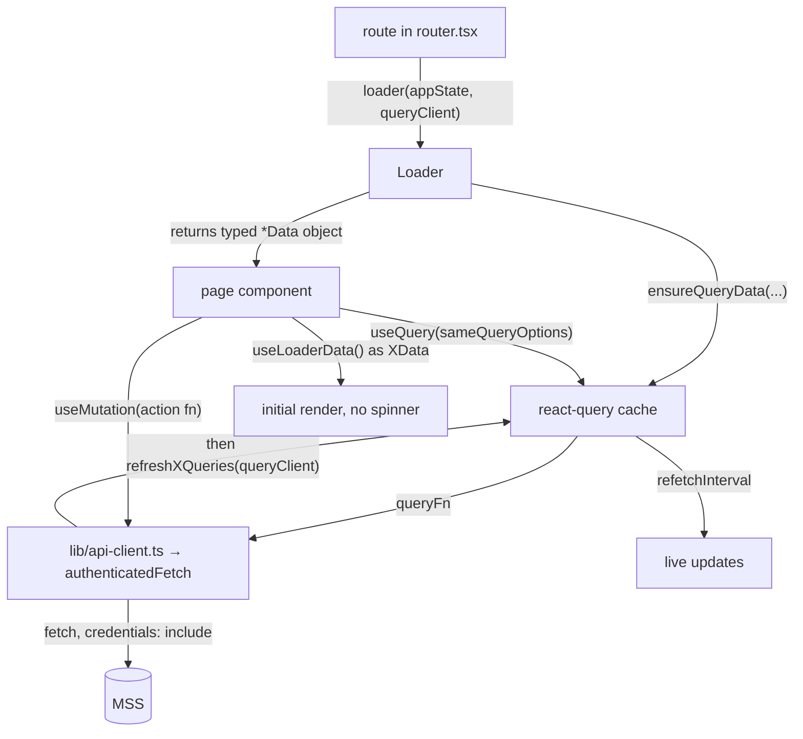

# Tergite Dashboard — System Design

The web client of the Tergite stack: a React single-page app that shows the state of the
quantum computers and lets users manage projects, API tokens, bookings and (for admins)
backends, QPU-time requests and notices.

Read [../../DESIGN.md](../../DESIGN.md) first for the monorepo context, deployment and the
cross-app conventions.

The dashboard has **no backend of its own**. In production it is a static bundle served by
nginx; every piece of data comes from MSS over HTTP with a cookie. The Express server in
`api/` is a development and testing mock only — it is never deployed.

## 1. Architecture: co-located hierarchy

The organising principle is **proximity of use**. A component lives as close as possible to
the single place that uses it, and only moves outward when a second consumer appears.

```
src/
├── main.tsx                 # ReactDOM root
├── app.tsx                  # QueryClientProvider + AppStateContext + AppRouter
├── router.tsx               # every route, its element and its loader
├── index.css                # Tailwind layers + CSS custom properties (light/dark)
├── lib/
│   ├── api-client.ts        # ALL HTTP + all react-query queryOptions
│   ├── app-state.ts         # the AppStateContext and its factory
│   └── utils.ts             # shared pure helpers (cn, formatting, normalising)
├── hooks/
│   └── use-toast.ts
├── components/
│   ├── ui/                  # generic, page-agnostic primitives (shadcn/ui + our own)
│   │   ├── data-table/      # the shared table: index, filter-form, sort-header, table-row
│   │   └── __tests__/
│   └── layouts/
│       └── dashboard/
│           ├── index.tsx    # the layout shell + its loader
│           └── components/  # footer, sidebar, top-banner, topbar/
└── pages/
    ├── devices.tsx          # a single-file page
    ├── login.tsx
    ├── error-alert.tsx
    ├── home/
    │   ├── index.tsx        # the page + its loader
    │   └── components/
    │       ├── devices-table/{index,columns}.tsx
    │       ├── jobs-table/{index,columns,filter-form,detail-drawer}.tsx
    │       └── bookings-table/{index,columns,filter-form}.tsx
    ├── device-detail/
    │   ├── index.tsx
    │   └── components/
    │       ├── device-summary.tsx            # leaf → a file
    │       ├── calibration-data-table.tsx
    │       ├── bookings-calendar/            # has children → a folder
    │       │   ├── index.tsx
    │       │   └── booking-form.tsx
    │       └── calibration-bar-chart/
    │           ├── index.tsx
    │           └── calibration-bar.tsx
    ├── projects/, tokens/, admin-control/, admin-projects/, admin-requests/
types.ts                     # all shared TypeScript types (repo root of the app)
```

### The rule

1. A page is `src/pages/{page-name}/index.tsx`. If it has no children of its own it may be a
   single file, `src/pages/{page-name}.tsx` (`devices.tsx`, `login.tsx`).
2. Components used **only** by that page live in `src/pages/{page-name}/components/`.
3. The same rule recurses. A component that itself has children becomes a folder with
   `index.tsx` plus its children beside it; a leaf component stays a single file.
   `device-detail/components/bookings-calendar/booking-form.tsx` is only reachable from the
   bookings calendar, which is only reachable from the device-detail page, and the directory
   path says exactly that.
4. A component is promoted to `src/components/ui/` **when and only when** a second, unrelated
   consumer appears. `ui/` is for things with no knowledge of any particular page —
   `Button`, `DataTable`, `Card`, `DonutChart`, `EventCalendar`.
5. `src/components/layouts/` is for shells that wrap routes rather than being routed to. It
   follows the same recursion: `layouts/dashboard/components/topbar/` is a folder because the
   topbar has its own `breadcrumb.tsx` and `mobile-menu.tsx`.

Note that `detail-item.tsx` exists both in `components/ui/` and in
`pages/device-detail/components/` — the page-specific one is a different component that
happens to share a name. That is the layout working as intended: no need to generalise a
component to reuse a name.

### Why

You can delete a feature by deleting one directory. You can see a component's blast radius
from its path. Nothing accumulates in a global `components/` bucket that nobody dares touch
because its consumers are unknown. The cost is a deeper tree and some near-duplication
between sibling pages, which is accepted deliberately — duplication is cheaper here than a
premature abstraction shared by two pages that then diverge.

### Table sub-convention

Any page listing records uses the shared `DataTable` and splits the work the same way:

| File | Contains |
| --- | --- |
| `index.tsx` | the thin wrapper that passes `columns`, `data`, `filterFormProps`, `getDrawerContent` to `DataTable` |
| `columns.tsx` | the `ColumnDef[]` — cell rendering, `SortHeader`, `meta.headerClassName` |
| `filter-form.tsx` | the `DataTableFormConfig` describing the filter popover fields |
| `detail-drawer.tsx` | the drawer body rendered when a row is clicked (where the page has one) |

The pattern is visible in `home/components/jobs-table/`, `tokens/components/tokens-table/`,
`projects/components/project-table/`, `admin-projects/components/projects-table/` and
`admin-requests/components/requests-table/`. Follow it for a new table rather than inventing
a variant.

Pages with a master/detail split additionally have a `*-sidebar/` folder holding the detail
panel and its dialogs (`tokens/components/tokens-sidebar/{index,delete-dialog,lifespan-dialog}.tsx`).

## 2. Data flow



Three layers, each with one job:

**`lib/api-client.ts`** is the only module that calls `fetch`. It exports, for each
resource, a react-query `queryOptions` object (`devicesQuery`, `myJobsQuery(...)`,
`noticesQuery(...)`, …) and, for each write, an async action function (`createAppToken`,
`approveUserRequest`, `switchBackendOff`, `dismissNotice`, …), plus `refresh*Queries`
helpers that invalidate the right keys after a mutation. Everything goes through the private
`authenticatedFetch`, which sets `credentials: "include"` and converts a non-ok response
into an `ErrorInfo` (an `Error` carrying `status`, message taken from the `detail` field).

Query keys are always `[baseUrl, resource, ...discriminators]` so a different API base URL
cannot collide in the cache. `refetchInterval` comes from `VITE_REFETCH_INTERVAL_MS`
(default 2 min), which is why the e2e config drops it to 1 s.

**Route loaders.** Every route in `router.tsx` has `loader: xLoader(appState, queryClient)`.
The loader is exported from the page module next to the component (with an
`// eslint-disable-next-line react-refresh/only-export-components`), pre-fetches through
`queryClient.ensureQueryData(...)`, and returns a single typed `XData` object. The page reads
it with `useLoaderData() as XData` and uses those values as the `default` for its `useQuery`
calls — so the first paint has real data and no loading state, and react-query takes over
afterwards for polling and invalidation.

Every loader is wrapped in `loadOrRedirectIfAuthErr` (`lib/utils.ts`), which catches a 401/403
from any of the pre-fetches and redirects to `/login`. That is the whole auth guard — there is
no separate `<RequireAuth>` component. Non-fatal per-item fetches use `tryQueryFetchMany`,
which swallows the failure of one item rather than failing the page (used for per-backend
bookings, where one offline backend must not blank the home page).

**Mutations** are `useMutation({ mutationFn: <action from api-client>, onSuccess: refresh… })`.
No component calls `fetch` directly.

### Global state

Deliberately tiny. `AppStateContext` (`lib/app-state.ts`) holds only what is neither server
data nor URL state:

- `currentProjectExtId` / `setCurrentProjectExtId` — the project selected in the topbar,
  which scopes jobs and tokens across pages
- `apiToken` / `setApiToken` — a freshly minted token, held long enough to show it once
- `isDark` / `toggleIsDark` — theme, persisted to localStorage by `app.tsx`
- `clear()` — used on logout

Everything else is either in the react-query cache (server state) or in the route (which
device, which page). Do not add server data to the context.

### Routes

`public/` holds the assets copied verbatim into the bundle, including two **static** pages
outside React entirely — `privacy.html` and `terms.html`, linked from the footer and covered
by their own cypress specs. `index.html` is the vite entry that mounts `#root`.

`/` is the `Dashboard` layout with `dashboardLoader` (fetches the current user, derives
`isUserAdmin`); its children are `/` (home), `/devices`, `/devices/:deviceName`, `/tokens`,
`/projects`, `/admin-projects`, `/admin-requests`, `/admin-control`. `/login` sits outside the
layout. Each route element is wrapped in `<ErrorBound>` and the layout and the child group each
have an `errorElement` of `<ErrorAlert>`, so a failure inside a page replaces the page rather
than the whole app.

## 3. UI conventions

- **Tailwind + shadcn/ui**, `style: new-york`, base colour gray, CSS variables. Colours are
  never literal — use the semantic tokens (`bg-background`, `text-muted-foreground`,
  `border-input`, `bg-destructive`) defined in `tailwind.config.js` against the custom
  properties in `src/index.css`. Dark mode is the `dark` class on the layout root, driven by
  `appState.isDark`.
- **Add a shadcn primitive** with the shadcn CLI (config in `components.json`) so it lands in
  `src/components/ui/` with the project's style, then edit it in place — these are vendored
  source files, not a dependency.
- **`cn()`** from `lib/utils.ts` (clsx + tailwind-merge) for every conditional class list.
- **Forms** are `react-hook-form` + `zod` via `@hookform/resolvers`, rendered through the
  `Form`/`FormField`/`FormItem`/`FormMessage` primitives. Define the schema as a
  module-level `const formSchema = z.object({...})` and type the form with
  `z.infer<typeof formSchema>`.
- **Charts** are `@visx/*` (`donut-chart.tsx`, `calibration-bar-chart/`,
  `calibration-map-chart.tsx`); calendars are `@fullcalendar/*` wrapped by
  `ui/event-calendar.tsx`. Dates and durations are `luxon` (`DateTime`) — prefer it over
  `Date` arithmetic; `date-fns` is present only for `react-day-picker`.
- **Icons** are `lucide-react`.
- **e2e hooks**: give anything a test needs to find a stable `id` (`id="jobs-table"`) or a
  `data-cy-*` attribute (`data-cy-login-link`). Cypress selectors must not depend on
  Tailwind classes or DOM position.

## 4. Types

All shared types live in the single top-level [types.ts](./types.ts) — not in `src/`, because
the mock API server and the cypress specs import them too. It mirrors the MSS DTOs by hand
(`Device`, `Job`, `Project`, `AppToken`, `UserRequest`, `Booking`, `Notice`, `User`,
`PaginatedData<T>`, the `JobStatus` / `UserRole` / `NoticeSeverity` enums, …).

Component-local prop types stay in the component file, conventionally as
`interface Props { … }` **below** the component that uses them, matching the existing files.
Loader payload types follow the same placement as `interface XData`.

`tsconfig.json` is `strict` with `noUnusedLocals` and `noUnusedParameters`, so an
intentionally unused binding must be `_`-prefixed (the eslint rule matches). `@/*` resolves
to `src/*` in both tsconfig and vite; imports of `types.ts` from within `src` are relative.

## 5. The mock API server (`api/`)

An Express app that impersonates MSS well enough to develop and test the UI without running
the real stack.

```
api/
├── server.ts        # express setup, mounts routers, JSON error handler ({ detail })
├── routes/
│   ├── general.ts   # every MSS resource endpoint, plus GET /refreshed-db
│   └── oauth.ts     # the mock OAuth2 authorize/callback pair
├── views/oauth.hbs  # the fake provider's consent page
└── utils.ts         # MockDb over the cypress fixtures + JWT signing/verification
```

- `utils.ts` builds an in-memory `MockDb` from `cypress/fixtures/*.json` and issues real
  HS256 JWTs with `jose`, using `JWT_SECRET` / `AUTH_AUDIENCE` from the `.env` file — so the
  cookie handling under test is the real thing, not a stub.
- `GET /refreshed-db` resets the mock database; cypress specs call it between tests.
- `CURRENT_DATE` in `.env.test` pins "now" so date-sensitive fixtures and visual snapshots
  are stable.

Run it with `npm run dev-api` (watch mode) or `npm run test-api`. `npm run dev` starts it and
vite together via `start-server-and-test`.

**When an MSS response shape changes, three places need updating**: `types.ts`, the mock
route in `api/routes/general.ts`, and the fixture in `cypress/fixtures/`. Missing one shows
up as a passing UI suite against a stale contract — which is what the repo-level
`e2e_test.sh` exists to catch.

## 6. Testing

| Suite | Runner | Scope |
| --- | --- | --- |
| Component | vitest + happy-dom + Testing Library | files matching `src/**/__tests__/*` only |
| e2e | cypress against vite preview + the mock API | `cypress/e2e/*.cy.ts`, one spec per page |
| Visual | `cypress-image-diff-js` inside the e2e run | baselines in `cypress-image-diff-screenshots/baseline/` |

```bash
npm run test    # component tests
npm run e2e     # build --mode test, serve, run cypress headless
npm run visual-e2e   # same, with the cypress UI
```

Component tests are the thin layer: `vite.config.ts` restricts them to `__tests__`
directories, and only pure-ish primitives are covered there (`ui/__tests__/donut-chart.test.tsx`).
The real coverage is the cypress suite, which drives the app through the mock API. Specs
typically iterate over the fixture users (`users.forEach((user) => …)`) so each page is
asserted for every role. `TZ=Europe/Stockholm` is set for every cypress run — timezone
changes will move snapshots.

Visual baselines are Linux-specific. Regenerate them through `Dockerfile.e2e` rather than
locally on macOS; see the "How to Generate Snapshots for CI" section of
[CONTRIBUTING.md](./CONTRIBUTING.md).

## 7. Build and serve

`npm run build` = `tsc` (type-check only, `noEmit`) then `vite build` → `dist/`. Because
`VITE_*` variables are inlined at build time, **a different API URL or cookie name means a
different build** — the production image cannot be re-pointed by changing an environment
variable at container start; that is why the Dockerfile takes them as build args (or reads
them out of the mounted `mss-config.toml`).

`npm run lint` is eslint with `--max-warnings 0`, extending
`@typescript-eslint/recommended`, `react-hooks/recommended` and `react-refresh`. It is a CI
gate, so keep the `react-refresh/only-export-components` disables minimal and only where a
loader must be exported alongside a component.

## 8. Adding things — where to start

| Task | Path |
| --- | --- |
| New page | `src/pages/{name}/index.tsx` exporting the component **and** its `loader`; add the `<Route>` in `src/router.tsx`; add a nav item in `layouts/dashboard/components/sidebar.tsx` — unless it is only reached in context, as `/approvals` and `/settings` are |
| New component used by one page | `src/pages/{page}/components/` — a file if it is a leaf, a folder with `index.tsx` if it has children |
| New component used by two+ pages | promote to `src/components/ui/` and strip any page knowledge |
| New table | a `*-table/` folder with `index.tsx`, `columns.tsx`, `filter-form.tsx` (+ `detail-drawer.tsx`) |
| New API call | a `queryOptions` (reads) or an action function (writes) in `src/lib/api-client.ts` — nowhere else calls `fetch` |
| New response shape | `types.ts`, the mock route in `api/routes/general.ts`, and the `cypress/fixtures/` JSON |
| New shadcn primitive | the shadcn CLI, then edit the generated file in `src/components/ui/` |
| New env variable | `VITE_`-prefix it if the browser needs it, add it to `.env.development` / `.env.test`, and thread it through `Dockerfile` as a build arg |
