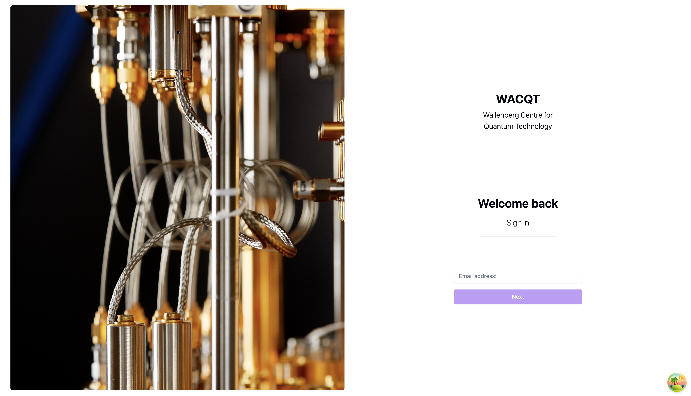
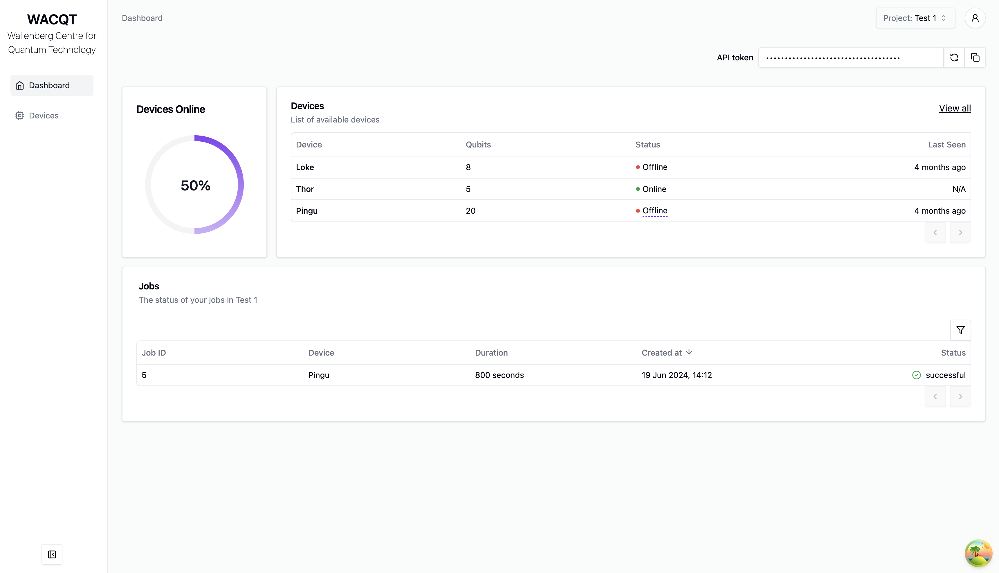
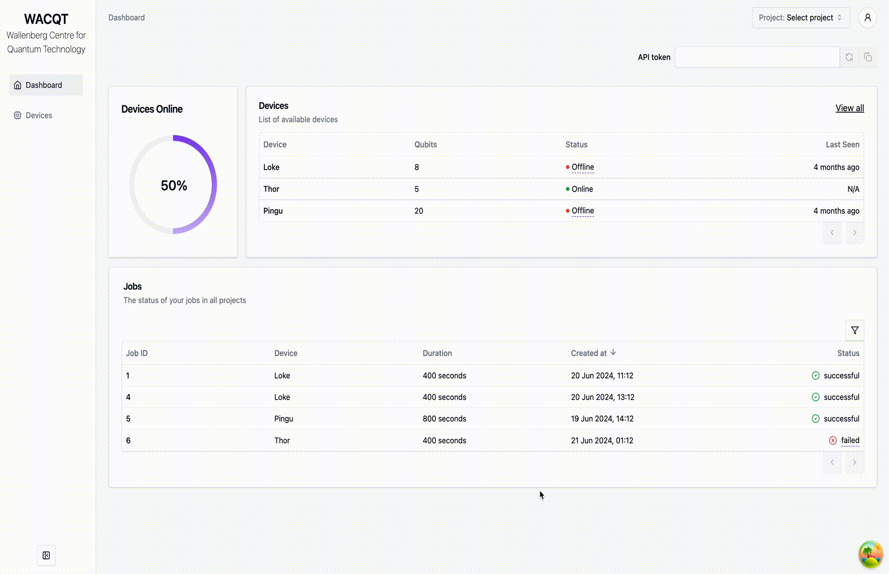

# Tergite Dashboard

The dashboard in the [Tergite software stack](https://tergite.github.io/) of the WACQT quantum computer.

**This project is developed by a core group of collaborators.**  
**Chalmers Next Labs AB (CNL) takes on the role of managing and maintaining this project.**

## Version Control

The tergite stack is developed on a separate version control system and mirrored on Github.
If you are reading this on GitHub, then you are looking at a mirror.

## Major Dependencies

- [Nodejs 20](https://nodejs.org/)
- [Vitejs +5.2.0](https://vitejs.dev/)
- [tailwind CSS +3.4.4](https://tailwindcss.com/)
- [Shadcn UI](https://ui.shadcn.com/)
- [React +18.2.0](https://react.dev/)
- [React router +6.23.1](https://reactrouter.com/)
- [Visx](https://airbnb.io/visx/)

## Quick Start


The login screen


The home screen


A preview of the the dashboard

- Ensure you have [Nodejs +20.12](https://nodejs.org/) installed.
- Clone the repo and enter its root folder

```shell
git clone git@github.com:tergite/tergite-frontend.git
cd apps/tergite-mss/ui
```

- Install the dependencies

```shell
npm i
```

- Run the app in development mode, against MSS: this seeds the database of MSS's config
  (`../mss-config.toml`, or the file `MSS_CONFIG_FILE` names) with [fixtures/](./fixtures),
  clearing those tables, serves MSS on 8002 and runs vite against it

```shell
npm run dev
```

- Open your browser at [http://127.0.0.1:5173/ui/](http://127.0.0.1:5173/ui/)

## Contribution Guidelines

If you would like to contribute to tergite-dashboard, please have a look at our
[contribution guidelines](./CONTRIBUTING.md)

## Authors

This project is a work of
[many contributors](https://github.com/tergite/tergite-dashboard/graphs/contributors).

Special credit goes to the authors of this project as seen in the [CREDITS](./CREDITS.md) file.

## ChangeLog

To view the changelog for each version, have a look at
the [CHANGELOG.md](./CHANGELOG.md) file.

## License

[Apache 2.0 License](./LICENSE)

## Acknowledgements

This project was sponsored by:

- [Knut and Alice Wallenberg Foundation](https://kaw.wallenberg.org/en) under the [Wallenberg Center for Quantum Technology (WACQT)](https://www.chalmers.se/en/centres/wacqt/) project at [Chalmers University of Technology](https://www.chalmers.se)
- [Nordic e-Infrastructure Collaboration (NeIC)](https://neic.no) and [NordForsk](https://www.nordforsk.org/sv) under the [NordIQuEst](https://neic.no/nordiquest/) project
- [European Union's Horizon Europe](https://research-and-innovation.ec.europa.eu/funding/funding-opportunities/funding-programmes-and-open-calls/horizon-europe_en) under the [OpenSuperQ](https://cordis.europa.eu/project/id/820363) project
- [European Union's Horizon Europe](https://research-and-innovation.ec.europa.eu/funding/funding-opportunities/funding-programmes-and-open-calls/horizon-europe_en) under the [OpenSuperQPlus](https://opensuperqplus.eu/) project
