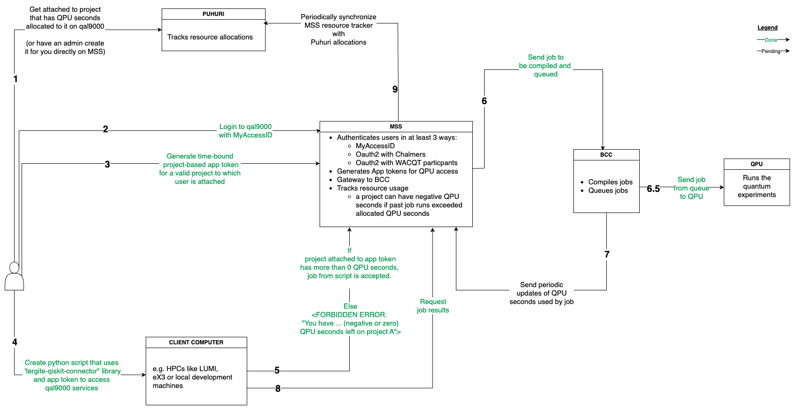

# Authentication and Authorization

This is how MSS authenticates its users and controls their access to the quantum computer resource.

## Authentication

- It uses [Oauth2](https://oauth.net/2/), a standard similar to HTTP in the sense that for any system,
  also called an **Oauth2 client**, to allow its users to authenticate with another system,
  called an **Oauth2 provider**, all that is needed are two strings:
  - `CLIENT_ID`
  - `CLIENT_SECRET`
- The two strings are unique to this system, but are given by the Oauth2 provider
- Common Oauth2 providers include Google, Github, Microsoft, Chalmers (which uses Microsoft)
- Organizations which have a sort of ActiveDirectory can automatically be Oauth2 providers.
- We also use [OpenID Connect](https://openid.net/developers/how-connect-works/) which is a flavour of Oauth2 that requires a third string, a  
  `OPENID_CONFIGURATION_ENDPOINT`, from where to get the configuration of the openID provider.

### How to Set Up a New Oauth2 Provider

- Let's say we want some 'Company B' users to have access to MSS.
- Copy the `mss-config.example.toml` to `mss-config.toml`, and update the configs therein.  
  Note: You could also create a new toml file based on `mss-config.example.toml`  
  and set the `MSS_CONFIG_FILE` environment variable to point to that file.
- Add the new client:

```toml
[[auth.clients]]
# this name will appear in the URLs e.g. http://127.0.0.1:8002/auth/company-b/...
name = "company-b"
client_id = "some-openid-client-id"
client_secret = "some-openid-client-secret"
# the URL to redirect to after user authenticates with the system.
# It is of the format {MSS_BASE_URL}/auth/{provider_name}/callback
redirect_url = "http://127.0.0.1:8002/auth/company-b/callback"
client_type = "openid"
email_regex = ".*"
# Roles that are automatically given to users who authenticate through Company B
# roles can be: "admin", "user", "researcher", "partner". Default is "user".
roles = ["partner", "user"]
# openid_configuration_endpoint is necessary if Company B uses OpenID Connect, otherwise ignore.
openid_configuration_endpoint = "https://example.com/.well-known/openid-configuration"
```

- Start the frontend.
  Instructions are on the [tergite-frontend/README.md](../README.md)

## Authorization

- We control access to MSS, and its BCCs using two ways
  - `roles` control basic access to auth-related endpoints e.g. project creation, token management etc.
  - `projects` control access to all other endpoints. To create a job, or get its results etc,
    one must be attached to a project that has more than zero QPU seconds.
- QPU seconds are the number of seconds a project's experiments are allocated on the quantum computer.
- QPU seconds can be increased, decreased etc., but no job can be created without positive QPU seconds.
- A job could run for longer than the allocated project QPU seconds but
  it may fail to update MSS of its results. A user must thus make sure their project has enough QPU seconds.

### How Authorization Works

Here is an interaction diagram of QAL9000 auth showcasing authentication via [MyAccessID](https://ds.myaccessid.org/).



**The raw editable drawio diagram can be found [in the assets folder](./assets/qal9000-auth.drawio)**

### FAQs

#### - How do we bypass authentication in development?

~~We use feature flag `auth.is_enabled` property in the `mss-config.toml` file, setting it to `false`~~

We no longer support disabling authentication.

#### - How do we allow other Tergite components (e.g. tergite backend) to access MSS, without user intervention?

With key pairs, not app tokens: MSS and each backend (BCC) sign what they send each other with
their private keys, and check what they receive against the other's public key, as
[DESIGN.md §3.2](../DESIGN.md#32-job-submission--the-one-flow-that-crosses-everything) details.

- MSS signs every request it sends a backend with its private key, `PRIVATE_KEY_FILE`; the
  backend checks it against its copy of MSS's public key, `BCC_MSS_PUBLIC_KEY_PATH`.
- A backend signs its websocket handshake to MSS with its own private key,
  `BCC_PRIVATE_KEY_FILE`; MSS checks it against that backend's `public_key_path` in its
  `[[backends]]` entry of `mss-config.toml`, whose `name` must be the backend's
  `BCC_DEFAULT_PREFIX`, and, unless `is_strict_ip = false`, that it comes from the host of the
  entry's `url`.

The backend keeps no token of MSS's, so nothing expires: replacing either side's key pair
means giving the other side its new public key.

#### - How do I log in?

- Open the dashboard, which MSS serves at `/ui`, e.g. http://127.0.0.1:8002/ui; it builds into
  `ui/dist` for MSS to serve, as the [README](../README.md) describes.
- **Make sure that your `mss-config.toml` file has all variables filled appropriately**.
- The dashboard redirects you to the login page if you are not already logged in.
- However, you can also log in without running the dashboard first. See the next FAQ.

#### - How do I log in without having to run the dashboard?

- **Make sure that your `mss-config.toml` file has all variables filled appropriately**.
  The `mss-config.example.toml` is a good template to copy from, but it must all placeholder (`<some-stuff>`) must be replaced in the actual `mss-config.toml` file.
- Run the application

```shell
./start_mss.sh
```

- Visit the http://127.0.0.1:8002/auth/github/authorize endpoint in your browser.
- Copy the “authorization_url” from the response and paste it in another tab in your browser. Follow any prompts the browser gives you.
- After you are redirected back to http://127.0.0.1:8002/auth/github/callback, you should see an “access_token”. Copy it to your clipboard.  
  If you run into any errors, ensure that the `client_id` and `client_secret` for the `client` table with `name = tergite` in your `mss-config.toml` file are appropriately set.
- You can then try to create an app token or anything auth related using `curl` or [postman](https://www.postman.com/).  
  To authenticate those requests, you must always pass an "Authorization" header of format `Bearer <access_token>`.  
  **Do note that this auth token can only be used on `/auth...` endpoints. It will return 401/403 errors on all other endpoints**.
- Do note also that some endpoints are only accessible to users that have a given role e.g. 'admin' or 'system' etc.

#### - Why do I keep being redirected back to the login page even after successful login?

The likely cause is the `cookie_domain` variable in the `[auth]` of `mss-config.toml`. It needs to be the same as the domain you visit the dashboard on in the web browser.

**A big culprit is localhost vs 127.0.0.1: if `cookie_domain` is 127.0.0.1, open the dashboard at http://127.0.0.1:8002/ui, not at localhost.**

#### - How does BCC (backend) get authenticated?

- A client (say [tergite](https://github.com/tergite/tergite)) sends a `POST`
  request is sent to `/jobs` on MSS (this app) with an `app_token` in its `Authorization` header
- A new job entry is created in the database, together with a new unique `job_id`.
- MSS then requests BCC for a user token via a POST to `/token`, passing it the `user_id` and the `job_id`, plus some headers signed by MSS's private key
- BCC verifies that the headers are indeed signed by MSS's private key since BCC has a copy of MSS's public RSA key.
- BCC creates a token for the user and if the user does not exist yet, a new one with a random password and email is created
- BCC encrypts that token with MSS's public key so that only MSS can read it, and then sends it back to the requester.
- MSS decrypts the token, and alongside the `upload_url` (which is the `/jobs` url for the given BCC backend), sends it to the client application.
- The client application then posts the job for the given job_id to the backend with the given token in the `Authorization` header.
- Currently, we have not limited this token to be used only once so technically a user could send different experiments
  but with the same job_id. However, the token itself has a short time span to reduce the extent of this.
  In future, we might limit each token to only one request.
- A similar flow is used to download raw logfiles from BCC at `/logfiles/{job_id}` endpoint.
- For all other BCC endpoints, they must be accessed via MSS on behalf of the user.
