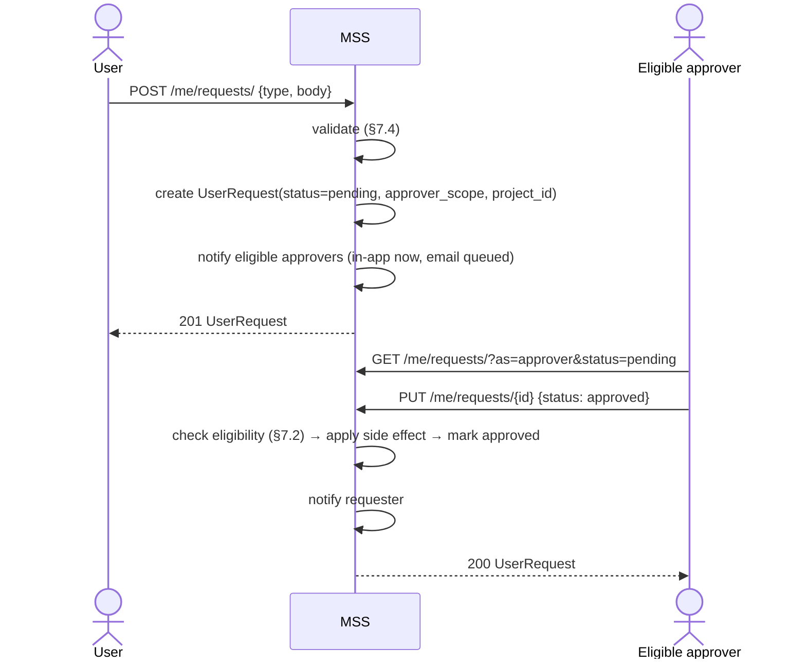

# RFC 0001 — Project access requests and notifications

| | |
| --- | --- |
| **Status** | Draft |
| **Scope** | `apps/tergite-mss`, `apps/tergite-dashboard`, `mss-config.toml` |
| **Created** | 2026-08-18 |

## 1. Summary

Three changes that together replace "email someone and wait" with an in-product path from "I just
logged in" to "my job is running". Not a self-service path — QPU time is still granted by an
operator (§7.2) — but every step is visible, actionable and reported inside the product:

1. **Every user gets a personal project automatically**, on first login, with a configurable
   QPU-second allowance that may be `0`. Nobody asks for it and nobody approves it.
2. **A user can request access to a shared project** by typing its ID. Routed to that project's
   admin, who approves or rejects.
3. **A notification subsystem** (in-app + email) reports the outcome of those requests, of
   QPU-second requests, and of QPU exhaustion.

The only *new* request type is project access. Getting QPU seconds onto a personal project reuses
the request machinery that already exists — the user asks, a system admin grants — which is what
makes an allowance of `0` a workable default rather than a dead end.

## 2. Motivation

Two gaps, both of which currently route through email.

**A new user has nothing.** No project means no app token, no job, and no in-product way to ask
for one. Project membership can only be changed by a superuser through
`PUT /admin/projects/{id}`. Auto-created personal projects close this: after first login the user
has somewhere to put a token, and — depending on the deployment's allowance — either something to
spend or a one-click path to asking for it.

**Project admins are powerless.** The people who actually know whether a requester belongs on a
project cannot act at all: `PUT /admin/user-requests/{_id}` is `CurrentSuperuserDep`, so every
membership decision escalates to a superuser who has to ask the project admin anyway.

## 3. Requirements

**Personal projects**

1. Every user has exactly one personal project, created automatically on first login — never
   requested, never approved. Creation is lazy: a user who never logs in never gets one, and needs
   none (§5.5).
2. Its QPU-second allowance is configurable and **defaults to `0`**, so an unconfigured deployment
   keeps behaving exactly as it does today. `0` is also the right setting for any deployment that
   does not extend trust to everyone who can authenticate.
3. A user with `0` (or exhausted) seconds **requests** more through the **existing** QPU-seconds
   request machinery, and a system admin approves or rejects it. No new mechanism, and no
   self-service — see §7.2.
4. Personal project identity derives from the user's **ID**, not their email — `personal-{user_id}`.
   This makes uniqueness intrinsic and keeps personal data out of token records, query strings and
   logs (§7.3).
5. A user cannot delete their own personal project, since it would be recreated with a fresh
   allowance; a superuser can, for offboarding and erasure (§5.4).

**Shared project access**

6. A user can request access to a shared project by ID; a non-existent ID produces an inline
   "does not exist" error in the form.
7. Project-access requests go to the project's admin (`Project.admin_id`); superusers may also
   act on them.
8. The request entry point sits on the projects page, where a user already manages their
   memberships — not in the top banner (§8.3).
9. QPU-second allocation stays a system-admin power, exactly as today. This RFC gives project
   admins membership decisions only (§7.2).

**Notifications**

10. The requester is notified of the approve/reject decision, for project-access **and** for
    QPU-seconds requests.
11. Notification types are distinct and visually distinguishable; actionable ones are separated
    from informational ones.
12. Email delivery in addition to in-app, configured by SMTP settings. **No SMTP configured →
    in-app only, no errors.**
13. Users can opt out of some notification types.
14. Notifications when a project's QPU seconds are low or exhausted.

## 4. Non-goals

- No **shared** project creation requests. The `create-project` `UserRequestType` is reserved
  for exactly that and is left in place for RFC 0002 — §4.1.
- No autocomplete, search, or project browser for shared projects. Deliberate: project
  membership is not public.
- No invitation flow (admin invites user). Only the pull direction.
- No push/webhook/Slack channels. In-app and email only.
- No request type for personal projects. That is the whole point of §5.5 — the thing a user
  would have requested is simply there.

### 4.1 The existing `create-project` request type stays, for RFC 0002

At first glance this RFC looks like it duplicates something that already exists. It does not —
`create-project` is declared but nothing is wired up:

| | State today |
| --- | --- |
| Enum member | `UserRequestType.CREATE_PROJECT` exists in `services/auth/user_requests/dtos.py`. |
| Producer | **None.** `user_requests.create()` is generic, but its only caller is `create_qpu_time_request()`, which hardcodes `PROJECT_QPU_SECONDS`. The only creation route is `POST /admin/qpu-time-requests/`. |
| Approval side effect | **None.** `user_requests.update()` branches only on `PROJECT_QPU_SECONDS` and carries a `# TODO: deal with other request types`. A `create-project` request would flip to `approved` and silently create nothing. |
| Dashboard | `types.ts` declares `CreateProjectPostBody` / `CreateProjectUserRequest`, and `getUserRequestTitle` renders a title for the type. No UI produces one. `CreateProjectForm` under `admin-projects/` is unrelated — it is the superuser's *direct* creation form posting to `POST /admin/projects/`, which creates the project immediately with no request and no approval. |
| Test data | One padding row each in `apps/tergite-mss/tests/fixtures/user_requests.json` and `apps/tergite-dashboard/cypress/fixtures/user-requests.json`. |

So the flow was sketched — the comment in `types.ts` states the intent explicitly — and never
built.

**It is not superseded by this RFC and must not be deleted.** The three things are distinct:

| Need | Mechanism | Where |
| --- | --- | --- |
| A starter project to experiment in | auto-created on first login, payload fixed by policy | this RFC |
| Join a shared project that already exists | `project-access` request → project admin | this RFC |
| Bring a **new shared** project into being, with a chosen name, `ext_id`, members and allowance | `create-project` request → system admin | **RFC 0002** |

Nothing here covers the third. A research group forming around a new grant needs a shared project
that does not exist yet, and today that means emailing a superuser — the same gap in §2, one level
up. `create-project` is the right type for it and it keeps its name.

**Deferred rather than folded in**, because it is a genuinely separate design problem: naming and
`ext_id` collision rules, who the initial members are and how they are named, what allowance a
requester may ask for versus what an admin grants, and whether an approver may amend the payload
before approving. Answering those inside this RFC would double its size and delay the parts that
unblock a brand-new user. RFC 0002 (§14) picks it up, and by then the machinery it needs —
`approver_scope`, `/me/requests/`, the notification types, the approvals UI — already exists, so
it should be a small RFC that adds one type to an existing frame.

**Until then, `create-project` stays exactly as it is:** declared, unreachable, and harmless. The
one thing worth doing now is a comment on the enum member pointing at RFC 0002, so the next reader
knows it is reserved rather than forgotten.

**A note for whoever implements RFC 0002: do not delete or rename `CreateProjectPostBody` on the
assumption that it is dead.** Despite its name it is load-bearing — `Project` is
`Omit<CreateProjectPostBody, "user_emails">`, `UpdateProjectPutBody` is
`Partial<Omit<CreateProjectPostBody, "ext_id">>`, and `AdminCreateProjectBody` extends it.
Removing it breaks the `Project` type across the whole dashboard.

## 5. Domain model changes (MSS)

### 5.1 `UserRequest` (`services/auth/user_requests/dtos.py`)

One new type and two new fields. `create-project` is untouched (§4.1):

```python
class UserRequestType(str, enum.Enum):
    CREATE_PROJECT = "create-project"          # reserved for RFC 0002; still unwired
    CLOSE_PROJECT = "close-project"
    TRANSFER_PROJECT = "transfer-project"
    PROJECT_QPU_SECONDS = "project-qpu-seconds"
    PROJECT_ACCESS = "project-access"          # new


class ApproverScope(str, enum.Enum):
    """Who is entitled to react to a request"""
    SYSTEM_ADMIN = "system-admin"
    PROJECT_ADMIN = "project-admin"
```

Added to `UserRequest`:

| Field | Type | Why |
| --- | --- | --- |
| `approver_scope` | `ApproverScope = SYSTEM_ADMIN` | Decides the eligibility rule. Defaulting to `SYSTEM_ADMIN` keeps every existing document behaving exactly as it does today — no data migration on this collection. |
| `project_id` | `Optional[str] = None` | Promoted out of `request` to a top-level indexed field so "requests for the projects I administer" is one query. `request.project_id` stays populated for back-compat with the current QPU-time flow. |

One new request body:

```python
class ProjectAccessPostBody(BaseModel):
    project_ext_id: str
    reason: str
```

New indexes on `auth_user_requests`:

- `IndexModel([("project_id", 1), ("status", 1)], sparse=True)` — the project-admin inbox query.
- `IndexModel([("requester_id", 1), ("created_at", -1)])` — "my requests".

Note what is *no longer* needed: the earlier draft carried a unique partial index to enforce "one
personal project ever". Auto-creation makes the rule structural rather than enforced — there is no
request to duplicate, and §5.5 is idempotent.

### 5.2 `Project` (`services/auth/projects/dtos.py`)

| Field | Type | Why |
| --- | --- | --- |
| `is_personal` | `bool = False` | Personal projects are excluded from project-access lookups (§7.4), cannot be deleted by their owner though a superuser may (§5.4), and are shown differently in the UI. Kept separate from `source`, which means *where the allocation came from* (`puhuri` / `internal`) and is orthogonal. |
| `low_qpu_notified_at` | `Optional[str] = None` | Edge-trigger latch so the "QPU seconds low" notification fires once per depletion cycle instead of once per job (§9). |

### 5.3 `UserRead`

Unchanged. The earlier draft added a `personal_project_status` field so the UI could grey out the
"request a personal project" option; with no such option there is nothing to gate.

### 5.4 Who may delete a personal project

A user may **not** delete their own. A superuser **may**.

The asymmetry is the whole rule, and it has one reason: `DELETE /me/projects/{_id}` is open to
the project's admin, and the admin of a personal project is its owner. Since
`ensure_personal_project` recreates one on next login with `projects.personal_qpu_seconds`,
self-deletion is an allowance farm wherever that figure is non-zero — delete, log in, collect,
repeat.

Nothing about that argues for disarming operators, and an earlier draft of this RFC did exactly
that, making personal projects permanent against everyone including superusers. That was wrong.
An operator offboarding someone who has left, or honouring an erasure request over a project
carrying the person's email in `user_emails`, `admin_email` and its name, would have had no
route but editing MongoDB by hand. "Go to the database" is not an answer, and for an EU-funded
stack the erasure case is not optional.

- `DELETE /me/projects/{_id}` refuses when `project.is_personal`, with "you cannot delete your
  own personal project".
- `DELETE /admin/projects/{id}` allows it, as for any other project.
- The rule cannot live in `ProjectAppTokenManager.on_before_delete`, which cannot see who is
  deleting. It belongs at the user-facing route.
- The dashboard mirrors this: no Delete on `pages/projects/` for a personal project, Delete
  present on `admin-projects/`.

Deleting one is less destructive than it first appears: the next login recreates it. What it
resets is the balance, which is exactly why the owner must not be able to trigger it.

**On the allocation anchor.** An earlier draft justified permanence by wanting every user to
reliably have exactly one personal project, so population-wide operations such as gifting QPU
seconds (§7.6) could rely on it. Auto-creation on login provides that on its own, regardless of
deletion history — a deleted project comes back, and a grant campaign covers returning users by
raising `personal_qpu_seconds` anyway. The anchor never needed permanence.

Personal projects can also still be deactivated (`is_active = false`) by a superuser, blocking
token use without removing the record. For a troublesome *user*, the sharper lever is
`User.is_active`: an inactive user cannot authenticate at all, which makes the state of their
personal project moot.

There is no user-deletion endpoint today — `get_users_router` is never mounted — so removing a
user remains a database operation. That predates this RFC and is unchanged by it, but it is
worth a follow-up: with personal projects now deletable by a superuser, a user-deletion route
could cascade cleanly.

### 5.5 Auto-creation, and the existing users

`ensure_personal_project(user)` is idempotent: it looks for a personal project owned by the user
and creates one only if absent. It is called from **`UserManager.on_after_login`**.

Why that hook, verified against fastapi-users 14.0.1:

- `router/oauth.py:151` calls `on_after_login` on **every** OAuth callback — new and returning
  users alike. OAuth is the only login path, so this catches everyone who actually uses the
  system.
- `on_after_register` alone would not be enough. `_get_user_email_id_map` in
  `services/auth/projects/routers.py` creates stub users with `User.insert_many` when an admin
  lists unknown emails on a project, bypassing the manager entirely — so those users never fire the
  register hook. They do fire the login hook when they first sign in.
- Logins are rare, so one extra indexed lookup on each is not a cost worth optimising. Keeping the
  write out of `GET /me` matters more.

**No migration, and no backfill.** Creation is lazy on purpose. A user row that never logs in
belongs to someone who needs no project and no QPU seconds, and provisioning for them buys nothing:

- Their personal project would hold an allowance nobody can spend, and `auth_projects` would carry
  a row per never-seen invitee — including every stub user an admin ever conjured by typing an
  email into the members field.
- The population-wide operations that motivate §5.4 do not need it. Reporting on a user who
  consumed nothing loses nothing by their absence. A grant campaign needs to raise
  `personal_qpu_seconds` anyway (§5.4), and once it does, a dormant user who returns gets the
  campaign figure through ordinary creation — the same path as a brand-new user, with no special
  case. A backfill would in fact cover *less*: it reaches dormant users but not users who register
  after the campaign.

So existing users need nothing done to them. Each one converges the next time they log in, which is
also the first moment the project could possibly matter to them.

**Concurrency, not coverage, is where "exactly one" could break** — two logins racing, two tabs
finishing OAuth, a double-submitted callback. Both could find no personal project and both try to
create one. Because `ext_id` is derived from the user's ID (§7.3) and `Project.ext_id` already
carries a unique index, the second insert fails on a duplicate key; `ensure_personal_project`
catches it and re-reads, which is the standard idempotent-create shape. **No additional index is
needed** — deriving the identity from the user is what makes the existing constraint do this work.

### 5.6 `QpuSecondsGrant` — the record of a bulk grant

A superuser granting QPU seconds to many personal projects at once (§7.6) writes one document per
operation, not per recipient:

```python
QPU_SECONDS_GRANT_DB_COLLECTION = "qpu_seconds_grants"

class GrantTarget(str, enum.Enum):
    EMAILS = "emails"                  # an explicit list
    ALL_PERSONAL_PROJECTS = "all-personal-projects"      # every existing personal project


class QpuSecondsGrant(Document):
    seconds: float
    target: GrantTarget
    target_emails: Optional[List[str]] = None
    reason: str
    granted_by: PydanticObjectId
    idempotency_key: str
    granted_project_ids: List[str] = []
    skipped: List[SkippedTarget] = []   # {email, why}
    created_at: Optional[str] = Field(default_factory=get_current_timestamp)

    class Settings:
        name = QPU_SECONDS_GRANT_DB_COLLECTION
        indexes = [
            IndexModel("idempotency_key", unique=True),
            IndexModel([("created_at", -1)]),
        ]
```

Two reasons this is a record rather than a fire-and-forget loop:

1. **`$inc` is not idempotent, and this is exactly where a double-submit happens.** Granting to
   several hundred projects is a slow request; a client retry, an impatient second click, or a proxy
   replay would grant twice. The unique index on `idempotency_key` makes the second attempt a no-op
   that returns the first result.
2. **Audit.** "Why does this user have 5 000 seconds?" is answerable, and a high-impact irreversible
   action involving real machine time should leave a trace naming who did it and why.

## 6. Notifications (MSS)

### 6.1 Why a new service rather than extending `notices`

`notices` is an **operator broadcast** channel: admin-authored, severity-ranked, TTL-expiring,
shared dismissal state, optionally targeted at a list of emails. Notifications are
**system-authored, per-recipient, event-driven, actionable, and per-user opt-out-able**. The
only things they share are "shows up in the bell". Overloading `Notice` would mean making
`created_by`, `starts_at`, `expires_at` and `target_user_ids` all conditional on a type
discriminator.

New service: `services/notifications/` (`dtos.py`, `service.py`, `templates.py`, plus
`on_startup`). `notices` is left untouched.

**In the UI they merge into one bell** with per-type visual treatment (§8.3). Separate storage,
unified presentation — two bells would be worse than the problem being solved.

### 6.2 `Notification` document

```python
NOTIFICATION_DB_COLLECTION = "notifications"

class NotificationType(str, enum.Enum):
    PROJECT_ACCESS_REQUESTED = "project-access-requested"      # → project admin, actionable
    PROJECT_ACCESS_APPROVED = "project-access-approved"        # → requester
    PROJECT_ACCESS_REJECTED = "project-access-rejected"        # → requester
    QPU_SECONDS_REQUESTED = "qpu-seconds-requested"            # → eligible approver, actionable
    QPU_SECONDS_GRANTED = "qpu-seconds-granted"                # → requester
    QPU_SECONDS_DENIED = "qpu-seconds-denied"                  # → requester
    PROJECT_MEMBERSHIP_REVOKED = "project-membership-revoked"  # → removed member (§7.5)
    QPU_SECONDS_LOW = "qpu-seconds-low"                        # → project admin
    QPU_SECONDS_DEPLETED = "qpu-seconds-depleted"              # → project admin + members


class NotificationAction(BaseModel):
    """What the recipient can do about it, rendered as buttons in the UI"""
    kind: Literal["user-request"]
    request_id: str


class EmailStatus(str, enum.Enum):
    NOT_APPLICABLE = "not-applicable"   # email channel off for this type/user
    PENDING = "pending"
    SENT = "sent"
    FAILED = "failed"


class Notification(Document):
    user_id: PydanticObjectId           # exactly one recipient; fan-out = one doc per user
    type: NotificationType
    title: str
    body: str
    severity: NoticeSeverity            # reuse info | warning | critical
    action: Optional[NotificationAction] = None
    context: Dict[str, Any] = {}        # project_ext_id, requester_name, … for deep links
    read_at: Optional[str] = None
    email_status: EmailStatus = EmailStatus.NOT_APPLICABLE
    email_attempts: int = 0
    created_at / updated_at
```

Indexes: `(user_id, created_at desc)`, `(user_id, read_at)` sparse,
`(email_status, updated_at)` sparse for the outbox sweep, and a TTL index on a
`Notification.expires_at` set to `created_at + notifications.retention_days` so the collection
stays bounded.

### 6.3 Preferences and opt-out

Each `NotificationType` carries static metadata in `templates.py`:

```python
CHANNEL_POLICY: Dict[NotificationType, ChannelPolicy] = {...}
# ChannelPolicy(in_app_mandatory: bool, email_default: bool)
```

- **In-app is mandatory** for: anything awaiting your action, and any decision on your own
  request. Silencing those makes the product lie to the user.
- **Email is opt-out for every type.** Purely informational in-app types
  (`QPU_SECONDS_LOW`, `QPU_SECONDS_DEPLETED`) are also in-app-mutable.

Preferences live in their own collection, `notification_preferences`, owned by the
notifications service — not as a field on `User`. Keeping them out of the auth service avoids
the notifications service writing to the auth service's document, and avoids a schema change
on the hottest document in the system. One doc per user, `{user_id, prefs: {type: {in_app, email}}}`,
absent doc = all defaults.

### 6.4 Email delivery — transactional outbox

Sending SMTP inline in the request that triggers it is wrong: it makes an approve click as
slow as the mail server and fails the click when the mail server is down.

Instead, **the notification row is the outbox**:

1. The notification is created with `email_status = PENDING` (or `NOT_APPLICABLE` when the
   channel is off / no SMTP configured). This is the only write on the request path.
2. A single `asyncio` task started in the app lifespan polls every
   `notifications.email_sweep_interval` seconds for `email_status = PENDING`, renders and
   sends, then sets `SENT` or increments `email_attempts`, flipping to `FAILED` past
   `notifications.email_retry_limit`.
3. `FAILED` is visible to admins and never blocks anything.

Survives a restart, needs no queue infrastructure, and gives the delivery state a place to
live. `email_status` also gives us the "did they get the mail" answer during support.

The SMTP client goes in `services/external/email/` — outbound third-party clients belong under
`services/external/`, alongside `bcc`. New dependency: `aiosmtplib`. Templates are plain
Python format strings held as module-level constants; six to eight messages do not justify
pulling in a template engine. Bodies are plaintext only — the HTML wrapper this section
originally called for buys nothing for messages this short, and plaintext renders everywhere.

The sweeper does not claim a row before sending, so two MSS processes against one database
would send some notifications twice. One process per deployment is the assumption, which is
what `start_mss.sh` runs.

Emails carry a deep link built from `notifications.dashboard_url`, which MSS does not
currently know about. Without it, emails are far less useful, so treat it as required whenever
`[email]` is configured.

## 7. Flows

### 7.1 Requesting and approving

Two request types flow through one path: `project-access` (new) and `project-qpu-seconds`
(existing, now carrying the notification UX).



Approval side effects, applied **before** the request is marked decided so a failure leaves a
retryable pending request rather than an approved request with nothing done:

| Type | Effect | Scope |
| --- | --- | --- |
| `project-access` | `$addToSet` the requester into `Project.user_ids`, and into `user_emails` when that field is populated. Idempotent by construction. | `PROJECT_ADMIN` |
| `project-qpu-seconds` | `$inc` the project's `qpu_seconds` and clear `low_qpu_notified_at` (§9). Already implemented. | `SYSTEM_ADMIN` — unchanged from today |

This extends the existing `user_requests.update()` switch, which already handles
`PROJECT_QPU_SECONDS` this way.

Personal projects appear nowhere in this section. They are not requested — §5.5 creates them.

### 7.2 Eligibility

Resolved at reaction time from current state, not denormalised at creation time — a project
whose admin changed between request and decision must route to the *new* admin.

Scope is a property of the request type, assigned at creation:

| Type | `approver_scope` | Rationale |
| --- | --- | --- |
| `project-access` | `PROJECT_ADMIN` | The project's admin is the person who knows whether the requester belongs. This is the new capability. |
| `project-qpu-seconds` | `SYSTEM_ADMIN` | **Unchanged from today.** QPU time is a system-level allocation. Project admins *request* it; only system admins grant it. |

That division is deliberate and pre-existing: `POST /admin/qpu-time-requests/` lets a project
member file a request (the dashboard's `QpuTimeDialog` shows the button only to the project admin),
and `PUT /admin/user-requests/{_id}` is `CurrentSuperuserDep`. This RFC does not move QPU-second
allocation to project admins — it only gives them membership decisions.

```
is_eligible(user, request):
    if user.is_superuser:                       return True
    if request.approver_scope == SYSTEM_ADMIN:   return False
    if str(user.id) == request.requester_id:     return False   # defence in depth
    project = get(request.project_id)
    return project is not None and project.admin_id == str(user.id)
```

Because QPU-second requests are `SYSTEM_ADMIN`, a user who administers their own personal project
gains no ability to grant themselves time — they can ask, and only an operator can grant. That is
what makes a `personal_qpu_seconds` of `0` a coherent policy rather than a self-service loophole,
and it needs no special-casing: the existing scope is already right.

The self-exclusion line is **defence in depth, not load-bearing.** Nothing currently reaches it: a
`project-access` requester cannot be the project's admin, because an admin is already in `user_ids`
and §7.4 rejects "already a member" before the request is created. It is there so that a future
`PROJECT_ADMIN`-scoped type cannot accidentally become self-approvable. It sits *below* the
superuser check on purpose — a superuser can already set any project's `qpu_seconds` directly
through `PUT /admin/projects/{id}`, so refusing them here would be theatre.

Not eligible → `ForbiddenError` → 403 through the existing central handler. The project-admin
inbox query is the same rule read forwards: fetch the projects where `admin_id == me`, then
requests whose `project_id` is in that set — the shape `myProjectsQpuTimeRequestsQuery` in the
dashboard already uses.

**Project deleted while a request is pending**: the request is auto-rejected lazily on next
read or reaction, with `rejection_reason = "project no longer exists"`. No new status value —
`UserRequestStatus` stays `pending | approved | rejected`, so `ProgressStatus` in the dashboard
needs no change.

### 7.3 Personal project identity

Derived from the user's ID, not their email:

```python
ext_id = f"personal-{user.id}"      # e.g. "personal-507f1f77bcf86cd799439011"
name   = "Personal project"
```

This is deliberately boring, and it buys four things:

1. **Uniqueness is intrinsic.** `Project.ext_id` already carries a unique index, and the id is 1:1
   with the user, so "exactly one personal project per user" is enforced by a constraint that
   already exists. The concurrent-double-login race of §5.5 closes for free: the second insert
   fails on duplicate `ext_id`. No extra partial index is needed.
2. **No personal data spreads.** An email-derived `ext_id` would end up in more places than is
   obvious: a column in the user's projects table, the projects sidebar, every app token's
   `project_ext_id` **and** its generated title (`top-banner.tsx` builds
   `` `${projectExtId}-${timestamp}` ``, persisted in `auth_app_tokens`), and every
   `?project_ext_id=` query string — so also access logs, Loki, and browser history. A user ID
   carries none of that.
3. **Nothing to guess.** `personal-{objectid}` cannot be derived from knowing someone's email
   address, which removes the enumeration concern an email-derived id created (§11).
4. **No generation algorithm.** No slug regex, no random suffix, no collision-retry loop.

The `personal-` prefix rather than a bare `str(user.id)` is worth the extra nine characters: it is
self-describing in logs and in the UI, and it cannot be mistaken for a project `_id` by a reader or
by code.

`name` is a constant rather than `"{slug} (personal)"` for the same data-minimisation reason —
otherwise the email local part is merely moved one field sideways. `Project.name` has no unique
index, so every personal project sharing a name is fine, and a system admin still sees whose it is:
`ProjectAdminView` fills `admin_email` via `_get_full_admin_project`.

**Cost, stated plainly:** where `ext_id` is *displayed* it is now opaque — the projects table
column, the sidebar detail row, the tokens table. That is acceptable because nobody has to type
their own personal project's id (only shared-project ids get typed, §8.3) and `name` remains
readable. The one place worth a small fix is the generated app-token title, which becomes
`personal-507f…-1699…`; switching that template to use the project **name** would read better and
is an improvement independent of this RFC.

### 7.4 Validation and its error responses

| Condition | Response |
| --- | --- |
| No project with that `ext_id`, **or** the project is personal | 404 `{"detail": "no project with ID '<ext_id>'"}` |
| Requester already a member | 400 `{"detail": "you are already a member of '<ext_id>'"}` |
| A pending request already exists for that project | 409 `{"detail": "a request for '<ext_id>' is already pending"}` |
| More than `projects.max_pending_requests_per_user` (default 5) pending | 429 |
| More than `projects.max_failed_lookups_per_hour` (default 20) failed project lookups in the last hour | 429, **checked before the lookup** |

Personal projects returning the *same* 404 as a non-existent project is deliberate, though it is
now a second line of defence rather than the first: since `ext_id` is `personal-{user_id}` (§7.3),
a prober has nothing to construct a guess from in the first place.

Project access is the only path that takes a project identifier from the user — QPU-seconds
requests reference a project the requester is already a member of, and personal projects are never
named by anyone. The whole probing surface is therefore one field on one endpoint, which is what
makes a single per-user counter sufficient (§11).

### 7.5 Member removal

A project admin who can let people in must be able to let them out, or the only correction for a
mistaken approval is emailing a superuser. This is **not** a request flow — the admin is
authorised, so they act directly and no approval is involved.

`DELETE /me/projects/{project_id}/members/{user_id}` — project admin of that project, or a
superuser.

- Implemented by routing through `ProjectAppTokenManager.update` with the member dropped from
  `user_ids` (and from `user_emails` when populated), **not** by a raw `$pull`. The existing
  `on_before_update` hook already deletes app tokens belonging to users no longer in `user_ids`
  for that project, so going through the manager revokes the removed member's tokens for free.
  A raw `$pull` would leave them with working tokens.
- Removing the project's own admin is refused (400) — it would orphan the project. Changing the
  admin stays a superuser operation via `PUT /admin/projects/{id}`.
- Emits `PROJECT_MEMBERSHIP_REVOKED` to the removed user. Being silently locked out is the kind
  of thing that generates a support ticket; being told is cheap.
- Idempotent: removing a non-member is a no-op 204.

### 7.6 Bulk QPU-second grants

The §5.4 anchor rationale in practice: a new QPU comes online, or a term starts, and an operator
wants to put seconds on many personal projects at once. Two targeting modes, both superuser-only:

- **By email** — an explicit list of users.
- **All existing personal projects** — the population-wide grant.

```
for each resolved personal project:
    increment_qpu_seconds(project_id, seconds)   # also clears low_qpu_notified_at (§9)
    emit QPU_SECONDS_GRANTED to the owner
```

It must reuse `ProjectDatabase.increment_qpu_seconds` rather than issuing its own `$inc`, so the
`low_qpu_notified_at` latch is cleared and a project that had gone quiet starts warning again.

**Dormant users are skipped, not provisioned.** A user who has never logged in has no personal
project (§5.5), so there is nothing to increment. Creating one would reintroduce exactly what §5.5
rejects. They are reported in `skipped` with a reason, and the operator's remedy is the one from
§5.4: raise `projects.personal_qpu_seconds` so users who arrive later start at the new figure. Note
that the "all existing personal projects" wording is literal and deliberate.

**Partial failure is normal, so the response is a report**, not a bare 200:

```json
{
  "seconds": 3600,
  "granted": 412,
  "skipped": [
    {"email": "newcomer@example.com", "why": "no personal project yet — user has never logged in"},
    {"email": "typo@example.com", "why": "no such user"}
  ]
}
```

**Fan-out.** An all-personal-projects grant emits one notification per recipient. In-app that is a single
`insert_many`; email is paced by the outbox sweeper (§6.4) rather than dispatched inline, which is
what keeps a 400-user grant from becoming a 400-message burst inside one request. The notification
reuses `QPU_SECONDS_GRANTED` with `context.reason = "admin-grant"` to distinguish it from
`"request-approved"` — the user-facing meaning is identical ("you have more time"), so a separate
type would be noise.

**Sanity cap.** `projects.max_grant_seconds` bounds a single grant, defaulting to something
generous but finite, so a mistyped figure cannot hand out a decade of machine time. A superuser who
genuinely needs more can run the grant twice, which the idempotency key correctly treats as two
distinct operations.

## 8. API

### 8.1 New endpoints

| Method | Path | Auth | Purpose |
| --- | --- | --- | --- |
| `POST` | `/me/requests/` | JWT | Create a request. Body discriminated by `type`. |
| `GET` | `/me/requests/` | JWT | `?as=requester\|approver&type=&status=&skip=&limit=&sort=` |
| `PUT` | `/me/requests/{id}` | JWT | React. `{status, rejection_reason?}`. 403 unless eligible. |
| `DELETE` | `/me/projects/{project_id}/members/{user_id}` | JWT | Remove a member (§7.5). Project admin or superuser. |
| `POST` | `/admin/qpu-seconds-grants/` | Superuser | Bulk grant to personal projects (§7.6). Requires an `Idempotency-Key` header. |
| `GET` | `/admin/qpu-seconds-grants/` | Superuser | The grant history, newest first. |
| `GET` | `/me/notifications/` | JWT | `?type=&is_read=&skip=&limit=&sort=` |
| `PUT` | `/me/notifications/{id}` | JWT | `{is_read: true}` |
| `PUT` | `/me/notifications/` | JWT | Bulk mark-read (UpdateMany, permitted by the API design doc) |
| `GET` | `/me/notification-preferences/` | JWT | Effective preferences, defaults filled in |
| `PUT` | `/me/notification-preferences/` | JWT | Partial update |
| `GET` | `/counts/notifications` | JWT | `{count}` — mirrors `/counts/notices` |

`/me/requests/` becomes the canonical home for user requests. `/admin/user-requests/` and
`/admin/qpu-time-requests/` stay as the system-admin superset. Note the existing wart that
`/admin/qpu-time-requests/` is *not* superuser-gated despite its prefix; §12 resolves it.

### 8.2 Changed endpoints

- `GET /admin/user-requests/` — must stop being effectively pending-only in the dashboard so
  system admins can review decided requests, not just the queue. The endpoint already accepts
  `status`; the dashboard client is what pins it to `PENDING`.
- `POST /admin/qpu-time-requests/` — stamps `approver_scope = SYSTEM_ADMIN` and `project_id`, and
  emits `QPU_SECONDS_REQUESTED`. No change to who may create or who may approve: the request path
  for a zero-allowance personal project is machinery that already works, and a personal project's
  owner is both its admin and a member, so they can file a request today with no code change at
  all. A system admin still decides.
- `GET /me` — unchanged (§5.3).

### 8.3 Dashboard

Per the co-located hierarchy, each new component lives with the one place that uses it:

```
src/components/layouts/dashboard/components/
├── sidebar.tsx                      # gains the QPU meter at its foot
└── notifications/                   # new — moved out of top-banner.tsx
    ├── index.tsx                    # bell + popover, merges notices and notifications
    └── notification-item.tsx        # per-type icon/colour; inline Approve/Reject when actionable
src/pages/
├── admin-projects/components/
│   └── grant-qpu-seconds-form.tsx   # new — bulk grant card (§7.6)
├── projects/components/
│   └── request-access-dialog.tsx    # new — the meat of this RFC
├── approvals/                       # new — the project-admin inbox
│   ├── index.tsx
│   └── components/
│       ├── approvals-table/{index,columns,filter-form}.tsx
│       └── approvals-sidebar/index.tsx
└── settings/                        # new — notification preferences
    └── index.tsx
```

**The request-access button belongs on `/projects`, not in the top banner.** The earlier draft put
it beside the API-token input because requesting a project was the first thing a new user had to
do. Auto-created personal projects remove that: a new user already has a project, and their
first-run need is QPU time, not membership. Requesting access to someone else's shared project is
now an occasional action, and `pages/projects/` is where a user already sees and manages their
memberships. Global chrome is the wrong altitude for it.

- **Request dialog** — single mode, since there is nothing to choose between. A plain text input
  labelled *Project ID* plus a reason textarea; a 404 becomes an inline field error via
  `setError`, the way `login.tsx` already surfaces `getAuthProviders` failures. Triggered from a
  button in the `/projects` page header, next to the existing table.
- **Project ID, not project name.** `Project.name` is not unique, so a name cannot identify a
  project. `ext_id` is unique and is already what users see in the topbar project selector and in
  token titles.
- **Sidebar QPU meter.** A compact indicator at the foot of `sidebar.tsx` showing the remaining
  QPU seconds on the user's **personal** project. It shows the personal project rather than the
  selected one because that is the number with no other home: every user has exactly one (§5.5), it
  never disappears, and it governs their own individual experiments rather than a balance shared
  with a group. Shared-project balances already have surfaces — the projects page, and the
  QPU-low notifications of §9.
  - Reuses the existing `Progress` primitive against `personal_qpu_seconds` as the full-scale
    value, with the raw remaining seconds as text.
  - The sidebar collapses (`isExpanded`), so it needs a collapsed form — the bar alone, with the
    number in a tooltip.
  - **At zero it points at the request flow, and nothing more.** A user cannot grant themselves
    time, so the affordance is "Request QPU time", opening the **existing** `QpuTimeDialog` against
    their personal project; a system admin then approves or rejects, and the outcome arrives as a
    `QPU_SECONDS_GRANTED` / `_DENIED` notification. Under the default config (§10) this zero state
    is what every user sees on their first login after the upgrade, so it has to read as "ask for
    time here", not as a broken meter.
- **`/approvals`** mirrors `admin-requests/`'s table-plus-sidebar structure rather than reusing
  that page, which is superuser-gated and lists everything. The sidebar reuses the existing
  Approve/Reject buttons from `requests-sidebar.tsx`, pointed at `PUT /me/requests/{id}`. The nav
  item appears when the user administers at least one project — note that under auto-creation
  *every* user administers their own personal project, so gate on administering at least one
  **non-personal** project or the nav item shows for everyone.
- **Bulk grant card on `/admin-projects`.** A sibling to the existing `CreateProjectForm` card,
  which is where project allocation work already lives. Fields: a seconds duration, a reason, and a
  target — a radio choosing *these users* versus *all existing personal projects*.
  - For the email list, reuse the **`MultiInput`** component exactly as `create-project-form.tsx`
    does for `user_emails` (free-text chips plus `z.string().email()` validation). That is the
    established pattern for admin email lists in this codebase, and it needs no user directory.
    True autocomplete would require a `GET /admin/users` endpoint, which does not exist — worth
    considering later, but not a prerequisite. Note this is not in tension with §8.3's refusal to
    autocomplete *projects*: that refusal protects membership privacy from ordinary users, whereas
    a superuser already sees every email through `ProjectAdminView`.
  - The *all personal projects* mode needs a confirmation step naming the number of projects about
    to be affected, since it is irreversible and expensive. `confirm-dialog.tsx` already exists.
  - Render the response report (§7.6) rather than a toast: the skipped list is the useful part, and
    "412 granted, 2 skipped" with reasons is what tells an operator whether to act again.
- **`admin-requests/`** — `getUserRequestTitle` in `lib/utils.ts` gains a `project-access` case;
  the table gains type and status filters. Leave the existing `create-project` case alone (§4.1).
- **Visual distinction** — a per-type icon and accent colour from a single
  `NOTIFICATION_TYPE_META` map, actionable items rendered with a left border accent and inline
  buttons, informational ones flat. One map keeps the icon, colour, and label in one place rather
  than scattered across three components.

Remember the three-place rule for every new response shape: `types.ts`, the mock route in
`api/routes/general.ts`, and a fixture in `cypress/fixtures/`.

## 9. QPU-second notifications

Hook `jobs_service.update_qpu_usage`, which already decrements `Project.qpu_seconds` from the
`job_updated` device event:

- Crossing below `projects.qpu_seconds_low_threshold` while `low_qpu_notified_at is None` →
  `QPU_SECONDS_LOW` to the project admin, and stamp the latch.
- Crossing `<= 0` → `QPU_SECONDS_DEPLETED` to the project admin **and** all members. Members
  cannot fix it but they need to know why their jobs stopped.
- `ProjectDatabase.increment_qpu_seconds` clears `low_qpu_notified_at`, so an approved grant
  rearms the latch.

Neither reaches a system admin, even when the project admin is inactive. With many projects that
volume would be noise, and noise gets muted — which would cost more than the rare case of an
unresponsive project admin, where a member can still file a QPU-time request that a superuser
sees.

The latch is what makes this once-per-depletion rather than once-per-job.

## 10. Configuration

New tables in `mss-config.toml`, all documented in `mss-config.example.toml` in the same pass.

```toml
[projects]
# QPU seconds a personal project is created with. Default = 0, i.e. a new user gets a
# project but must ask for time through the QPU-seconds request flow before using it.
# Set this to something non-zero for a deployment that trusts everyone who can authenticate.
personal_qpu_seconds = 0
# whether personal projects are auto-created at all; default = true
personal_projects_enabled = true
# notify the project admin when remaining QPU seconds fall below this; default = 600
qpu_seconds_low_threshold = 600
# abuse caps. Both have working defaults; override only if someone actually hits them
# maximum pending requests one user may have at a time; default = 5
max_pending_requests_per_user = 5
# maximum failed project lookups per user per hour before 429; default = 20
max_failed_lookups_per_hour = 20
# upper bound on a single bulk QPU-seconds grant, so a mistyped figure cannot hand out
# a decade of machine time; default = 2592000 (30 days)
max_grant_seconds = 2592000

[notifications]
# base URL of the dashboard, used for deep links in emails.
# required when [email] is set
dashboard_url = "https://dashboard.example.com"
# seconds between outbox sweeps; default = 60
email_sweep_interval = 60
# attempts before an email is marked failed; default = 3
email_retry_limit = 3
# days a notification is kept before the TTL index removes it; default = 90
retention_days = 90

# omit this whole table to disable email; in-app notifications still work
[email]
host = "smtp.example.com"
port = 587
username = "apikey"
password = "some-smtp-password"
use_tls = true
from_address = "no-reply@example.com"
from_name = "Tergite"
# request timeout in seconds; default = 10
timeout = 10
```

**`personal_qpu_seconds` defaults to `0`, so an unconfigured deployment keeps behaving as it does
today.** That is the primary reason: an operator who upgrades without touching `mss-config.toml`
grants nobody any QPU time they did not have before, and every existing allocation path is
untouched. Nobody has to read a changelog to avoid a surprise.

It is also the right fail-closed default on its own merits — QPU time on a shared instrument costs
real money, several institutions deploy this stack, and `email_regex` gates *who may log in*, not
*what they may spend*. Those are different axes.

Be precise about what does change on upgrade: spending is unaffected, but each user gains a visible
personal project with a zero balance the next time they log in. That is why §8.3 requires the
zero-allowance state point at the QPU-seconds request flow — otherwise the first thing every
existing user sees after an upgrade is an empty project that looks broken.

A deployment that trusts everyone who can authenticate sets a non-zero figure and the first-run
experience becomes "log in and start working"; the flow is identical either way.

`AppConfig` gains `projects: ProjectsConfig = ProjectsConfig()`,
`notifications: NotificationsConfig = NotificationsConfig()`, and
`email: Optional[EmailConfig] = None`. `email is None` is the single switch that makes the
notifications service skip the email channel entirely — every notification is created with
`email_status = NOT_APPLICABLE` and the sweeper does not start. A `model_validator` on
`AppConfig` rejects `[email]` without `notifications.dashboard_url`, because silently sending
mail with dead links is worse than failing at startup.

SMTP credentials sit in the same file as the JWT secret and database URL, which already
supports SOPS/Vault encryption via `start_mss.sh` — no new secret-handling story needed.

## 11. Risks and decisions

| Concern | Decision |
| --- | --- |
| **Project-existence oracle.** Requirement 6 asks for "does not exist" feedback, which lets a user probe arbitrary `ext_id`s. | Explicit 404 kept — see §11.1 for why the alternatives are worse. Mitigated by the failed-lookup rate limit (§11.1), and by personal projects answering 404 identically to non-existent ones. |
| **Could someone probe for another user's personal project?** | Largely moot since `ext_id` is `personal-{user_id}` (§7.3), which cannot be derived from an email address. `is_personal` projects are also excluded from access lookups, so even a correct guess buys nothing. |
| **Approving is two writes** (mutate project, then mark request decided) and Mongo gives no cross-document transaction here. | Side effect first, and both side effects are idempotent (`$addToSet`; create-with-unique-`ext_id`). A crash between them leaves a pending request that can be approved again safely. |
| **Notification fan-out** — `QPU_SECONDS_DEPLETED` writes one document per member. | Acceptable at current project sizes (tens). `insert_many` in one call; revisit if projects grow to thousands. |
| **Transactional email and consent.** | Only the address the OAuth provider supplied is used, only for transactional messages the user's own actions trigger, and every type is email-opt-out-able. No marketing, no digests. |
| **Approver ambiguity for system-scoped requests** — every superuser is notified, several may click. This is now the common case, since every zero-allowance personal project generates a system-scoped QPU request. | First write wins; the rest get 409 `already decided`. The UI refetches on error and shows the outcome. |
| **Admin workload is not reduced, only re-labelled.** With a `0` default every new user files a QPU-seconds request, where previously they would have filed a personal-project request. Same queue depth, different type. | Accepted — the win is one fewer mechanism to build and maintain, not fewer approvals. A deployment that wants fewer approvals sets a non-zero `personal_qpu_seconds`, which removes the first request entirely. |
| **Feature creep into `notices`.** | `notices` is not touched in any phase. If they should ever merge, that is a separate RFC. |

### 11.1 Why the project-existence 404 stays explicit

The alternatives considered, and why each is worse:

| Option | Verdict |
| --- | --- |
| **Vague failure** ("request cannot be completed") | Rejected. Indistinguishable from a server error, so a user who mistyped an ID cannot tell whether to retry, correct the typo, or escalate — and typos will be the large majority of failures, since IDs get pasted out of chat. Converts a self-service correction into a support ticket. It also does not actually close the oracle unless success and failure are indistinguishable in *every* observable, including whether a request later appears in the user's own list. |
| **Accept and never route** | Rejected. It lies to the user, who waits for a decision that can never arrive and then escalates anyway. It leaves pending requests pointing at nothing. And it still leaks on a multi-day delay, once the user notices that real requests get decided and phantom ones never do. |
| **Accept, then immediately auto-reject "project not found"** | Rejected. Reveals exactly the same information as the 404, just asynchronously and with worse UX. |
| **Explicit 404** | **Chosen.** What requirement 6 asks for, and the only option that lets a user fix their own typo. |

What makes this acceptable rather than merely convenient:

- The caller is already an authenticated user who cleared OAuth against a configured provider
  and its `email_regex`. This is not a public endpoint.
- A confirmed `ext_id` yields no membership, allowance, or member list — only the ability to
  file a request an admin must approve.
- Personal projects are not probeable in any useful way: their `ext_id` is `personal-{user_id}`
  (§7.3), not derivable from an email address. The identical-404 treatment in §7.4 is belt and
  braces on top of that, not the thing holding it up.

**The pending-request cap does not mitigate probing**, which an earlier draft of this RFC got
wrong: a 404 creates no request, so failed lookups consume none of that budget. The mitigation
has to limit the *lookup*:

- A per-user counter of failed project lookups with a one-hour TTL — a plain `INCR` plus
  `EXPIRE` on the Redis connection obtained the way `get_request_logs_store()` obtains it
  (`Redis.from_url(settings.CONFIG.database.redis_url)`). Not a `redis_store.Collection`; that
  abstraction is document-oriented and the wrong tool for a counter.
- **Checked before the lookup**, so tripping the limit does not reveal whether the ID resolved.
- Failed lookups are logged at `warning` with the request ID, so sustained probing is visible
  in Loki rather than silent.

## 12. Phased plan

Each phase is independently shippable and separately releasable. Every MSS phase adds tests
under `tests/api/rest/`; every dashboard phase updates `types.ts`, the mock API route, and the
cypress fixture together.

### Phase 1 — personal projects and the request domain (MSS only, no UI)

- `Project.is_personal`, `Project.low_qpu_notified_at`.
- `ensure_personal_project` + the `on_after_login` hook (§5.5), and the `on_before_delete` guard
  refusing owner self-deletion (§5.4) — same phase, so no personal project ever exists without
  the guard.
- The duplicate-key retry in `ensure_personal_project` (§5.5). No extra index — `ext_id` is
  `personal-{user_id}` and the existing unique index on `ext_id` already enforces one per user. No
  backfill and no migration either: existing users converge on next login.
- `UserRequestType.PROJECT_ACCESS`, `ApproverScope`, `ProjectAccessPostBody`, the new
  `UserRequest` fields and indexes.
- `approver_scope` assignment (per type — `PROJECT_ACCESS` → `PROJECT_ADMIN`,
  `PROJECT_QPU_SECONDS` → `SYSTEM_ADMIN`, i.e. today's behaviour made explicit) and the eligibility
  rule of §7.2.
- Approval side effects and the validation of §7.4, including the failed-lookup rate limiter
  (§11.1). Personal-project identity needs no generation algorithm (§7.3).
- `POST/GET /me/requests/`, `PUT /me/requests/{id}`.
- `[projects]` config table, including the two abuse caps.
- Tests: a **project-admin-who-is-not-a-superuser** fixture is new and needed by everything
  downstream — add it to `tests/_utils/auth.py` first. Cover the delete guard by attempting to
  delete a personal project as a superuser, auto-creation idempotency by logging in twice,
  uniqueness under a simulated concurrent double-login, and — the one that matters most — that a
  **non-superuser cannot approve a QPU-seconds request on the personal project they administer**,
  which pins the system-admin-only allocation rule against regression.

Ships a usable API. Nothing regresses: `approver_scope` defaults to today's behaviour and the
QPU-seconds flow keeps working unchanged for shared projects.

### Phase 2 — in-app notifications (MSS only)

- `services/notifications/` with the `Notification` document, indexes, `on_startup`, preferences
  collection, `CHANNEL_POLICY`, and templates.
- `/me/notifications/*`, `/me/notification-preferences/`, `/counts/notifications`.
- Emit on the phase-1 lifecycle events **and on the existing QPU-seconds request flow** —
  `QPU_SECONDS_REQUESTED` / `_GRANTED` / `_DENIED`. That flow is how every zero-allowance personal
  project gets any time at all, so it is core rather than a later nicety.
- `email_status` is always `NOT_APPLICABLE` in this phase.
- `[notifications]` config table.

### Phase 3 — membership management and dashboard

MSS:

- `DELETE /me/projects/{project_id}/members/{user_id}` and the `PROJECT_MEMBERSHIP_REVOKED`
  notification (§7.5). Needs phase 2 for the notification, and it routes through
  `ProjectManager.update` so token revocation comes for free.

Dashboard:

- `notifications/` bell moved out of `top-banner.tsx`, merging notices and notifications, with
  `NOTIFICATION_TYPE_META`.
- The sidebar QPU meter (§8.3), including its collapsed form and its zero state.
- `request-access-dialog.tsx` under `pages/projects/components/`.
- `/approvals` page and its nav item, gated on administering a **non-personal** project.
- `admin-requests` type/status filters and the `project-access` title case.
- `isDisabled={project.is_personal}` on `DeleteProjectDialog`.
- Cypress: `approvals.cy.ts`, `notifications.cy.ts`, request-dialog and sidebar-meter cases in
  `projects.cy.ts` / `dashboard.cy.ts`, and a self-deletion-refused case. New fixtures
  `notifications.json`, `notification-preferences.json`, and new entries in `user-requests.json`
  and `projects.json` — including a personal project **per fixture user**, since auto-creation
  means every user has one and the fixtures should reflect the real shape.

End of phase 3 the user-facing feature is complete without email — the natural place to stop if the
SMTP story slips. Phases 4–6 are additive.

### Phase 4 — bulk QPU-second grants

Small, and independent of everything except phase 2's notifications.

- `QpuSecondsGrant` document and collection (§5.6), `POST/GET /admin/qpu-seconds-grants/`.
- Reuse `increment_qpu_seconds` so the §9 latch clears; emit `QPU_SECONDS_GRANTED` with
  `context.reason = "admin-grant"`.
- `projects.max_grant_seconds`.
- `grant-qpu-seconds-form.tsx` on `/admin-projects`, with the confirmation step for the
  all-personal-projects mode and the report rendering.
- Tests: the idempotency key rejecting a replay, dormant users landing in `skipped` rather than
  being provisioned, and the latch actually clearing so a previously-warned project warns again.

### Phase 5 — email

- `services/external/email/` + `aiosmtplib`, `[email]` config, the `dashboard_url` validator.
- Outbox sweeper in the lifespan; `email_status` transitions.
- `/me/notification-preferences/` email switches in `pages/settings/`.
- Tests mock the `aiosmtplib` boundary rather than running a real SMTP server, matching how
  `respx` is used for BCC.

### Phase 6 — QPU-second warnings

- The `update_qpu_usage` hook and the `low_qpu_notified_at` latch, emitting `QPU_SECONDS_LOW` and
  `QPU_SECONDS_DEPLETED` (§9). The field lands in phase 1; the notifications need phase 2.

**Dropped: retiring `POST /admin/qpu-time-requests/`.** An earlier draft proposed replacing it with
`POST /me/requests/` behind a deprecation window, on the grounds that the `/admin` prefix misleads
for a route any project member may call. The prefix does mislead, but the RFC also called the change
"purely an endpoint tidy-up", and that is not worth breaking the dashboard's four call sites, the
mock API and any SDK client. It is also not a duplicate: `create_qpu_time_request` already notifies
approvers. The naming stays as it is.

## 13. Resolved questions

Recorded so the reasoning is not re-litigated later.

1. **Do users request their personal project?** **No** — §5.5. It is auto-created on first login
   with a configurable allowance that defaults to `0`, and topping it up reuses the existing
   QPU-seconds request flow. This removed a request type, a status enum, a uniqueness index, three
   notification types and a two-mode dialog, and it turned "discover and ask for a starter project"
   into "it is already there".
2. **Is a migration needed, given existing users?** **No** — §5.5. The `on_after_login` hook
   converges every user the next time they log in, which is the first moment the project could
   matter to them. A backfill was considered and rejected: a user who never logs in needs no
   project and no QPU seconds, and the population-wide operations that motivate §5.4 are served
   better by raising `personal_qpu_seconds` during a grant campaign — which also covers users who
   register *after* it, something a backfill would miss. What did need adding was a partial unique
   index, since concurrency, not coverage, is where "exactly one" can actually break.
3. **What is a personal project's `ext_id`?** **`personal-{user_id}`** — §7.3. Chosen over an
   email-derived slug because it makes uniqueness intrinsic to the existing unique index (removing
   the need for a separate partial index), keeps the email local part out of app-token records,
   query strings, access logs and browser history, and leaves nothing for an enumeration attempt to
   construct. `name` is the constant `"Personal project"` for the same reason; admins still see the
   owner through `admin_email`.
4. **How does an operator grant QPU seconds to many users at once?** `POST
   /admin/qpu-seconds-grants/` with either an email list or all-existing-personal-projects — §7.6.
   It is recorded rather than fire-and-forget because `$inc` is not idempotent and a several-hundred
   project grant is precisely where a double-submit happens; the unique `idempotency_key` makes a
   retry a no-op. Dormant users are skipped and reported, never provisioned, which keeps §5.5
   intact.
5. **Can a project admin remove a member?** **Yes** — §7.5. Direct action rather than a request,
   since the admin is already authorised. Guarded against removing the project's own admin, and it
   revokes the removed member's app tokens by going through `ProjectManager.update` rather than a
   raw `$pull`.
6. **Should `QPU_SECONDS_LOW` escalate to a system admin when the project admin is inactive?**
   **No** — §9. At any real project count it becomes noise, and muted notifications cost more than
   the rare unresponsive admin.
7. **Are personal projects deletable?** **By a superuser, yes; by their owner, no** — §5.4. An
   earlier draft made them permanent against everyone, leaving an operator no way to offboard a
   departing user or honour an erasure request short of editing MongoDB. The only case needing a
   block is self-deletion, which would hand out a fresh allowance on next login.
8. **Are the abuse caps configurable?** **Yes**, under `[projects]`, with working defaults (5
   pending requests, 20 failed lookups per hour) — §10.
9. **Does this RFC let project admins grant QPU seconds?** **No** — §7.2. An earlier draft
   proposed moving `project-qpu-seconds` to `PROJECT_ADMIN` scope; that was an unrequested change to
   a deliberate pre-existing division. Project admins request QPU time, system admins grant it, and
   this RFC touches only membership decisions. The self-approval hazard that the earlier draft
   created disappears with it.
10. **Does the existing `create-project` type make this RFC unnecessary?** **No**, and it is **not
   deleted** — §4.1. It is the right type for requesting a *new shared* project, which nothing here
   covers, and it is reserved for RFC 0002.
11. **Where does the request-access button live?** **On `/projects`**, not the top banner — §8.3.
   With personal projects auto-created it is no longer the first-run action, and project membership
   management belongs on the page that already shows memberships.

## 14. Follow-up work

- **RFC 0002 — shared project creation requests.** Skeleton drafted at
  [0002-shared-project-creation-requests.md](./0002-shared-project-creation-requests.md). Picks up
  the reserved `create-project` type once this RFC's machinery exists.

No open questions block this RFC. Reviewers should focus on §6.4 (the outbox approach to email),
§7.2 (the per-type scope assignment), and the
`personal_qpu_seconds` default in §10 — the three places where a different choice would change the
most code or the most user-visible behaviour.
