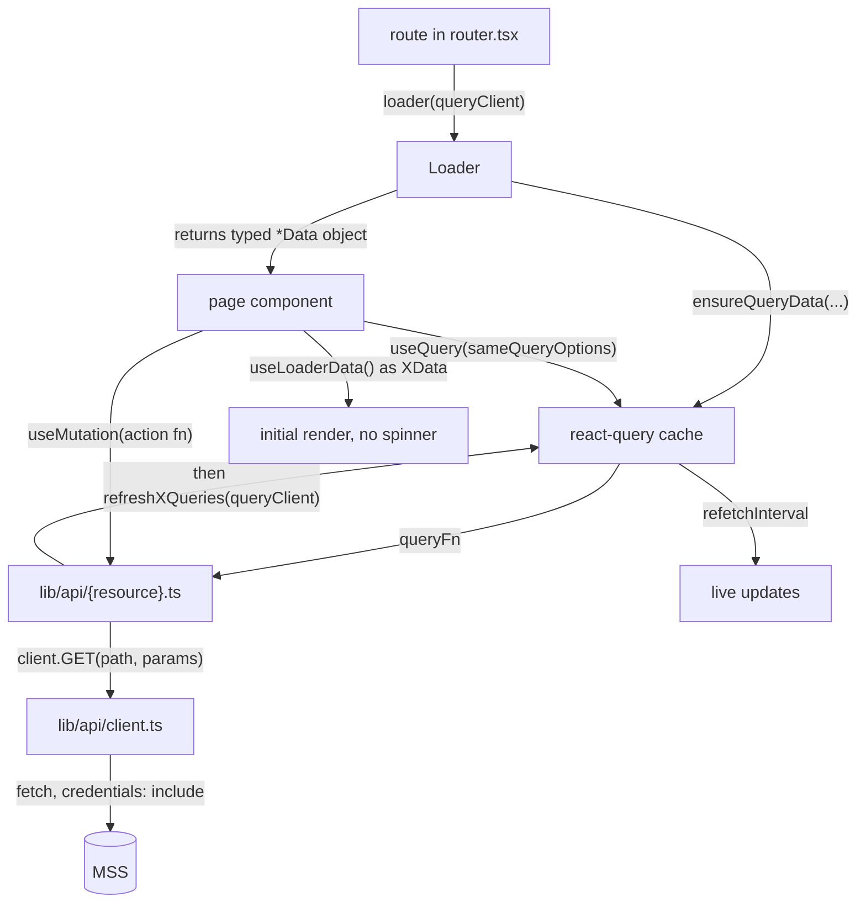

# Tergite Dashboard — System Design

The web client of the Tergite stack: a React single-page app that shows the state of the
quantum computers and lets users manage projects, API tokens, bookings and (for admins)
backends, QPU-time requests and notices.

Read [../DESIGN.md](../DESIGN.md) first for MSS, deployment and the conventions both halves
share.

The dashboard has **no backend of its own**. In production it is a static bundle MSS serves
at `/ui`; every piece of data comes from MSS over HTTP with a cookie, in development and in
the e2e as in production.

## 1. Architecture: co-located hierarchy

The organising principle is **proximity of use**. A component lives as close as possible to
the single place that uses it, and only moves outward when a second consumer appears.

```
src/
├── main.tsx                 # ReactDOM root
├── app.tsx                  # builds the router once; QueryClientProvider + RouterProvider
├── router.tsx               # the module-level route array: every route, its element, its loader
├── index.css                # Tailwind layers + CSS custom properties (light/dark)
├── lib/
│   ├── api/
│   │   ├── client.ts        # the typed openapi-fetch client: the only file that talks HTTP
│   │   ├── schema.d.ts      # generated from MSS's OpenAPI schema by `npm run generate:api`
│   │   ├── types.ts         # the dashboard's names for the schema's types
│   │   └── devices.ts, …    # one module per resource: its queryOptions and mutations
│   ├── app-state.ts         # useAppStore, the zustand store of app state
│   ├── app-tokens.ts        # a token's expiry and project name, apart from the HTTP client
│   ├── query-client.ts      # the one QueryClient, polling by default
│   ├── loaders.ts           # loadOrRedirectIfAuthErr and tryQueryFetchMany, for route loaders
│   ├── time.ts              # parsing and formatting times and durations beyond one luxon call
│   ├── user-requests.ts     # a request's title and details, as every request view shows them
│   └── utils.ts             # cn, and nothing else
├── hooks/
│   └── use-toast.ts
├── components/
│   ├── ui/                  # generic, page-agnostic primitives (shadcn/ui + our own)
│   │   ├── data-table/      # the shared table: index, filter-form, sort-header, table-row
│   │   └── __tests__/
│   └── layouts/
│       └── dashboard/
│           ├── index.tsx    # the layout shell + its loader
│           └── components/  # footer, sidebar, top-banner, topbar/
└── pages/
    ├── devices.tsx          # a single-file page
    ├── login.tsx
    ├── error-alert.tsx
    ├── home/
    │   ├── index.tsx        # the page + its loader
    │   └── components/
    │       ├── devices-table/{index,columns}.tsx
    │       ├── jobs-table/{index,columns,filter-form,detail-drawer}.tsx
    │       └── bookings-table/{index,columns,filter-form}.tsx
    ├── device-detail/
    │   ├── index.tsx
    │   └── components/
    │       ├── device-summary.tsx            # leaf → a file
    │       ├── calibration-data-table.tsx
    │       ├── calibration-points.ts         # shared by the map and the bar chart
    │       ├── bookings-calendar/            # has children → a folder
    │       │   ├── index.tsx
    │       │   ├── event-content.tsx
    │       │   └── booking-form.tsx
    │       └── calibration-bar-chart/
    │           ├── index.tsx
    │           └── calibration-bar.tsx
    ├── projects/, tokens/, requests/, admin-control/, admin-projects/, admin-requests/
```

### The rule

1. A page is `src/pages/{page-name}/index.tsx`. If it has no children of its own it may be a
   single file, `src/pages/{page-name}.tsx` (`devices.tsx`, `login.tsx`).
2. Components used **only** by that page live in `src/pages/{page-name}/components/`.
3. The same rule recurses. A component that itself has children becomes a folder with
   `index.tsx` plus its children beside it; a leaf component stays a single file.
   `device-detail/components/bookings-calendar/booking-form.tsx` is only reachable from the
   bookings calendar, which is only reachable from the device-detail page, and the directory
   path says exactly that.
4. A component is promoted to `src/components/ui/` **when and only when** a second, unrelated
   consumer appears. `ui/` is for things with no knowledge of any particular page —
   `Button`, `DataTable`, `Card`, `DonutChart`, `EventCalendar`.
5. `src/components/layouts/` is for shells that wrap routes rather than being routed to. It
   follows the same recursion: `layouts/dashboard/components/topbar/` is a folder because the
   topbar has its own `breadcrumb.tsx` and `mobile-menu.tsx`.

Note that `detail-item.tsx` exists both in `components/ui/` and in
`pages/device-detail/components/` — the page-specific one is a different component that
happens to share a name. That is the layout working as intended: no need to generalise a
component to reuse a name.

### Why

You can delete a feature by deleting one directory. You can see a component's blast radius
from its path. Nothing accumulates in a global `components/` bucket that nobody dares touch
because its consumers are unknown. The cost is a deeper tree and some near-duplication
between sibling pages, which is accepted deliberately — duplication is cheaper here than a
premature abstraction shared by two pages that then diverge.

### Table sub-convention

Any page listing records uses the shared `DataTable` and splits the work the same way:

| File | Contains |
| --- | --- |
| `index.tsx` | the thin wrapper that passes `columns`, `data`, `filterFormProps`, `getDrawerContent` to `DataTable` |
| `columns.tsx` | the `ColumnDef[]` — cell rendering, `SortHeader`, `meta.headerClassName` |
| `filter-form.tsx` | the `DataTableFormConfig` describing the filter popover fields |
| `detail-drawer.tsx` | the drawer body rendered when a row is clicked (where the page has one) |

The pattern is visible in `home/components/jobs-table/`, `tokens/components/tokens-table/`,
`projects/components/project-table/`, `admin-projects/components/projects-table/` and
`admin-requests/components/requests-table/`. Follow it for a new table rather than inventing
a variant.

Pages with a master/detail split additionally have a `*-sidebar/` folder holding the detail
panel and its dialogs (`tokens/components/tokens-sidebar/{index,delete-dialog,lifespan-dialog}.tsx`).
The page renders that panel for the selected row, or a `SidebarPlaceholder` when no row is
selected.

## 2. Data flow



Three layers, each with one job:

**`lib/api/client.ts`** is the only module that talks HTTP: an
[openapi-fetch](https://openapi-ts.dev/openapi-fetch/) client typed by the generated
`schema.d.ts` (§4), holding the base URL and `credentials: "include"`. Its one middleware
throws an `ErrorInfo` (an `Error` carrying `status`, message taken from the `detail` field)
for every non-2xx response, so a call that returns has its `data`, hence the `data!`.

**`lib/api/{resource}.ts`** — `devices`, `jobs`, `bookings`, `projects`, `tokens`,
`requests`, `notices`, `admin-control`, `auth` — export, for each read, a react-query
`queryOptions`: a constant where it takes no argument (`devicesQuery`, `myProjectsQuery`),
else a `get…Query(...)` function (`getMyJobsQuery`, `getNoticesQuery`). For each write they
export an async action function (`createAppToken`, `approveMyRequest`, `switchBackendOff`,
`dismissNotice`, …), plus one-line `refresh*Queries` helpers that invalidate the right keys
after a mutation. Each calls the client with a path and parameters that `tsc` checks against
MSS's schema; where a read takes the whole of an endpoint's query, its argument is typed as
that query (`getNoticesQuery`).

Query keys are `[resource, ...discriminators]`. Every query polls at the `QueryClient`'s
default `refetchInterval`, set in `lib/query-client.ts` from `VITE_REFETCH_INTERVAL_MS` (default 2 min),
which is why the e2e config drops it to 1 s; a query that must not poll says
`refetchInterval: false`.

**Route loaders.** Every route in `router.tsx` has `loader: xLoader(queryClient)`; a loader
that needs app state reads `useAppStore.getState()`.
The loader is exported from the page module next to the component (with an
`// eslint-disable-next-line react-refresh/only-export-components`), pre-fetches through
`queryClient.ensureQueryData(...)` — independent fetches together in one `Promise.all` — and
returns a single typed `XData` object of data, never of query options. The page reads
it with `useLoaderData() as XData` and uses those values as the `default` for its `useQuery`
calls — so the first paint has real data and no loading state, and react-query takes over
afterwards for polling and invalidation.

Every loader is wrapped in `loadOrRedirectIfAuthErr` (`lib/loaders.ts`), which catches a 401/403
from any of the pre-fetches and redirects to `/login`. That is the whole auth guard — there is
no separate `<RequireAuth>` component. Non-fatal per-item fetches use `tryQueryFetchMany`,
which swallows the failure of one item rather than failing the page (used for per-backend
bookings, where one offline backend must not blank the home page).

**Mutations** are `useMutation({ mutationFn: <action from lib/api>, onSuccess: refresh… })`,
invalidating in their own `onSuccess`; a callback a parent passes down only resets the
parent's state, such as its row selection, and is called before the invalidation.

**Every request goes through a react-query construct** — `useQuery` / `ensureQueryData` for
reads, `useMutation` for writes. Never `await` an API action straight from an event
handler, and never fetch from a `useEffect`. The hooks are not ceremony: `isPending` is what
disables a submit button, `error` is what a form reports, `onSuccess` is the one place the
`refresh*Queries` invalidation belongs, and the shared cache is how a write on one page
updates a table on another. A hand-rolled `try`/`catch` gets none of that and leaves the
rest of the app looking at stale data. Feedback after a write is a `toast` from
`hooks/use-toast`.

**Navigation goes through react-router** — `<Link>` / `<NavLink>` to move, `useNavigate` for
a redirect from code, `redirect()` from a loader, and the route itself for state that belongs
in the URL. Never `window.location`, `history.pushState`, or a bare `<a href>` to an internal
route: they reload the bundle and throw away the query cache and app state. `login.tsx` uses
`window.location.origin` to build the OAuth `next` parameter — that is a URL being *sent to
the provider*, not navigation, and it is the only such use.

### Global state

Deliberately tiny. The zustand store `useAppStore` (`lib/app-state.ts`) holds only what is
neither server data nor URL state:

- `currentProjectId` / `setCurrentProjectId` — the project selected in the topbar,
  which scopes jobs and tokens across pages
- `apiToken` / `setApiToken` — a freshly minted token, held long enough to show it once
- `isDark` / `toggleIsDark` — the theme, the one field its `persist` middleware keeps in
  localStorage; the API token must never reach storage
- `clear()` — used on logout

Components read it with the hook (`useAppStore((state) => state.isDark)`), loaders with
`useAppStore.getState()`. The router is built once, in `app.tsx`, and
`revalidateOnProjectChange` reruns the loaders when the selected project changes. Everything
else is either in the react-query cache (server state) or in the route (which device, which
page). Do not add server data to the store.

### Routes

`public/` holds the assets copied verbatim into the bundle, including two **static** pages
outside React entirely — `privacy.html` and `terms.html`, linked from the footer and covered
by their own Playwright specs. `index.html` is the vite entry that mounts `#root`.

`/` is the `Dashboard` layout with `dashboardLoader` (fetches the current user, derives
`isAdmin`); its children are `/` (home), `/devices`, `/devices/:deviceName`, `/tokens`,
`/projects`, `/requests`, `/admin-projects`, `/admin-requests`, `/admin-control`. `/login` sits outside the
layout. An `ErrorBoundary` around the layout's `<Outlet/>`, reset on navigation, and one around
the login page catch render errors; the layout and the child group each have an
`errorElement` of `<ErrorAlert>` for loader errors. Either way a failure inside a page
replaces the page rather than the whole app.

## 3. UI conventions

- **Tailwind + shadcn/ui**, `style: new-york`, base colour gray, CSS variables. Colours are
  never literal — use the semantic tokens (`bg-background`, `text-muted-foreground`,
  `border-input`, `bg-destructive`) defined in `tailwind.config.js` against the custom
  properties in `src/index.css`. Dark mode is the `dark` class on the layout root, driven by
  the store's `isDark`.
- **Add a shadcn primitive** with the shadcn CLI (config in `components.json`) so it lands in
  `src/components/ui/` with the project's style, then edit it in place — these are vendored
  source files, not a dependency.
- **`cn()`** from `lib/utils.ts` (clsx + tailwind-merge) for every conditional class list.
- **Forms** are `react-hook-form` + `zod` via `@hookform/resolvers`, rendered through the
  `Form`/`FormField`/`FormItem`/`FormMessage` primitives. Define the schema as a
  module-level `const formSchema = z.object({...})` and type the form with
  `z.infer<typeof formSchema>`.
- **Charts** are `@visx/*` (`donut-chart.tsx`, `calibration-bar-chart/`,
  `calibration-map-chart.tsx`); calendars are `@fullcalendar/*` wrapped by
  `ui/event-calendar.tsx`. Dates and durations are `luxon` (`DateTime`) — prefer it over
  `Date` arithmetic; `date-fns` is present only for `react-day-picker`.
- **Icons** are `lucide-react`.
- **e2e hooks**: give anything a test needs to find a stable `id` (`id="jobs-table"`) or a
  `data-cy-*` attribute (`data-cy-login-link`). Test selectors must not depend on
  Tailwind classes or DOM position.

## 4. Types

The API contract is generated: `npm run generate:api` runs MSS's `dev/openapi/export.py`,
which writes `dev/openapi/openapi.json`, and `openapi-typescript` turns that
into `src/lib/api/schema.d.ts`. Never edit the generated file; rerun the command. CI runs
`npm run check:api`, which fails when `schema.d.ts` is stale. The client's paths, parameters,
bodies and responses come from it, so a change to an MSS route or DTO fails `tsc` here.

Every response and request type comes from it. `src/lib/api/types.ts` gives the schema's
types the dashboard's names (`Device`, `Job`, `Project` for `ProjectRead`, `UserRequest` for
`Request`, `NoticeType` for `NoticeTypeId`, …), so a schema renamed in MSS is renamed there
alone. It refines a type only where MSS's responses are tighter than its schema says, each
with a comment: a stored record always has its `id` and `created_at`, a request's metadata
depends on its type, and notice preferences are keyed by every notice type. The schema's
enums are string or number unions, so the code writes their values (`"admin"`, `"pending"`)
and `tsc` checks them.

The shapes only the client has live beside their users: `ErrorInfo` in `lib/api/client.ts`,
`ExtendedAppToken` in `lib/api/tokens.ts`, `Time` and `InputDuration` in `lib/time.ts`,
`QubitProp` and `CalibrationDataPoint` in `pages/device-detail/components/calibration-points.ts`.

Component-local prop types stay in the component file, conventionally as
`interface Props { … }` **below** the component that uses them, matching the existing files.
Loader payload types follow the same placement as `interface XData`.

`tsconfig.json` is `strict` with `noUnusedLocals` and `noUnusedParameters`, so an
intentionally unused binding must be `_`-prefixed (the eslint rule matches). `@/*` resolves
to `src/*` in both tsconfig and vite.

## 5. Data for development and tests

`fixtures/*.json` are the data MSS is seeded with. MSS's `python -m dev.seed`
([dev/seed.py](../dev/seed.py)) clears the fixtures' tables in the database of the MSS config
and fills them from the fixtures through the storage layer, so it seeds MongoDB and SQLite
alike, validating each fixture against MSS's schemas; it refuses a production config.

- `npm run dev` seeds the database of MSS's config, serves MSS on 8002 and runs vite against
  it; give MSS a development config, as seeding clears those tables.
- [dev/e2e_native_test.sh](../dev/e2e_native_test.sh) seeds before MSS starts, and its
  reset service, `dev/e2e_reset_server.py`, reseeds on every `GET /refreshed-db`.
- `dev/perf/record.sh` seeds the database its runs measure.

`CURRENT_DATE` in `.env.test`, which the backends of the e2e stack take as theirs, pins "now"
so that date-sensitive fixtures and visual snapshots are stable.

**When an MSS response shape changes**, rerun `npm run generate:api`, and update the fixture
in `fixtures/` if its shape changed: a fixture that no longer fits fails the seeding.
`playwright/types.ts` gives the specs the dashboard's API types and the enums they build data
of at runtime.

## 6. Testing

| Suite | Runner | Scope |
| --- | --- | --- |
| Component | vitest + happy-dom + Testing Library | files matching `src/**/__tests__/*` only |
| e2e | Playwright against MSS serving the test build, with the backends, seeded from `fixtures/` | `playwright/*.spec.ts`, one spec per page |
| Visual | Playwright's `toHaveScreenshot` inside the e2e run | baselines in `playwright/*-snapshots/`, one set per platform |

```bash
npm run test    # component tests
npm run e2e     # with BACKEND_PATH set: dev/e2e_native_test.sh starts the stack and runs playwright
npm run visual-e2e   # same, in playwright's UI mode
```

[dev/e2e_native_test.sh](../dev/e2e_native_test.sh) starts MongoDB, seeded from `fixtures/`
by `dev/seed.py`, the backends, and MSS serving this dashboard's test build at `/ui`; it sets
`DASHBOARD_URL`, which `playwright.config.ts` requires, and passes its arguments to
`playwright test`. The specs run on one worker, as they share the stack's data.

Each feature's happy path, and the spec that walks it:

| Feature | Spec |
| --- | --- |
| Login | `login.spec.ts` |
| Layout: sidebar, top bar, project switch, app token | `dashboard.spec.ts` |
| Home: devices, jobs, bookings | `home.spec.ts` |
| Devices | `devices.spec.ts` |
| Device detail, bookings and calibrations | `device-detail.spec.ts` |
| Projects, QPU-time and access requests | `projects.spec.ts` |
| Tokens | `tokens.spec.ts` |
| My requests | `my-requests.spec.ts` |
| Approvals | `approvals.spec.ts` |
| Notices | `notices.spec.ts` |
| Settings | `settings.spec.ts` |
| Admin projects | `admin-projects.spec.ts` |
| Admin requests | `admin-requests.spec.ts` |
| Admin control | `admin-control.spec.ts` |
| Error page | `error-alert.spec.ts` |
| Run | `run.spec.ts` |

The e2e stack serves the backends' API alone but for `sim_1q`, which also gets a heavy and a
light worker, on the backend's own simulated transmon behind dummy clusters, as the SDK's e2e
runs it: `run.spec.ts` runs a circuit there to its counts. `sim_1q` is in `fixtures/` as its
worker publishes it, since every reset re-seeds MSS's devices and a worker publishes only at start.

The specs reuse the dashboard's own pure helpers (`extendAppToken`, `getUserRequestDetails`)
rather than copies; a module they import must not build the HTTP client, whose base URL only
vite defines.

Component tests are the thin layer: `vite.config.ts` restricts them to `__tests__`
directories, and only pure-ish primitives are covered there (`ui/__tests__/donut-chart.test.tsx`).
The real coverage is the Playwright suite, which drives the app through MSS. Each spec names
the fixture users whose roles or data change its pages, and runs its tests for each
(`for (const user of users)`). The `resetData` fixture resets the stack's data before a test
only if an earlier test wrote, so read-only tests share a reset. The browser runs in
`Europe/Stockholm`, the config's `timezoneId` — a change of zone will move snapshots.

Playwright names visual baselines after the platform, so CI needs the linux ones. Generate
them with the stack in Playwright's linux image through `Dockerfile.playwright`; see the "How to Generate
Snapshots for CI" section of [CONTRIBUTING.md](../CONTRIBUTING.md#how-to-generate-snapshots-for-ci).

## 7. Build and serve

`npm run build` = `tsc` (type-check only, `noEmit`) then `vite build` → `dist/`. Because
`VITE_*` variables are inlined at build time, **a different API URL means a different
build**. Every mode's base is `/ui/`, where MSS serves the build, and the router takes it as its
basename; the production build's empty `VITE_API_BASE_URL` calls MSS's own origin.

`npm run lint` is eslint with `--max-warnings 0`, extending
`@typescript-eslint/recommended`, `react-hooks/recommended` and `react-refresh`. It is a CI
gate, so keep the `react-refresh/only-export-components` disables minimal and only where a
loader, or a constant other files share (`SEVERITY_LABELS` in `ui/notice-banner.tsx`), must be
exported alongside a component.

## 8. Adding things — where to start

| Task | Path |
| --- | --- |
| New page | `src/pages/{name}/index.tsx` exporting the component **and** its `loader`; add the `<Route>` in `src/router.tsx`; add a link to `NAV_GROUPS` in `layouts/dashboard/components/nav-items.ts`, which the sidebar and the mobile menu both render — unless it is only reached in context, as `/approvals` and `/settings` are |
| New component used by one page | `src/pages/{page}/components/` — a file if it is a leaf, a folder with `index.tsx` if it has children |
| New component used by two+ pages | promote to `src/components/ui/` and strip any page knowledge |
| New table | a `*-table/` folder with `index.tsx`, `columns.tsx`, `filter-form.tsx` (+ `detail-drawer.tsx`) |
| New API call | a `queryOptions` (reads) or an action function (writes) in its resource's `src/lib/api/{resource}.ts`, calling `client` from `src/lib/api/client.ts` — nowhere else talks HTTP — then consume it from a `useQuery` or a `useMutation`, never from a bare handler; if MSS gained the route, `npm run generate:api` first |
| New destination | a `<Route>` in `src/router.tsx` with its loader; reach it with `<Link>` or `useNavigate`, never `window.location` |
| New response shape | `npm run generate:api`, a name for it in `src/lib/api/types.ts` if the dashboard uses it, and the `fixtures/` JSON MSS is seeded with |
| New shadcn primitive | the shadcn CLI, then edit the generated file in `src/components/ui/` |
| New env variable | `VITE_`-prefix it if the browser needs it, and add it to `.env.development` / `.env.test`, and to `.env.production` if the build MSS serves needs a value |
